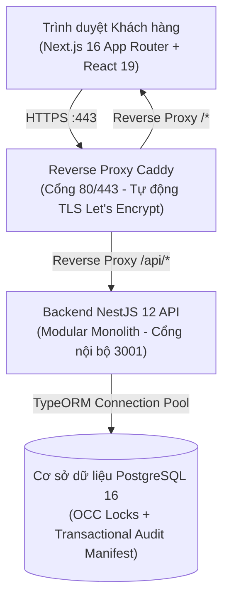

# BrewLite — Hệ Thống Đặt Đồ Uống Trực Tuyến (Online Drink Ordering System)
**Nghiệm thu 23/11/2026.** [Hướng dẫn chạy LOCAL và Postman](docs/testing/postman-local-guide.md) · [Kết quả và cấu hình production đã kiểm tra](docs/audits/ASM2-FINAL-ACCEPTANCE-REPORT.md). LOCAL dùng project brewlite-local và cổng loopback 3000/3001/5432. Lightsail triển khai qua [runbook](docs/deployment/production-release-runbook.md).


[](https://github.com/vohuunghiaah/brewlite/actions/workflows/quality.yml)
[](https://github.com/vohuunghiaah/brewlite/actions/workflows/deploy.yml)
[](https://nodejs.org/)
[](https://nextjs.org/)
[](https://nestjs.com/)
[](https://www.postgresql.org/)
[](https://www.docker.com/)
[](docs/security/final-secrets-audit.md)

---

## Mục Lục (Table of Contents)

- [A. Giới Thiệu Dự Án & Phạm Vi Bàn Giao (Project Overview)](#a-giới-thiệu-dự-án--phạm-vi-bàn-giao-project-overview)
- [B. Kiến Trúc Hệ Thống & Ngăn Xếp Công Nghệ (Architecture & Tech Stack)](#b-kiến-trúc-hệ-thống--ngăn-xếp-công-nghệ-architecture--tech-stack)
- [C. Yêu Cầu Tiên Quyết (Prerequisites)](#c-yêu-cầu-tiên-quyết-prerequisites)
- [D. Hướng Dẫn Sao Chép & Khởi Chạy Local Với Docker (Clone & Local Setup)](#d-hướng-dẫn-sao-chép--khởi-chạy-local-với-docker-clone--local-setup)
- [E. Khởi Chạy Trực Tiếp Không Dùng Docker (Run Without Docker)](#e-khởi-chạy-trực-tiếp-không-dùng-docker-run-without-docker)
- [F. Hướng Dẫn Kiểm Thử Tự Động (Automated Testing)](#f-hướng-dẫn-kiểm-thử-tự-động-automated-testing)
- [G. Hướng Dẫn Đóng Gói & Build Ứng Dụng (Build Instructions)](#g-hướng-dẫn-đóng-gói--build-ứng-dụng-build-instructions)
- [H. Triển Khai Production Lên AWS Lightsail (Deployment to AWS Lightsail)](#h-triển-khai-production-lên-aws-lightsail-deployment-to-aws-lightsail)
- [I. Quản Lý Migration & Đồng Bộ Danh Mục (Database Migration & Catalog Sync)](#i-quản-lý-migration--đồng-bộ-danh-mục-database-migration--catalog-sync)
- [J. Chiến Lược Sao Lưu & Khôi Phục Hai Lớp (Backup & Two-Phase Rollback)](#j-chiến-lược-sao-lưu--khôi-phục-hai-lớp-backup--two-phase-rollback)
- [K. Địa Chỉ Production & Bằng Chứng Vận Hành (Production URLs & Verification)](#k-địa-chỉ-production--bằng-chứng-vận-hành-production-urls--verification)
- [L. Xử Lý Sự Cố Thường Gặp (Troubleshooting)](#l-xử-lý-sự-cố-thường-gặp-troubleshooting)
- [M. Danh Mục Bàn Giao & Tài Liệu Dự Án (Project Handover Documentation)](#m-danh-mục-bàn-giao--tài-liệu-dự-án-project-handover-documentation)

---

## A. Giới Thiệu Dự Án & Phạm Vi Bàn Giao (Project Overview)

**BrewLite** là hệ thống phần mềm hỗ trợ đặt đồ uống trực tuyến không dùng tiền mặt và quản lý quy trình pha chế cho chuỗi cửa hàng cà phê, được xây dựng và bàn giao trong khuôn khổ môn học **Công nghệ Phần mềm (Software Engineering) — Assignment 2 (Học kỳ 1, Năm học 2026-2027)**.

### 1. Phân định giữa Assignment 1 và Assignment 2:
- **Assignment 1 (Kỹ nghệ Yêu cầu - Requirements Engineering):** Khảo sát nghiệp vụ, phân tích stakeholder, xác định phạm vi hệ thống, xây dựng SRS v1.4.0, danh mục Use Case (`UC-01` -> `UC-13`), và Ma trận truy vết yêu cầu (RTM).
- **Assignment 2 (Thiết kế, Triển khai & Bàn giao Sản phẩm):**
  - **Task 1:** Chuẩn hóa yêu cầu phần mềm và đặc tả Use Case chi tiết.
  - **Task 2:** Phân tích và thiết kế hệ thống UML (Sơ đồ Hoạt động Activity Diagram Task 2.1, Sơ đồ Tuần tự Sequence Diagram Task 2.2, Sơ đồ Lớp miền Class Diagram Task 2.3).
  - **Task 3:** Thiết kế kiến trúc Modular Monolith, hệ thống 7 quyết định kiến trúc (ADR-001 -> ADR-007) và Sơ đồ Triển khai Deployment Diagram (Task 3.2).
  - **Task 4:** Triển khai nền tảng mã nguồn Sprint 1 (Next.js, NestJS, TypeORM, PostgreSQL), quản lý tài liệu `docs/`, và thiết lập CI Quality Gates.
  - **Task 5:** Triển khai trọn vẹn Sprint 2 MVP, kiểm soát đồng thời lạc quan (OCC), kiểm thử tích hợp & E2E, nâng cấp giao diện UI V2 (Homepage cao cấp, danh mục 15 đồ uống, huy hiệu tồn kho thời gian thực), tự động hóa CD, quét bảo mật Gitleaks, triển khai thành công lên AWS Lightsail và hoàn tất bàn giao.

### 2. Các tính năng nổi bật:
- **Trang chủ thương hiệu cao cấp (Rich UI V2 Homepage):** Hero banner, bộ lọc danh mục đồ uống, câu chuyện hạt cà phê nguyên bản, đánh giá khách hàng và thiết kế responsive thích ứng trên cả Desktop lẫn Mobile.
- **Thực đơn mở rộng 15 sản phẩm (Expanded Catalog):** Cung cấp 15 loại đồ uống chuẩn hóa theo `TARGET_CATALOG` (Cà phê Latte, Trà đào, Cacao sữa, Nước suối, Cà phê đen đá, Cà phê sữa đá, Bạc xỉu, Espresso, Americano đá, Cappuccino, Caramel Macchiato, Cold Brew cam, Matcha Latte, Trà vải, Trà chanh mật ong).
- **Huy hiệu tồn kho động (Stock Badges):** Hiển thị trực quan trạng thái `"Còn X ly"`, `"Sắp hết · Còn X ly"`, hoặc `"Tạm hết hàng"`.
- **Tùy biến món uống (Customizer Modal):** Tùy chọn kích cỡ (Size M / Size L), tỷ lệ đường ($0\% - 100\%$), tỷ lệ đá ($0\% - 100\%$) và topping đi kèm.
- **Giỏ hàng trượt thông minh (Sticky Cart Drawer):** Tính toán tức thì, đối soát an toàn với giá từ cơ sở dữ liệu backend.
- **Xác thực linh hoạt & Khách vãng lai:** Hỗ trợ đăng nhập JWT bảo mật hoặc đặt hàng nhanh không cần tài khoản.
- **Mô phỏng thanh toán VietQR (Mock Payment Gateway):** Sinh mã QR chuẩn xác, xử lý thanh toán mô phỏng an toàn với kiểm tra tính lũy tiến (Idempotency).
- **Vé nhận món điện tử (Buzzer Pickup Ticket):** Cung cấp mã nhận món, mô phỏng chuông rung khi đơn hàng hoàn tất pha chế.
- **Tra cứu lịch sử đơn hàng (Order History):** Quản lý trạng thái đơn hàng (`PENDING` -> `PAID` -> `PREPARING` -> `READY` -> `COMPLETED`) với tính toàn vẹn dữ liệu tuyệt đối.

---

## B. Kiến Trúc Hệ Thống & Ngăn Xếp Công Nghệ (Architecture & Tech Stack)

### 1. Sơ đồ Kiến trúc Tổng thể (Architecture Diagram)



> [!IMPORTANT]
> **Phân định rõ Định Tuyến API Cục Bộ và Production:**
> - **Khi gọi API trực tiếp trên môi trường Local (không qua Caddy):** Backend NestJS **không đặt global prefix `/api`**. Do đó, các endpoint cục bộ nằm trực tiếp tại gốc:
>   - Health Check: `http://localhost:3001/health`
>   - Danh mục sản phẩm: `http://localhost:3001/products`
> - **Khi gọi API trên môi trường Production (qua Caddy Reverse Proxy):** Caddy lắng nghe tại `/api/*`, tự động bóc tách (strip) tiền tố `/api` bằng directive `handle_path /api/*` rồi chuyển tiếp vào cổng `3001` của NestJS:
>   - Health Check: `https://brewlite.click/api/health`
>   - Danh mục sản phẩm: `https://brewlite.click/api/products`

### 2. Bảng Ngăn Xếp Công Nghệ (Technology Stack)

| Tầng kiến trúc | Công nghệ sử dụng | Phiên bản | Vai trò & Mục đích |
|---|---|:---:|---|
| **Frontend Client** | [Next.js](https://nextjs.org/) (App Router) | `16.4.5` | Giao diện SSR & Client Components, quản lý giỏ hàng, menu và checkout. |
| **Giao diện & UI** | [React](https://react.dev/), CSS Modules | `19.3.0` | Thư viện UI reactive, tối ưu hóa hiển thị, chống layout shift. |
| **Backend API** | [NestJS](https://nestjs.com/) (Express Platform) | `12.0.1` | Kiến trúc Modular Monolith, quản lý nghiệp vụ đơn hàng, thanh toán, catalog. |
| **Cơ sở dữ liệu & ORM** | [PostgreSQL](https://www.postgresql.org/) & [TypeORM](https://typeorm.io/) | `16` / `1.1.2` | Lưu trữ bền vững, 4 migrations bất biến, kiểm soát đồng thời lạc quan (OCC). |
| **Reverse Proxy & TLS** | [Caddy Server](https://caddyserver.com/) | `2-alpine` | Proxy ngược, tự động cấp phát và gia hạn SSL/TLS đa tên miền (`brewlite.click`). |
| **Containerization** | [Docker](https://www.docker.com/) & Docker Compose | `29.x` / Compose v2 | Đóng gói multi-stage độc lập, bảo mật người dùng non-root (`nextjs:nodejs`). |
| **Hạ tầng Cloud** | [AWS Lightsail](https://aws.amazon.com/lightsail/) | Ubuntu 24.04 | Máy chủ ảo duy nhất (2GB RAM, 1 vCPU, 60GB SSD), giới hạn RAM container 1.62GB. |
| **Bảo mật & DevSecOps** | [Gitleaks](https://gitleaks.io/) & GitHub Actions | `8.x` | Quét mã bí mật tự động trong CI, ngăn chặn rò rỉ secret trong mã nguồn và log. |

---

## C. Yêu Cầu Tiên Quyết (Prerequisites)

Trước khi cài đặt và khởi chạy dự án, hãy đảm bảo máy tính của bạn đã cài đặt các công cụ sau:

1. **Node.js:** Phiên bản `24.x` (khuyến nghị chính thức) hoặc `20.x` LTS trở lên.
2. **Package Manager:** `npm` v10+ (đi kèm sẵn với Node.js).
3. **Docker & Docker Compose:**
   - **Windows / macOS:** Docker Desktop (bản cập nhật mới nhất, đã bật Docker Compose v2).
   - **Linux:** Docker Engine 24+ và Docker Compose Plugin.
4. **Git:** Phiên bản 2.30+.

> [!NOTE]
> **Phân biệt cú pháp dòng lệnh giữa Windows PowerShell và macOS/Linux Bash:**
> - Trên **Windows PowerShell**: Sử dụng `Copy-Item` để sao chép tệp, dấu chấm phẩy `;` để phân tách lệnh, và `npm.cmd` nếu gặp lỗi chính sách thực thi script.
> - Trên **macOS / Linux Bash**: Sử dụng `cp` để sao chép tệp và dấu `&&` để nối chuỗi lệnh.

---

## D. Hướng Dẫn Sao Chép & Khởi Chạy Local Với Docker (Clone & Local Setup)

Đây là phương pháp **khuyến nghị nhanh nhất** để khởi chạy trọn vẹn toàn bộ hệ thống gồm Cơ sở dữ liệu, Backend API và Frontend Web chỉ với một vài câu lệnh.

### Bước 1: Sao chép repository
```bash
git clone https://github.com/vohuunghiaah/brewlite.git
cd brewlite
```

### Bước 2: Thiết lập biến môi trường & Khởi tạo JWT Secret
Sao chép tệp cấu hình mẫu:
- **Trên Windows PowerShell:**
  ```powershell
  Copy-Item .env.example .env
  ```
- **Trên macOS / Linux Bash:**
  ```bash
  cp .env.example .env
  ```

> [!IMPORTANT]
> **Khởi tạo `JWT_SECRET` cho Môi trường Development:**
> Backend NestJS áp dụng cơ chế fail-closed: API sẽ từ chối khởi động nếu `JWT_SECRET` bị bỏ trống, có độ dài dưới 32 bytes, hoặc giữ nguyên chuỗi mặc định không an toàn.
> Hãy sinh một khóa ngẫu nhiên an toàn (64 ký tự hex) bằng câu lệnh sau:
> ```bash
> node -e "console.log(require('crypto').randomBytes(32).toString('hex'))"
> ```
> Sau đó mở tệp `.env` vừa tạo và điền giá trị vừa sinh vào dòng:
> ```env
> JWT_SECRET=paste_your_generated_32_bytes_random_secret_here
> ```
> *(Lưu ý: Tuyệt đối không sử dụng khóa bí mật của Production và không commit tệp `.env` chứa secret vào Git)*.

### Bước 3: Khởi chạy trọn gói bằng Docker Compose
```bash
docker compose up -d --build
```

Lệnh này sẽ tự động:
1. Kéo image `postgres:16-alpine` và khởi tạo cơ sở dữ liệu `brewlite`.
2. Tự động chạy 4 bản migration TypeORM và nạp dữ liệu mẫu ban đầu (seed data).
3. Đóng gói và khởi chạy container Backend NestJS tại cổng `3001`.
4. Đóng gói và khởi chạy container Frontend Next.js tại cổng `3000`.

### Bước 4: Kiểm tra trạng thái hệ thống
Kiểm tra danh sách các container đang hoạt động:
```bash
docker compose ps
```
Xác nhận cả 3 dịch vụ (`brewlite-db`, `brewlite-api`, `brewlite-web`) đều ở trạng thái `healthy` hoặc `running (Up)`.

Truy cập và trải nghiệm các dịch vụ:
- **Frontend Storefront:** [http://localhost:3000](http://localhost:3000)
- **Thực đơn trực tuyến (Menu):** [http://localhost:3000/menu](http://localhost:3000/menu)
- **Kiểm tra sức khỏe Backend (Health Check):** [http://localhost:3001/health](http://localhost:3001/health) *(Trả về: `{"status":"ok"}`)*
- **Danh mục đồ uống API:** [http://localhost:3001/products](http://localhost:3001/products) *(Trả về danh sách 15 sản phẩm)*

### Bước 5: Dừng hệ thống
Khi muốn dừng hệ thống và bảo toàn dữ liệu trong volume:
```bash
docker compose down
```

> [!WARNING]
> Cờ `-v` (`docker compose down -v`) sẽ **XÓA TOÀN BỘ** dữ liệu trong database volume `postgres_data`. Chỉ dùng cờ `-v` trên môi trường local development khi bạn thực sự muốn reset toàn bộ cơ sở dữ liệu thử nghiệm để khởi tạo lại từ đầu. **TUYỆT ĐỐI KHÔNG BAO GIỜ** sử dụng cờ `-v` trên máy chủ Production.

---

## E. Khởi Chạy Trực Tiếp Không Dùng Docker (Run Without Docker)

Dành cho nhà phát triển muốn chạy mã nguồn trực tiếp trên máy trạm với tính năng Hot-Reload (NestJS watch & Next.js Fast Refresh).

### Bước 1: Khởi động duy nhất cơ sở dữ liệu PostgreSQL
Khởi chạy dịch vụ PostgreSQL từ Docker Compose và ánh xạ cổng `5432` ra localhost:
```bash
docker compose up -d db
```

### Bước 2: Cấu hình biến môi trường cục bộ
Mở tệp `.env` tại thư mục gốc:
1. Cập nhật `DATABASE_HOST=localhost` (thay cho giá trị `db` của mạng nội bộ Compose).
2. Đảm bảo `JWT_SECRET` đã được điền chuỗi ngẫu nhiên $\ge 32$ bytes.

```env
DATABASE_HOST=localhost
DATABASE_PORT=5432
DATABASE_NAME=brewlite
DATABASE_USER=brewlite
DATABASE_PASSWORD=brewlite_dev_password
JWT_SECRET=your_generated_random_secret_at_least_32_bytes_long
```

### Bước 3: Cài đặt và khởi chạy Backend API
Mở cửa sổ dòng lệnh thứ nhất:
```bash
cd apps/api
npm ci
npm run start:dev
```
Backend NestJS sẽ khởi chạy tại [http://localhost:3001](http://localhost:3001), tự động kết nối PostgreSQL và đồng bộ cơ sở dữ liệu.

### Bước 4: Cài đặt và khởi chạy Frontend Web
Mở cửa sổ dòng lệnh thứ hai:
```bash
cd apps/web
npm ci
npm run dev
```
Frontend Next.js sẽ khởi chạy tại [http://localhost:3000](http://localhost:3000) với tính năng Hot-Reload.

---

## F. Hướng Dẫn Kiểm Thử Tự Động (Automated Testing)

Dự án BrewLite tích hợp bộ kiểm thử tự động toàn diện với **259 bài kiểm thử đạt tỷ lệ thành công 100%**:

```text
======================= TỔNG HỢP KIỂM THỬ BREWLITE =======================
1. API Unit & Integration Tests (Jest):                   130 / 130 PASS
2. Web Component & UI Tests (Node Test Runner):            94 /  94 PASS
3. Catalog Sync & Rollback Tests (Integration):            24 /  24 PASS
4. Security, Concurrency & E2E Tests (Jest):               11 /  11 PASS
-------------------------------------------------------------------------
TỔNG CỘNG KIỂM THỬ TOÀN DỰ ÁN:                           259 / 259 PASS (100%)
=========================================================================
```

### 1. Kiểm thử Backend API (`apps/api`):
Chạy toàn bộ 130 unit tests và integration tests:
```bash
npm --prefix apps/api test
```
Kiểm tra chuẩn mã nguồn bằng Oxlint:
```bash
npm --prefix apps/api run lint
```

### 2. Kiểm thử Frontend Web (`apps/web`):
Chạy toàn bộ 94 unit tests và component tests:
```bash
npm --prefix apps/web test
```
Kiểm tra chuẩn mã nguồn bằng ESLint:
```bash
npm --prefix apps/web run lint
```

### 3. Kiểm thử Tích hợp Đồng bộ & Hoàn tác Danh mục (Catalog Sync & Safe Rollback):
Chạy 24 bài kiểm thử tích hợp thực tế với PostgreSQL (kiểm tra giao dịch nguyên tử, bảng kiểm toán `catalog_deployments`, chế độ all-or-nothing của prune mode, và bảo toàn lịch sử đơn hàng của compensate mode):
```bash
node scripts/test-sync-catalog.mjs
```

### 4. Kiểm thử Kịch bản Triển khai & Vận hành (Deployment Tooling):
Xác minh kịch bản khôi phục, sao lưu, và cấu hình Caddy:
- Trên Linux/macOS hoặc Git Bash:
  ```bash
  bash scripts/test-production-rollout.sh
  node scripts/test-deployment-scripts.mjs
  ```
- Trên Windows PowerShell:
  ```powershell
  node scripts/test-deployment-scripts.mjs
  ```

### 5. Kiểm thử Nghiệm thu Toàn diện (Task 5.2 Compose & Chromium Acceptance):
Khởi dựng môi trường container PostgreSQL cô lập, kiểm tra luồng mua hàng thực tế qua trình duyệt Chromium không đầu:
- **Trên Windows PowerShell:**
  ```powershell
  npm.cmd ci --prefix scripts
  node scripts/node_modules/playwright/cli.js install chromium --only-shell
  node scripts/test-compose.mjs --quality
  ```
- **Trên macOS / Linux Bash:**
  ```bash
  npm ci --prefix scripts
  node scripts/node_modules/playwright/cli.js install chromium --only-shell
  node scripts/test-compose.mjs --quality
  ```

---

## G. Hướng Dẫn Đóng Gói & Build Ứng Dụng (Build Instructions)

### 1. Build mã nguồn cục bộ (Local Artifacts Build):
- **Build Backend API:**
  ```bash
  npm --prefix apps/api run build
  ```
  *(Kết quả xuất ra tại `apps/api/dist/`)*.
- **Build Frontend Web:**
  ```bash
  npm --prefix apps/web run build
  ```
  *(Kết quả xuất ra ứng dụng Next.js Standalone tại `apps/web/.next/standalone/`)*.

### 2. Đóng gói Container Images (Docker Build):
Đóng gói Docker images theo chuẩn multi-stage tối ưu dung lượng:
```bash
# Đóng gói API Container (~79.1 MB)
docker build -t brewlite-api:local -f apps/api/Dockerfile .

# Đóng gói Web Container (~74.8 MB)
docker build -t brewlite-web:local -f apps/web/Dockerfile .
```

---

## H. Triển Khai Production Lên AWS Lightsail (Deployment to AWS Lightsail)

Hệ thống triển khai theo kiến trúc Single-VM an toàn tuân thủ [ADR-007](docs/architecture/adr/adr/007-aws-lightsail-deployment.md):

### 1. Quy trình CI/CD GitHub Actions:
- **Workflow Quality Gates (`.github/workflows/quality.yml`):**
  - Kích hoạt tự động trên mỗi Pull Request và commit vào nhánh `main`.
  - Chạy song song: Quét bảo mật Gitleaks Secret Scanner (cả phạm vi PR và full history audit), kiểm tra Linting, Unit/Integration Tests, Catalog Rollback Tests, và Build artifacts.
- **Workflow Continuous Delivery (`.github/workflows/deploy.yml`):**
  1. **Bước 1 — Quality Gate:** Thực thi lại toàn bộ bộ kiểm thử nghiệm thu.
  2. **Bước 2 — Build & Publish:** Đóng gói và đẩy Docker images gắn commit SHA lên GitHub Container Registry (`ghcr.io/vohuunghiaah/brewlite-api` và `brewlite-web`).
  3. **Bước 3 — Cổng phê duyệt thủ công (Manual Approval Gate):** Yêu cầu phê duyệt từ Reviewer chỉ định và bắt buộc nhập chuỗi xác nhận `confirm_production=DEPLOY_PRODUCTION`.
  4. **Bước 4 — Triển khai máy chủ AWS:** Kết nối SSH bảo mật, sao lưu cơ sở dữ liệu tự động, cập nhật cấu hình `.deployment-state.json`, kéo image mới, khởi chạy Compose, chạy Smoke Test tự động và kích hoạt Rollback tức thì nếu phát hiện lỗi.

### 2. Nguyên tắc An toàn Bí mật (Zero Secret Exposure):
- Mọi bí mật máy chủ (`LIGHTSAIL_SSH_KEY`, `POSTGRES_PASSWORD`, `JWT_SECRET`) được lưu trong GitHub Actions Environment Secrets.
- Không có bất kỳ bí mật nào bị in ra console logs (được GitHub Actions tự động mask bằng `***`).
- Tệp `.env` trên máy chủ từ xa được phân quyền nghiêm ngặt `0600` chỉ người dùng sở hữu mới có quyền đọc.

---

## I. Quản Lý Migration & Đồng Bộ Danh Mục (Database Migration & Catalog Sync)

### 1. Quản lý Migration Cơ sở Dữ liệu (TypeORM Migrations):
Cơ sở dữ liệu BrewLite được quản lý bởi **4 bản migration bất biến**:
- `1731888000000-init-schema.ts`: Khởi tạo bảng người dùng và danh mục cơ bản.
- `1731974400000-orders-and-history.ts`: Cấu trúc bảng đơn hàng và lịch sử.
- `1732060800000-payments-and-transactions.ts`: Cấu trúc bảng thanh toán và giao dịch.
- `1732147200000-idempotency-and-locks.ts`: Khóa chống trùng lặp và cột `version` OCC.

### 2. Đồng bộ Danh mục Đồ uống An toàn (`scripts/sync-catalog.mjs`):
Cho phép mở rộng danh mục đồ uống từ 4 lên 15 món mà không làm thay đổi baseline TypeORM:
- **Chạy thử nghiệm (Dry-Run — Không ghi dữ liệu):**
  ```bash
  node scripts/sync-catalog.mjs --dry-run
  ```
- **Áp dụng chính thức (Apply — Giao dịch nguyên tử PostgreSQL):**
  ```bash
  node scripts/sync-catalog.mjs --apply
  ```
- **Thực thi trên Production thông qua Docker Compose:**
  ```bash
  docker compose -f docker-compose.prod.yml run --rm --no-deps api node scripts/sync-catalog.mjs --dry-run
  docker compose -f docker-compose.prod.yml run --rm --no-deps api node scripts/sync-catalog.mjs --apply
  ```
- **Bảng kiểm toán `catalog_deployments`:**
  - Tự động lưu trữ `deployment_id`, danh sách các product ID mới được thêm, timestamp và trạng thái (`APPLIED`).
  - Được thực hiện trong cùng một transaction với thao tác INSERT sản phẩm, bảo đảm tính toàn vẹn 100%.

---

## J. Chiến Lược Sao Lưu & Khôi Phục Hai Lớp (Backup & Two-Phase Rollback)

Hệ thống phân định rạch ròi giữa 3 quy trình khôi phục:

### 1. Sao lưu & Phục hồi Cơ sở Dữ liệu (Database Backup & Disaster Recovery):
- **Tạo bản sao lưu trước khi phát hành:**
  ```bash
  node scripts/backup-db.mjs
  ```
  Tạo bản snapshot SQL tại thư mục `backups/db-backup-<timestamp>.sql` với quyền tệp `0600`.
- **Phục hồi Cơ sở Dữ liệu (Disaster Recovery):**
  ```bash
  node scripts/restore-db.mjs --confirm-restore-database --container <container_name> --db <db_name> --backup-file <path_to_sql>
  ```
  > [!CAUTION]
  > Thao tác phục hồi cơ sở dữ liệu sẽ ghi đè toàn bộ dữ liệu hiện tại bằng bản snapshot sao lưu. Lệnh này yêu cầu cờ bắt buộc `--confirm-restore-database` và chỉ được kích hoạt trong trường hợp thảm họa theo [Sổ Tay Vận Hành SOP-03](docs/deployment/production-release-runbook.md).

### 2. Khôi phục Phiên bản Ứng dụng (Application Container Rollback):
Khi phiên bản container mới gặp sự cố hiệu năng hoặc lỗi runtime:
```bash
node scripts/rollback.mjs
```
- Tự động nạp lại digest container phiên bản tốt gần nhất từ tệp `/home/ubuntu/app/.deployment-state.json`.
- **Tuyệt đối bảo toàn volume dữ liệu `postgres_data`**, không chạy bất kỳ lệnh down migration phá hủy nào.

### 3. Hoàn tác Danh mục Dữ liệu An toàn (`scripts/safe-catalog-rollback.mjs`):
Khi cần hoàn tác các sản phẩm đồ uống đã đưa vào hệ thống theo đúng mã `deployment_id` từ bảng audit `catalog_deployments`:
- **Chế độ Compensate (Bồi hoàn an toàn — Khuyến nghị chính thức cho Production):**
  - Chạy thử nghiệm đối soát:
    ```bash
    node scripts/safe-catalog-rollback.mjs --dry-run --deployment-id=<id>
    ```
  - Áp dụng bồi hoàn:
    ```bash
    node scripts/safe-catalog-rollback.mjs --apply --deployment-id=<id> --mode=compensate
    ```
  - Hoặc bồi hoàn đợt sync gần nhất có xác nhận ID:
    ```bash
    node scripts/safe-catalog-rollback.mjs --apply --manifest-latest --confirm-deployment=<id> --mode=compensate
    ```
  *(Cơ chế: Đặt `isAvailable=false`, giữ nguyên số lượng tồn kho gốc, tăng version OCC, bảo vệ nguyên vẹn 100% các đơn hàng lịch sử tham chiếu)*.

- **Chế độ Prune (Xóa vật lý món chưa tham chiếu — Dành cho Dev/Staging):**
  - Chạy thử nghiệm:
    ```bash
    node scripts/safe-catalog-rollback.mjs --dry-run --deployment-id=<id> --mode=prune
    ```
  - Áp dụng xóa thật (BẮT BUỘC cờ `--confirm`):
    ```bash
    node scripts/safe-catalog-rollback.mjs --apply --deployment-id=<id> --mode=prune --confirm
    ```
  *(Cơ chế: Áp dụng nguyên tắc **All-or-Nothing**, từ chối xóa và rollback ngay lập tức nếu phát hiện bất kỳ món nào đã phát sinh đơn hàng)*.

---

## K. Địa Chỉ Production & Bằng Chứng Vận Hành (Production URLs & Verification)

Hệ thống BrewLite đang vận hành thực tế trên đám mây AWS Lightsail:

| Dịch vụ / Điểm cuối | URL Production Chính Thức | Trạng thái Thực tế |
|---|---|:---:|
| **Cửa hàng Khách hàng (Web)** | [https://brewlite.click](https://brewlite.click) | **200 OK (LIVE)** |
| **Thực đơn Đồ uống (Menu)** | [https://brewlite.click/menu](https://brewlite.click/menu) | **200 OK (LIVE)** |
| **Kiểm tra Sức khỏe Backend** | [https://brewlite.click/api/health](https://brewlite.click/api/health) | **200 OK (`{"status":"ok"}`)** |
| **Danh mục Đồ uống API** | [https://brewlite.click/api/products](https://brewlite.click/api/products) | **200 OK (15 sản phẩm)** |
| **Tên miền Dự phòng (Backup Domain)**| [https://swe-brewlite.54-255-241-1.sslip.io](https://swe-brewlite.54-255-241-1.sslip.io) | **200 OK (TLS Hợp lệ)** |

---

## L. Xử Lý Sự Cố Thường Gặp (Troubleshooting)

### 1. Lỗi khởi động API: `Set JWT_SECRET to a generated secret of at least 32 bytes`:
- **Nguyên nhân:** Tệp `.env` chưa được gán biến `JWT_SECRET` hoặc chuỗi secret dưới 32 bytes.
- **Khắc phục:** Chạy `node -e "console.log(require('crypto').randomBytes(32).toString('hex'))"` và gán chuỗi kết quả vào biến `JWT_SECRET` trong `.env`.

### 2. Lỗi kết nối cơ sở dữ liệu `ENOTFOUND db`:
- **Nguyên nhân:** Khởi chạy Backend NestJS trực tiếp trên máy trạm nhưng vẫn giữ nguyên `DATABASE_HOST=db` của Docker Compose.
- **Khắc phục:** Mở tệp `.env` tại thư mục gốc và đổi thành `DATABASE_HOST=localhost`.

### 3. Lỗi xung đột cổng mạng (Port Already in Use):
- **Hiện tượng:** Docker báo lỗi không thể lắng nghe tại cổng `3000`, `3001`, hoặc `5432`.
- **Khắc phục:**
  - Trên Windows: Chạy `netstat -ano | findstr :3000` để tìm PID và tắt tiến trình xung đột bằng `taskkill /PID <PID> /F`.
  - Trên Linux/macOS: Chạy `lsof -i :3000` và `kill -9 <PID>`.

### 4. Lỗi từ chối quyền thực thi PowerShell:
- **Hiện tượng:** `File ... cannot be loaded because running scripts is disabled on this system`.
- **Khắc phục:** Mở PowerShell với quyền Administrator và chạy `Set-ExecutionPolicy -Scope CurrentUser -ExecutionPolicy RemoteSigned`, hoặc gọi trực tiếp bằng `node <tệp>` / `npm.cmd`.

### 5. Lỗi phân quyền quản trị khi đồng bộ danh mục:
- **Hiện tượng:** `sync-catalog` báo lỗi `403 Forbidden: Catalog admin key required`.
- **Khắc phục:** Cung cấp biến môi trường `CATALOG_ADMIN_KEY` hợp lệ khi chạy lệnh sync trên môi trường production.

---

## M. Danh Mục Bàn Giao & Tài Liệu Dự Án (Project Handover Documentation)

Toàn bộ hệ thống tài liệu dự án được tổ chức và quản lý tập trung theo [Quy trình Quản lý Tài liệu (docs/document-control.md)](docs/document-control.md):

- **Báo cáo Phát hành & Nghiệm thu (Release & Verification):**
  - [Ghi Chú Phát Hành v1.0.0 (Release Notes v1.0.0)](docs/releases/v1.0.0.md)
  - [Báo Cáo Kiểm Toán An Toàn Bí Mật (Final Secrets Audit)](docs/security/final-secrets-audit.md)
  - [Biên Bản Nghiệm Thu Clone Sạch (Clean Clone Acceptance Report)](docs/handover/clean-clone-acceptance.md)
  - [Báo Cáo Hoàn Thành Task 5.3 CI/CD](docs/task-5-3-completion-report.md)
  - [Báo Cáo Hoàn Thành Task 5.2 Kiểm Thử Tích Hợp](docs/task-5-2-completion-report.md)
- **Đặc tả Yêu cầu & Nghiệp vụ (Task 1):**
  - [Đặc tả Yêu cầu Phần mềm (SRS v1.4.0)](docs/requirements/srs.md)
  - [Bối cảnh & Phạm vi Hệ thống](docs/requirements/context-and-scope.md)
  - [Danh mục & Đặc tả Use Cases](docs/requirements/use-cases.md)
  - [Đặc tả Chi tiết Use Case Trọng tâm UC-04 (Đặt đồ uống)](docs/requirements/use-case-place-order.md)
  - [Ma trận Truy vết Yêu cầu Toàn diện (RTM v2.5.0)](docs/traceability-matrix.md)
- **Phân tích & Thiết kế Hệ thống UML (Task 2):**
  - [Sơ đồ Hoạt động Activity Diagram (Tạo đơn & Thanh toán)](docs/diagram/ActivityDiagram.svg)
  - [Sơ đồ Tuần tự Sequence Diagram (Worker Activation & OCC)](docs/diagram/SequenceDiagram.svg)
  - [Sơ đồ Lớp miền Khái niệm Class Diagram (Mermaid)](docs/diagram/ClassDiagram-Conceptual.svg)
- **Kiến trúc Hệ thống & Quyết định Kỹ thuật (Task 3):**
  - [Đặc tả Kiến trúc Hệ thống Modular Monolith](docs/architecture/README.md)
  - [Sơ đồ Triển khai UML Deployment Diagram (Task 3.2)](docs/architecture/DeploymentDiagram.svg)
  - [Kho lưu trữ Quyết định Kiến trúc (ADR-001 -> ADR-007)](docs/architecture/adr/README.md)
- **Sổ tay Vận hành & Triển khai Production (Task 5.4.1):**
  - [Hướng Dẫn Triển Khai Production](docs/deployment/deployment-guide.md)
  - [Danh Sách Kiểm Tra Sẵn Sàng Phát Hành (Release Checklist)](docs/deployment/production-release-checklist.md)
  - [Sổ Tay Khắc Phục Sự Cố & Vận Hành (Release Runbook)](docs/deployment/production-release-runbook.md)
  - [Hướng Dẫn Rollback & Phục Hồi Thảm Họa (Disaster Recovery)](docs/deployment/rollback-guide.md)

---
*Dự án hoàn thành và bàn giao bởi Đội ngũ Kỹ nghệ Phần mềm BrewLite — Học kỳ 1, Năm học 2026-2027.*
