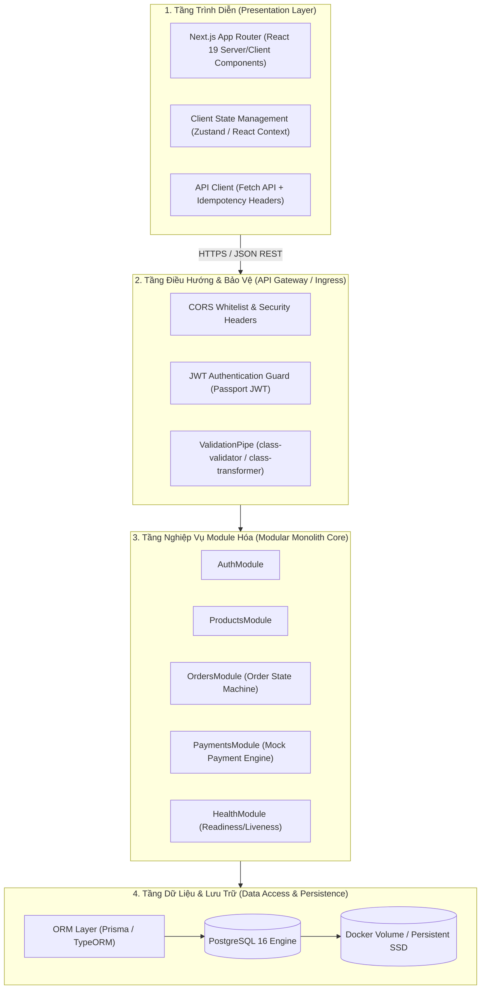

# Tài Liệu Đặc Tả Kiến Trúc Hệ Thống BrewLite (System Architecture Specification)

**Dự án:** Hệ Thống Đặt Đồ Uống Trực Tuyến BrewLite (Assignment 2)
**Phân hệ:** Task 3 — Thiết kế Kiến trúc (Task 3.1: Kiến trúc Hệ thống & Task 3.2: Deployment Diagram)
**Phiên bản:** 2.0.0 (Architecture Baseline Synchronization & Task 2 Handover)
**Ngày cập nhật:** 16/11/2026
**Tác giả:** Đội ngũ Kiến trúc sư Phần mềm BrewLite (Senior Software Architects)

---

## MỤC LỤC
1. [Giới Thiệu & Mục Tiêu Kiến Trúc](#1-giới-thiệu--mục-tiêu-kiến-trúc)
2. [Nguyên Tắc Thiết Kế & Phong Cách Kiến Trúc](#2-nguyên-tắc-thiết-kế--phong-cách-kiến-trúc)
3. [Phân Định Kiến Trúc: Hiện Hành (`main`) vs Mục Tiêu (`Target`)](#3-phân-định-kiến-trúc-hiện-hành-main-vs-mục-tiêu-target)
   - [3.1 Kiến Trúc Hiện Hành Trên Nhánh `main` (Current Architecture)](#31-kiến-trúc-hiện-hành-trên-nhánh-main-current-architecture)
   - [3.2 Kiến Trúc Mục Tiêu Hoàn Chỉnh (Target / Reference Architecture)](#32-kiến-trúc-mục-tiêu-hoàn-chỉnh-target--reference-architecture)
4. [Đặc Tả Chi Tiết 12 Thành Phần Kiến Trúc Cốt Lõi](#4-đặc-tả-chi-tiết-12-thành-phần-kiến-trúc-cốt-lõi)
   - [4.1 Frontend Next.js (Mobile-first & PWA)](#41-frontend-nextjs-mobile-first--pwa)
   - [4.2 Backend NestJS Modular Monolith](#42-backend-nestjs-modular-monolith)
   - [4.3 Cơ Sở Dữ Liệu Quan Hệ PostgreSQL 16](#43-cơ-sở-dữ-liệu-quan-hệ-postgresql-16)
   - [4.4 Cơ Chế Quản Lý Schema & Migration](#44-cơ-chế-quản-lý-schema--migration)
   - [4.5 Dịch Vụ Thanh Toán Mô Phỏng (Mock Payment Service)](#45-dịch-vụ-thanh-toán-mô-phỏng-mock-payment-service)
   - [4.6 Cơ Chế Ghi Nhật Ký (Logging & Traceability)](#46-cơ-chế-ghi-nhật-ký-logging--traceability)
   - [4.7 Endpoint Kiểm Tra Sức Khỏe (Health Check API)](#47-endpoint-kiểm-tra-sức-khỏe-health-check-api)
   - [4.8 Quản Lý Cấu Hình & Dữ Liệu Bí Mật (Environment Variables & Secrets)](#48-quản-lý-cấu-hình--dữ-liệu-bí-mật-environment-variables--secrets)
   - [4.9 Giao Dịch ACID, Khóa Idempotency & Kiểm Soát Đồng Thời OCC](#49-giao-dịch-acid-khóa-idempotency--kiểm-soát-đồng-thời-occ)
   - [4.10 Cơ Chế Xác Thực & Phân Quyền (Authentication & RBAC)](#410-cơ-chế-xác-thực--phân-quyền-authentication--rbac)
   - [4.11 Ranh Giới Giao Tiếp Giữa Các Module (Module Boundaries)](#411-ranh-giới-giao-tiếp-giữa-các-module-module-boundaries)
   - [4.12 Tự Động Hóa CI/CD & Liên Hệ Triển Khai (DevOps Pipeline)](#412-tự-động-hóa-cicd--liên-hệ-triển-khai-devops-pipeline)
5. [Sơ Đồ Triển Khai Hệ Thống (Task 3.2 — UML Deployment Diagram)](#5-sơ-đồ-triển-khai-hệ-thống-task-32--uml-deployment-diagram)
6. [Hệ Thống Quyết Định Kiến Trúc (Architecture Decision Records - ADR)](#6-hệ-thống-quyết-định-kiến-trúc-architecture-decision-records---adr)
7. [Ma Trận Truy Vết Kiến Trúc (Architecture Traceability Matrix)](#7-ma-trận-truy-vết-kiến-trúc-architecture-traceability-matrix)

---

## 1. Giới Thiệu & Mục Tiêu Kiến Trúc

Hệ thống **BrewLite** được thiết kế nhằm đáp ứng nhu cầu đặt đồ uống trực tuyến tại cửa hàng và mang đi (Takeaway/Dine-in) của khách hàng, đồng thời tối ưu hóa luồng công việc tiếp nhận và pha chế đơn hàng của Barista.

Tài liệu này là thành quả của **Task 3 (Thiết kế Kiến trúc Hệ thống)** trong khuôn khổ Assignment 2 môn Công nghệ Phần mềm, kế thừa trực tiếp các kết quả đã được nghiệm thu chính thức:
- **Task 1 (Yêu cầu Phần mềm):** SRS v1.3.2, Ma trận truy vết yêu cầu RTM v2.5.0.
- **Task 2 (Phân tích & Thiết kế UML - PASS):** Hệ thống 14 tệp sơ đồ chính thức trong `docs/diagram/` (Activity, Sequence, Domain Class Diagram).
- **Báo cáo kiểm toán kỹ thuật:** [GAP-01 đến GAP-05 & So sánh ORM](../audits/task2-to-task3-gap-audit.md).

Mục tiêu cốt lõi của kiến trúc là đảm bảo:
1. **Tính Toàn Vẹn Dữ Liệu & Chống Bán Quá Mức (Overselling Prevention):** Kiểm soát đồng thời bằng Optimistic Concurrency Control (OCC) và phân tách nghiêm ngặt giữa giao dịch tạo đơn (TX1) và giao dịch thanh toán trừ kho (TX2).
2. **Khả Năng Chống Giao Dịch Trùng Lặp (Idempotent Payments):** Bảo vệ an toàn tài chính của khách hàng trước các sự cố mạng và thao tác gửi lại request.
3. **Tính Dễ Triển Khai & Khả Năng Bảo Trì (Maintainability & Deployability):** Kiến trúc đóng gói hoàn toàn trong Docker container, kiểm soát chất lượng bằng CI Quality Gates tự động.

---

## 2. Nguyên Tắc Thiết Kế & Phong Cách Kiến Trúc

Dự án áp dụng phong cách kiến trúc **Modular Monolith** kết hợp mô hình **Layered Architecture (Kiến trúc phân tầng)**:



### Các nguyên tắc thiết kế chủ đạo:
1. **Loose Coupling, High Cohesion (Liên kết lỏng, gắn kết cao):** Mỗi module nghiệp vụ trong NestJS (`Products`, `Orders`, `Payments`, `Auth`) quản lý ranh giới dữ liệu và logic riêng biệt, chỉ giao tiếp với nhau qua Service Interface đã định nghĩa.
2. **Independent Two-Phase Transactions (Kiến trúc hai giao dịch độc lập):**
   - **Giao dịch 1 (TX1):** Tạo đơn hàng ở trạng thái `PENDING` (không trừ kho sớm, không giữ lock cơ sở dữ liệu kéo dài).
   - **Giao dịch 2 (TX2):** Tiếp nhận thanh toán mô phỏng -> Kiểm tra khóa Idempotency -> Trừ tồn kho bằng kỹ thuật OCC (Optimistic Concurrency Control) -> Chuyển trạng thái đơn sang `PAID`.
3. **Stateless Backend API:** Toàn bộ phiên làm việc của người dùng được xác thực thông qua JSON Web Token (JWT) trong header `Authorization: Bearer <token>`, cho phép ứng dụng dễ dàng mở rộng theo chiều ngang (Horizontal Scaling) khi cần thiết.

---

## 3. Phân Định Kiến Trúc: Hiện Hành (`main`) vs Mục Tiêu (`Target`)

Nhằm đảm bảo tính trung thực học thuật và chuẩn xác kỹ thuật, tài liệu kiến trúc tách biệt rõ ràng giữa hai hiện trạng:

### 3.1 Kiến Trúc Hiện Hành Trên Nhánh `main` (Current Architecture)
- **Nền tảng mã nguồn:** NestJS 12.0.1 kết hợp TypeORM 1.1.2 và PostgreSQL 16.
- **Phạm vi module hiện có:**
  - `ProductsModule`: Cung cấp danh mục sản phẩm đồ uống đơn giản (`GET /products`), nạp dữ liệu mẫu tự động (`products.seed.ts`).
  - `OrdersModule`: Cung cấp chức năng xem đơn (`GET /orders`, `GET /orders/:id`) và tạo đơn hàng cơ bản (`POST /orders`) lưu vào database qua TypeORM transaction, trạng thái cố định `PENDING`.
- **Hạn chế kỹ thuật trên `main`:**
  - Chưa có module `Auth`, `Payments`, `Promotions`, `Loyalty` và `Health`.
  - TypeORM đang chạy với cờ `synchronize: true` (chưa có migration scripts).
  - Khóa chính dùng số nguyên tự tăng (`Integer ID`). Không có kiểm soát tồn kho đồng thời (OCC).
  - Chưa có endpoint `GET /health` kiểm tra kết nối database.

### 3.2 Kiến Trúc Mục Tiêu Hoàn Chỉnh (Target / Reference Architecture)
- **Nền tảng mã nguồn:** Được hiện thực hóa và kiểm chứng trên nhánh `feature/sprint2-full-flow` (Prisma ORM, PostgreSQL 16, Next.js 16).
- **Phạm vi module toàn diện:**
  - `AuthModule`: Đăng ký, đăng nhập băm mật khẩu Bcrypt salt 10, cấp phát JWT, phân quyền Role-Based Access Control (`CUSTOMER`, `STAFF`, `ADMIN`).
  - `ProductsModule`: Danh mục đồ uống, tùy biến kích thước (`SMALL`, `MEDIUM`, `LARGE`), tùy chọn topping, quản lý số lượng tồn kho `stock` và phiên bản đồng thời `version`.
  - `OrdersModule`: Quản lý vòng đời đơn hàng nghiêm ngặt bằng State Machine (`PENDING -> PAID -> PREPARING -> READY -> COMPLETED`).
  - `PaymentsModule`: Cổng thanh toán mô phỏng (Mock Payment) hỗ trợ ví điện tử và thẻ ngân hàng, kiểm tra khóa `Idempotency-Key`, thực thi trừ kho OCC atomicity trong database transaction.
  - `HealthModule`: Endpoint giám sát `GET /health` thực hiện kiểm tra ping kết nối PostgreSQL phục vụ Container Orchestration.
  - `Promotion & Loyalty`: Áp dụng mã giảm giá (`BREW20`) và tích lũy điểm thưởng thành viên sau khi thanh toán thành công.

---

## 4. Đặc Tả Chi Tiết 12 Thành Phần Kiến Trúc Cốt Lõi

### 4.1 Frontend Next.js (Mobile-first & PWA)
- **Framework:** Next.js 16.4.5 (App Router, React 19).
- **Đặc trưng thiết kế:** Thiết kế hướng di động (Mobile-first) với viewport chuẩn 360px - 430px, kích thước vùng chạm (touch target) $\ge 44\text{px}$. Tối ưu hóa tải trang qua Server-Side Rendering (SSR) kết hợp Client-Side caching.
- **Khả năng PWA:** Hỗ trợ Service Worker, Web App Manifest cho phép cài đặt ứng dụng lên màn hình chính điện thoại, hỗ trợ trải nghiệm duyệt menu nhanh ngay cả khi mạng yếu.

### 4.2 Backend NestJS Modular Monolith
- **Framework:** NestJS 12.0.1 trên nền Express.
- **Tổ chức Module:** Tổ chức theo Domain-Driven Design (DDD). Mỗi module bao gồm Controller (tiếp nhận HTTP request), Service (xử lý business logic), Entity/Model (mô tả dữ liệu), DTO (Data Transfer Object kiểm tra dữ liệu đầu vào).
- **Độ tin cậy:** Sử dụng Dependency Injection (DI) toàn diện, thuận tiện cho việc viết mock test độc lập.

### 4.3 Cơ Sở Dữ Liệu Quan Hệ PostgreSQL 16
- **Hệ quản trị:** PostgreSQL 16 (Alpine container).
- **Tính năng khai thác:** Hỗ trợ chuẩn ACID Transactions toàn diện, các ràng buộc toàn vẹn khóa ngoại (`FOREIGN KEY`), chỉ mục duy nhất (`UNIQUE INDEX`), và kiểu dữ liệu JSONB lưu trữ linh hoạt danh sách topping của từng món.
- **Lưu trữ bền vững:** Toàn bộ dữ liệu database được ánh xạ vào Docker Named Volume `postgres_data`, đảm bảo dữ liệu không bị mất khi container khởi động lại.

### 4.4 Cơ Chế Quản Lý Schema & Migration
- **Hiện trạng `main`:** TypeORM với `synchronize: true` (chỉ phù hợp phát triển cục bộ).
- **Kiến trúc mục tiêu:** Áp dụng **Prisma Migrate** theo [ADR-002](adr/adr/002-postgresql-migration.md) và [ADR-006](adr/adr/006-orm-migration-prisma.md). Toàn bộ thay đổi cấu trúc bảng được quản lý bằng các tệp migration SQL có phiên bản và dấu thời gian trong thư mục `prisma/migrations/`, tự động thực thi khi triển khai container bằng lệnh `prisma migrate deploy`.

### 4.5 Dịch Vụ Thanh Toán Mô Phỏng (Mock Payment Service)
- **Thiết kế theo [ADR-003](adr/adr/003-mock-payment.md):** Do dự án thuộc phạm vi đồ án học tập, hệ thống xây dựng một Sandbox Mock Payment Service nội bộ thay vì phụ thuộc vào cổng thanh toán thật.
- **Hỗ trợ phương thức:** Ví điện tử (MoMo / ZaloPay mô phỏng) và Thẻ ngân hàng nội địa / quốc tế mô phỏng.
- **Kịch bản mô phỏng:** Hỗ trợ 3 kết quả thử nghiệm thông qua tham số `mockOutcome`:
  - `SUCCESS`: Thanh toán thành công -> Thực thi trừ kho OCC -> Chuyển đơn sang `PAID`.
  - `FAILED`: Thanh toán thất bại (số dư không đủ) -> Chuyển đơn sang `PAYMENT_FAILED` -> Giữ nguyên giỏ hàng cho khách thử lại.
  - `PENDING`: Giao dịch đang chờ xử lý -> Đơn hàng giữ nguyên `PENDING`.

### 4.6 Cơ Chế Ghi Nhật Ký (Logging & Traceability)
- **Thiết kế theo [ADR-004](adr/adr/004-logging-healthcheck.md):** Sử dụng hệ thống Logging tích hợp sẵn của NestJS (`LoggerService`).
- **Định dạng:** Nhật ký xuất ra dòng chuẩn (`stdout`) theo định dạng JSON có cấu trúc bao gồm `timestamp`, `level` (`INFO`, `WARN`, `ERROR`), `context` (tên module), `message`, và `trace` (stack trace khi có ngoại lệ).
- **Bảo mật:** Bộ lọc log tự động làm sạch (masking) các thông tin nhạy cảm như mật khẩu người dùng, mã băm, chuỗi JWT token hoặc số thẻ thanh toán.

### 4.7 Endpoint Kiểm Tra Sức Khỏe (Health Check API)
- **Thiết kế:** Bổ sung `HealthModule` cung cấp endpoint `GET /health` theo chuẩn Cloud-Native Readiness / Liveness Probe.
- **Cơ chế kiểm tra:** Thực hiện câu truy vấn `SELECT 1` tới PostgreSQL để kiểm tra kết nối sống.
- **Mã phản hồi HTTP:** Trả về HTTP 200 OK kèm thông tin trạng thái khi hệ thống khỏe mạnh; trả về HTTP 503 Service Unavailable khi mất kết nối cơ sở dữ liệu.
- **Tích hợp:** Đóng vai trò là probe cho Docker compose `healthcheck` và Kubernetes / Cloud Load Balancer.

### 4.8 Quản Lý Cấu Hình & Dữ Liệu Bí Mật (Environment Variables & Secrets)
- **Thiết kế theo [ADR-005](adr/adr/005-configuration-management.md):** Tuân thủ tuyệt đối quy tắc **The Twelve-Factor App**.
- **Cơ chế nạp:** Nạp biến môi trường toàn cục thông qua `@nestjs/config` và `ConfigService`.
- **Bảo mật:** Tuyệt đối không lưu mật khẩu thật hoặc khóa JWT trong Git repository. Mẫu cấu hình được công khai trong `.env.example`, trong khi giá trị thực tế được tiêm tại runtime qua file `.env` cục bộ hoặc Cloud Secrets Manager trên môi trường triển khai.

### 4.9 Giao Dịch ACID, Khóa Idempotency & Kiểm Soát Đồng Thời OCC
- **ACID Transactions:** Sử dụng transaction cấp cơ sở dữ liệu cho các luồng nghiệp vụ tạo đơn và thanh toán.
- **Client Idempotency Key:** Khách hàng gửi kèm header `Idempotency-Key` (UUIDv4) khi gọi `POST /payments`. Backend áp dụng ràng buộc duy nhất `UNIQUE(idempotencyKey)` trong cơ sở dữ liệu để ngăn ngừa thanh toán trùng lặp khi có sự cố mạng hoặc double-click.
- **Optimistic Concurrency Control (OCC):**
  - Thực thể sản phẩm có trường `version: Int` và `stock: Int`.
  - Khi thanh toán (TX2), backend cập nhật kho bằng câu lệnh điều kiện:
    ```sql
    UPDATE products
    SET stock = stock - :quantity, version = version + 1
    WHERE id = :id AND version = :expectedVersion AND stock >= :quantity;
    ```
  - Nếu `affectedRows == 0`, hệ thống phát hiện xung đột đồng thời (`ConflictException`) và kích hoạt luồng hoàn tiền / thông báo hết hàng mà không gây tình trạng bán quá tồn kho (overselling).

### 4.10 Cơ Chế Xác Thực & Phân Quyền (Authentication & RBAC)
- **Giao thức:** JSON Web Token (JWT) theo chuẩn RFC 7519.
- **Mã hóa:** Mật khẩu người dùng được băm một chiều bằng thuật toán `Bcrypt` với độ phức tạp `saltRounds = 10`.
- **Bảo vệ Endpoint:** Sử dụng NestJS Guard (`JwtAuthGuard`) kết hợp Decorator `@UseGuards()`.
- **Phân quyền Role-Based Access Control (RBAC):**
  - `CUSTOMER`: Quyền xem menu, tạo đơn hàng cá nhân, thanh toán, xem lịch sử đơn hàng của chính mình (chống lỗi bảo mật IDOR).
  - `STAFF` (Barista): Quyền tra cứu danh sách đơn chờ pha chế và cập nhật trạng thái đơn (`PREPARING -> READY -> COMPLETED`).
  - `ADMIN`: Quyền quản lý danh mục sản phẩm, cập nhật giá và tồn kho.

### 4.11 Ranh Giới Giao Tiếp Giữa Các Module (Module Boundaries)
- Các module nghiệp vụ (`Auth`, `Products`, `Orders`, `Payments`) là các hộp đen độc lập (Encapsulated Modules).
- **Quy tắc phụ thuộc:** Module cấp cao có thể inject Service của module cấp thấp, nhưng tuyệt đối không truy cập trực tiếp Repository hoặc chỉnh sửa bảng dữ liệu của module khác.
- Ví dụ: `PaymentsService` khi cần đổi trạng thái đơn hàng bắt buộc phải gọi thông qua phương thức hoặc State Machine của `OrdersModule`, đảm bảo tính toàn vẹn của logic chuyển trạng thái.

### 4.12 Tự Động Hóa CI/CD & Liên Hệ Triển Khai (DevOps Pipeline)
- **Continuous Integration (CI):** Sử dụng GitHub Actions (`.github/workflows/quality.yml`). Mọi Pull Request và Commit đẩy lên `main` đều phải vượt qua 4 chặng kiểm soát chất lượng (Quality Gates):
  1. `Install`: Cài đặt dependencies sạch qua `npm ci`.
  2. `Lint`: Quét lỗi cú pháp và kiểm tra an toàn kiểu dữ liệu (`oxlint` cho API, `eslint` cho Web).
  3. `Test`: Thực thi toàn bộ Unit Tests tự động bằng Jest và Node Test Runner.
  4. `Build`: Biên dịch ứng dụng Next.js và NestJS sang mã phân phối (`dist/`, `.next/`).
- **Liên hệ Triển khai (Continuous Delivery - CD):** Các image Docker được đóng gói sẵn sàng phân phối lên GitHub Packages (`ghcr.io`), phục vụ cho việc kéo (pull) và khởi chạy trên các máy chủ môi trường Production.

---

## 5. Sơ Đồ Triển Khai Hệ Thống (Task 3.2 — UML Deployment Diagram)

Sơ đồ Triển khai được thiết kế nhằm mô hình hóa trực quan sự phân bố của các thành phần phần mềm (Artifacts) lên trên các nút phần cứng và môi trường thực thi (Nodes & Execution Environments), phân định rõ ràng giữa **3 phân vùng môi trường**:
1. **Môi trường Cục bộ (Local Development):** Chạy trên máy trạm lập trình viên qua Docker Engine.
2. **Môi trường Tự động hóa CI/CD:** Thực thi trên máy ảo Ubuntu Runner của GitHub Actions và Container Registry `ghcr.io`.
3. **Môi trường Triển khai Production Mục tiêu (Target Cloud Platform):** Được định danh rõ ràng là **`PROPOSED / CHƯA TRIỂN KHAI LIVE TRÊN CLOUD`**, phản ánh kiến trúc mục tiêu phân tán trên đám mây với các giao thức HTTPS, chứng chỉ bảo mật và cơ chế bảo vệ secrets.

### Tệp nguồn và bản vẽ xuất bản:
- **Tệp nguồn PlantUML chỉnh sửa được:** [DeploymentDiagram.puml](DeploymentDiagram.puml)
- **Tệp kết xuất đồ họa vector SVG:** [DeploymentDiagram.svg](DeploymentDiagram.svg)

*(Xem chi tiết cấu trúc các node, artifact và giao thức kết nối trong sơ đồ đính kèm [DeploymentDiagram.svg](DeploymentDiagram.svg)).*

---

## 6. Hệ Thống Quyết Định Kiến Trúc (Architecture Decision Records - ADR)

Toàn bộ các quyết định công nghệ và kiến trúc then chốt của BrewLite được ghi nhận và lưu trữ tại thư mục [docs/architecture/adr/](adr/README.md):

1. **[ADR-001: Lựa chọn kiến trúc Modular Monolith cho Backend](adr/adr/001-modular-monolith.md)** — *Trạng thái: `Accepted` / `Implemented`*
2. **[ADR-002: Lựa chọn PostgreSQL và quản lý schema bằng Migration](adr/adr/002-postgresql-migration.md)** — *Trạng thái: `Accepted` / `Partially Implemented`*
3. **[ADR-003: Xây dựng dịch vụ thanh toán mô phỏng (Mock Payment Service)](adr/adr/003-mock-payment.md)** — *Trạng thái: `Accepted` / `Design Verified`*
4. **[ADR-004: Bổ sung Logging và Endpoint Health Check (`GET /health`)](adr/adr/004-logging-healthcheck.md)** — *Trạng thái: `Accepted` / `Partially Implemented`*
5. **[ADR-005: Quản lý cấu hình bằng Biến Môi Trường (Environment Variables)](adr/adr/005-configuration-management.md)** — *Trạng thái: `Accepted` / `Implemented`*
6. **[ADR-006: Đề xuất chuyển đổi ORM sang Prisma và chuẩn hóa UUID](adr/adr/006-orm-migration-prisma.md)** — *Trạng thái: `Proposed` (Chờ PO phê duyệt cho Sprint 2)*

---

## 7. Ma Trận Truy Vết Kiến Trúc (Architecture Traceability Matrix)

| Thành Phần Kiến Trúc | Quyết Định ADR | Sơ Đồ Thiết Kế Liên Quan | Vị Trí Mã Nguồn / Cấu Hình | Trạng Thái Triển Khai | Bằng Chứng Kiểm Chứng |
|---|:---:|:---:|---|:---:|---|
| **Frontend Web App** | - | [DeploymentDiagram.svg](DeploymentDiagram.svg) | `apps/web/` | **Implemented** | Next.js 16 build pass, giao diện Menu UI hoạt động |
| **Backend Modular Monolith** | [ADR-001](adr/adr/001-modular-monolith.md) | [ClassDiagram-Conceptual.mmd](../diagram/ClassDiagram-Conceptual.mmd) | `apps/api/src/app.module.ts` | **Implemented** | NestJS 12 build pass, nạp các module độc lập |
| **Cơ Sở Dữ Liệu PostgreSQL** | [ADR-002](adr/adr/002-postgresql-migration.md) | [DeploymentDiagram.svg](DeploymentDiagram.svg) | `docker-compose.yml` (`db`) | **Implemented** | PostgreSQL 16 container khởi chạy thành công qua Docker |
| **Schema Migration Mechanism** | [ADR-002](adr/adr/002-postgresql-migration.md)<br>[ADR-006](adr/adr/006-orm-migration-prisma.md) | - | `apps/api/src/app.module.ts`<br>*(Feature: `prisma/migrations`)* | **Partially Implemented** | `main` dùng `synchronize: true`; feature dùng `prisma migrate` |
| **Xác Thực Người Dùng (JWT & Bcrypt)** | [ADR-001](adr/adr/001-modular-monolith.md) | [SequenceDiagram.puml](../diagram/SequenceDiagram.puml) | *(Feature: `apps/api/src/auth/`)* | **Design Verified** / Feature Implemented | Ca kiểm thử `auth.service.spec.ts` pass 100% trên feature |
| **Quản Lý Đơn Hàng (State Machine)** | [ADR-001](adr/adr/001-modular-monolith.md) | [ActivityDiagram.puml](../diagram/ActivityDiagram.puml) | `apps/api/src/orders/` | **Partially Implemented** | `main` tạo đơn PENDING; State Machine đầy đủ trên feature |
| **Dịch Vụ Thanh Toán Mô Phỏng** | [ADR-003](adr/adr/003-mock-payment.md) | [ActivityDiagram-UC10.puml](../diagram/ActivityDiagram-UC10.puml)<br>[SequenceDiagram-UC10.puml](../diagram/SequenceDiagram-UC10.puml) | *(Feature: `apps/api/src/payments/`)* | **Design Verified** / Feature Implemented | Luồng thanh toán ví/thẻ và OCC đã nghiệm thu Task 2 |
| **Kiểm Soát Tồn Kho Đồng Thời (OCC)** | [ADR-003](adr/adr/003-mock-payment.md) | [SequenceDiagram-UC10.puml](../diagram/SequenceDiagram-UC10.puml) | *(Feature: `payments.service.ts`)* | **Design Verified** / Feature Implemented | Concurrency race condition test pass trên PR #9 |
| **Endpoint Health Check (`GET /health`)** | [ADR-004](adr/adr/004-logging-healthcheck.md) | [DeploymentDiagram.svg](DeploymentDiagram.svg) | *(Feature: `apps/api/src/health/`)* | **Design Verified** / Feature Implemented | Smoke test HTTP `GET /health` pass trong CI |
| **Quản Lý Cấu Hình (Env Vars)** | [ADR-005](adr/adr/005-configuration-management.md) | [DeploymentDiagram.svg](DeploymentDiagram.svg) | `.env.example`, `apps/api/src/app.module.ts` | **Implemented** | `@nestjs/config` nạp biến môi trường thành công |
| **Containerization (Docker Compose)** | [ADR-001](adr/adr/001-modular-monolith.md) | [DeploymentDiagram.svg](DeploymentDiagram.svg) | `docker-compose.yml`, `Dockerfile` | **Implemented** | `docker compose up` khởi chạy 3 container thành công |
| **Tự Động Hóa CI Quality Gates** | - | [DeploymentDiagram.svg](DeploymentDiagram.svg) | `.github/workflows/quality.yml` | **Implemented** | GitHub Actions Run [43832699668](https://github.com/vohuunghiaah/brewlite/actions/runs/43832699668) SUCCESS |
