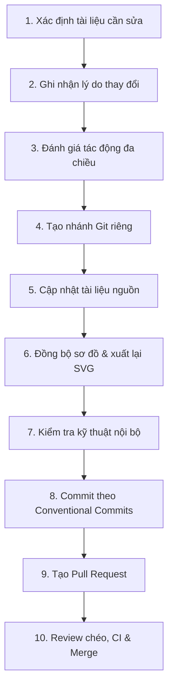

# QUY TRÌNH QUẢN LÝ THAY ĐỔI TÀI LIỆU (DOCUMENT CHANGE CONTROL PROCESS)
## DỰ ÁN: BREWLITE — HỆ THỐNG ĐẶT CÀ PHÊ KHÔNG DÙNG TIỀN MẶT
### PHÂN HỆ: TASK 4.2 — DOCUMENTATION MANAGEMENT & TRACEABILITY

- **Mã tài liệu:** `GOV-DOC-01`
- **Phiên bản:** 1.0.0
- **Trạng thái:** Active / Mandatory
- **Ngày ban hành:** 18/11/2026
- **Căn cứ pháp lý kỹ thuật:** Yêu cầu Task 4.2 môn Công nghệ Phần mềm (Assignment 2): *"Đưa toàn bộ tạo phẩm của Task 1–3 vào thư mục docs. Mọi thay đổi yêu cầu, sơ đồ hoặc kiến trúc phải đi qua commit/pull request và ghi rõ lý do."*

---

## 1. Mục Đích & Phạm Vi Áp Dụng

1. **Mục đích:**
   - Đảm bảo tính nhất quán, minh bạch và khả năng truy vết đa chiều (multi-directional traceability) của toàn bộ hệ thống tài liệu dự án BrewLite.
   - Ngăn chặn triệt để tình trạng tài liệu mâu thuẫn, sửa đổi âm thầm không qua kiểm duyệt, hoặc lệch pha giữa mã nguồn và tài liệu thiết kế.
   - Thiết lập quy trình 10 bước chuẩn hóa cho bất kỳ thao tác bổ sung, chỉnh sửa hoặc hủy bỏ tài liệu trong thư mục `docs/`.
2. **Phạm vi áp dụng:**
   - Toàn bộ các tạo phẩm thuộc **Task 1** (Yêu cầu & Use Cases: `docs/requirements/`), **Task 2** (Sơ đồ UML: `docs/diagram/`), **Task 3** (Kiến trúc & Quyết định ADR: `docs/architecture/`), và **Task 4** (Quy trình quản trị, Backlog, DoD: `docs/`).
   - Mọi thành viên đội ngũ phát triển, kiểm thử, kiến trúc sư phần mềm và người đánh giá chất lượng (QA).

---

## 2. Hệ Thống Mã Định Danh Tài Liệu (Document Identification Scheme)

Mỗi tạo phẩm trong thư mục `docs/` được gán một mã định danh duy nhất (`Document ID`) theo quy tắc:

| Tiền tố | Phân hệ / Thể loại | Ví dụ mã | Tên tài liệu đại diện |
|:---:|---|:---:|---|
| `REQ-*` | Yêu cầu nghiệp vụ, SRS, Use Case | `REQ-SRS-01` | Đặc tả Yêu cầu Phần mềm (SRS v1.4.0) |
| `UML-*` | Sơ đồ thiết kế hệ thống UML | `UML-ACT-01` | Activity Diagram Tạo đơn UC-04 |
| `ARCH-*` | Kiến trúc hệ thống & Triển khai | `ARCH-SPEC-01` | Đặc tả Kiến trúc Hệ thống Modular Monolith |
| `ADR-*` | Quyết định kiến trúc | `ARCH-ADR-001` | Lựa chọn kiến trúc Modular Monolith |
| `AUDIT-*`| Báo cáo kiểm toán & Đánh giá khoảng hở | `AUDIT-GAP-01` | Báo cáo Kiểm toán Khoảng hở GAP-01 -> GAP-05 |
| `TRACE-*`| Ma trận truy vết yêu cầu | `TRACE-RTM-01` | Requirements Traceability Matrix (RTM v2.5.0) |
| `GOV-*`  | Tài liệu quy trình & Quản trị | `GOV-GIT-01` | Chiến lược Phân nhánh Git |
| `BKLG-*` | Quản trị Backlog & Sprint | `BKLG-PRD-01` | Product Backlog Sprint 1 & Sprint 2 |

---

## 3. Quy Trình 10 Bước Quản Lý Thay Đổi Tài Liệu (10-Step Change Process)

Mọi thay đổi đối với tài liệu trong thư mục `docs/` bắt buộc phải tuân thủ nghiêm ngặt 10 bước sau:



### Chi tiết các bước thực hiện:

1. **Bước 1 — Xác định tài liệu cần sửa (Identification):**
   - Định danh chính xác tệp tài liệu cần tác động thông qua `Document ID` và đường dẫn tệp trong `docs/`.
   - Phân loại cấp độ tài liệu: Cốt lõi (SRS, RTM, 14 sơ đồ UML Task 2, ADR Accepted) hay Bổ trợ (Backlog, Verification report).

2. **Bước 2 — Ghi nhận lý do thay đổi (Change Justification):**
   - Xác định rõ nguyên nhân kích hoạt thay đổi: Thay đổi yêu cầu nghiệp vụ từ khách hàng/PO, phát hiện lỗi thiết kế từ kiểm toán (GAP audit), tối ưu hóa kiến trúc, hoặc cập nhật tiến độ bàn giao.
   - Ghi lý do vào phần mở đầu của PR hoặc phần lịch sử thay đổi của tài liệu.

3. **Bước 3 — Đánh giá tác động đa chiều (Multi-dimensional Impact Analysis):**
   - Rà soát các thành phần liên đới trước khi chỉnh sửa:
     - Yêu cầu chức năng (`FR-01` -> `FR-13`) và Phi chức năng (`NFR-01` -> `NFR-07`).
     - Đặc tả Use Case (`UC-01` -> `UC-13`).
     - Sơ đồ UML liên quan trong `docs/diagram/`.
     - Quyết định kiến trúc liên quan (`ADR-001` -> `ADR-007`).
     - Mã nguồn triển khai (`apps/web/`, `apps/api/`) và Ma trận truy vết [RTM](traceability-matrix.md).

4. **Bước 4 — Tạo nhánh Git riêng biệt (Branch Isolation):**
   - Tuyệt đối không sửa trực tiếp trên nhánh `main`.
   - Tạo nhánh mới từ `origin/main` mới nhất:
     ```sh
     git switch main
     git pull --ff-only origin main
     git switch -c docs/<ten-tai-lieu-can-sua>
     ```

5. **Bước 5 — Cập nhật tài liệu nguồn (Source Document Update):**
   - Chỉnh sửa nội dung trên tệp nguồn Markdown (`.md`), PlantUML (`.puml`) hoặc Mermaid (`.mmd`).
   - Cập nhật số phiên bản (Version) theo chuẩn Semantic Versioning (`MAJOR.MINOR.PATCH`) nếu là tài liệu có quản lý phiên bản (như SRS, RTM, Architecture Spec).
   - Ghi rõ ngày cập nhật và tóm tắt nội dung thay đổi tại phần đầu tài liệu.

6. **Bước 6 — Đồng bộ và kết xuất lại tệp SVG (Diagram Rendering Synchronization):**
   - **Quy tắc bắt buộc:** Khi sửa đổi bất kỳ tệp nguồn sơ đồ nào (`.puml` hoặc `.mmd`), người thực hiện **phải kết xuất lại (re-render) tệp SVG tương ứng**.
   - Cặp tệp nguồn và kết xuất phải luôn khớp nội dung và thời gian:
     - PlantUML: Kết xuất bằng PlantUML CLI/Docker: `plantuml -tsvg <diagram>.puml`.
     - Mermaid: Kết xuất bằng Mermaid CLI (`mmdc`): `mmdc -i <diagram>.mmd -o <diagram>.svg`.
   - **Lưu ý đặc biệt:** Không tự ý thay đổi 14 tệp sơ đồ Task 2 đã được nghiệm thu nếu không có chỉ thị sửa đổi chính thức từ hội đồng môn học/PO.

7. **Bước 7 — Kiểm tra kỹ thuật nội bộ (Local Verification & Linting):**
   - Chạy kiểm tra khoảng trắng và định dạng dòng:
     ```sh
     git diff --check
     ```
   - Chạy kiểm tra liên kết Markdown (Markdown relative links) đảm bảo 100% liên kết nội bộ trỏ tới tệp tồn tại.
   - Quét an toàn thông tin (Secret Scanner) đảm bảo không có token, password, private key hoặc secrets trong tài liệu.

8. **Bước 8 — Commit theo Conventional Commits (Standardized Commit):**
   - Thực hiện commit với thông điệp rõ ràng theo chuẩn Conventional Commits:
     ```text
     docs(<scope>): <mô tả ngắn gọn lý do và nội dung thay đổi>
     ```
   - Ví dụ: `docs(srs): align FR-13 health check payload with ADR-004` hoặc `docs(arch): update AWS Lightsail deployment diagram`.

9. **Bước 9 — Tạo Pull Request kèm Biểu mẫu Kiểm soát Thay đổi (Pull Request with Change Control):**
   - Đẩy nhánh lên remote: `git push -u origin docs/<ten-nhanh>`.
   - Mở Pull Request vào `main` thông qua GitHub CLI hoặc GitHub Web.
   - Điền đầy đủ mục **"Kiểm soát thay đổi tài liệu (Document Change Control)"** trong PR template:
     - Lý do thay đổi.
     - Tài liệu nguồn bị ảnh hưởng.
     - Yêu cầu / Sơ đồ / ADR liên quan.
     - Xác nhận đồng bộ tệp SVG.
     - Bằng chứng kiểm tra kỹ thuật (DoD checklist).

10. **Bước 10 — Đánh giá chéo, Kiểm chứng CI và Hợp nhất (Review, CI & Merge):**
    - Kiểm tra pipeline CI Quality Gates trên GitHub Actions (`.github/workflows/quality.yml`) đạt trạng thái SUCCESS.
    - Người chịu trách nhiệm tài liệu (Documentation Reviewer) hoặc Chủ repository thực hiện review diff trên PR.
    - Hợp nhất (Merge) PR vào `main` sau khi tất cả tiêu chí đạt yêu cầu. Tuyệt đối không tự ý merge khi chưa có kiểm chứng.

---

## 4. Vòng Đời và Trạng Thái Tài Liệu (Document Lifecycle States)

Mỗi tài liệu trong hệ thống có một trạng thái chính thức phản ánh mức độ hoàn thiện:

- **`Draft`:** Tài liệu đang trong quá trình soạn thảo sơ bộ, chưa sẵn sàng để thẩm định.
- **`Proposed`:** Tài liệu đã hoàn thiện dự thảo, đang mở PR hoặc chờ các bên liên quan (PO, Architect, Reviewer) đánh giá.
- **`Accepted / Design Verified`:** Tài liệu đã được đánh giá, thông qua và trở thành chuẩn thiết kế chính thức (đã merge vào `main`).
- **`Implemented`:** Tài liệu kiến trúc/thiết kế đã có mã nguồn hoạt động tương ứng trên `main` được kiểm chứng bằng kiểm thử tự động.
- **`Superseded`:** Tài liệu hoặc quyết định đã lỗi thời và bị thay thế bởi một tài liệu/quyết định mới hơn (bắt buộc phải ghi rõ mã tài liệu thay thế).

---

## 5. Quy Chuẩn Đóng Góp Thay Đổi Qua Pull Request

Mỗi Pull Request có thay đổi trong thư mục `docs/` bắt buộc phải bao gồm khối thông tin sau trong mô tả PR:

```markdown
### Kiểm soát thay đổi tài liệu (Document Change Control)
- **Document ID:** [Mã tài liệu bị ảnh hưởng, ví dụ: REQ-SRS-01, ARCH-SPEC-01]
- **Lý do thay đổi:** [Nêu lý do rõ ràng, ví dụ: Sửa lỗi tham chiếu v1.3.2 sang v1.4.0 theo biên bản review]
- **Yêu cầu / ADR liên quan:** [Ví dụ: FR-05, UC-04, ADR-004]
- **Đồng bộ sơ đồ SVG:** [ ] Đã re-render SVG / [x] Không đổi sơ đồ
- **Kiểm tra liên kết Markdown:** [x] PASS (0 lỗi liên kết hỏng)
```

---

## 6. Trách Nhiệm và Phân Quyền (Roles & Responsibilities)

| Vai trò | Thành viên | Trách nhiệm chính |
|---|---|---|
| **Author (Người thực hiện)** | Developer / QA | Soạn thảo, thực hiện quy trình 10 bước, cập nhật SVG, chạy kiểm tra kỹ thuật và mở PR. |
| **Reviewer (Người đánh giá)** | Technical Reviewer | Kiểm tra tính chính xác về mặt kỹ thuật, logic nghiệp vụ, tính nhất quán với UML/ADR và mã nguồn. |
| **Approver (Người phê duyệt)** | Repository Owner / PO | Kiểm duyệt cuối cùng, kiểm tra Definition of Done và thực hiện hành động merge vào `main`. |
