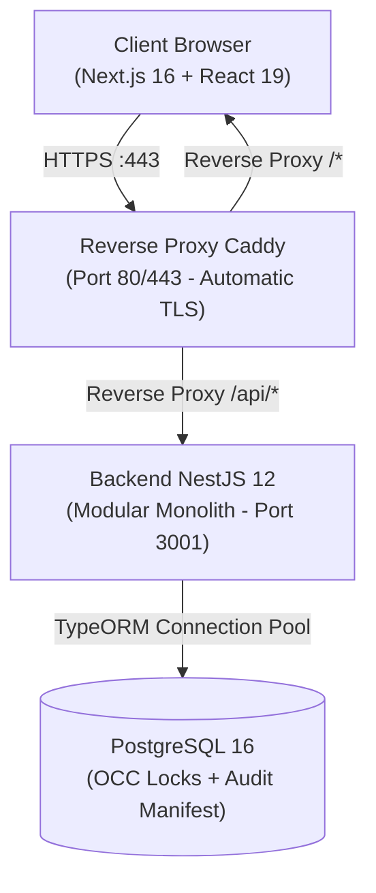

# BREWLITE RELEASE v1.0.0 — PRODUCTION MVP RELEASE CANDIDATE

- **Phiên bản phát hành:** `v1.0.0`
- **Mã phát hành (Codename):** *Autumn Brew — Production Ready*
- **Nhánh phát hành:** `main`
- **Chính sách phân định commit (Commit Separation Policy):**
  - **Mã nguồn ứng dụng đang chạy trên Production (Application Deployed Commit SHA):** `4e47d14c35177b94d287f1f3814c9299b896ea5b` (Merged PR #43, triển khai thành công tại CD Run `#45049566612`).
  - **Nhánh bàn giao tài liệu & bảo mật (Handover Delivery PR):** PR #44 (`docs/task5-4-release-security-handover`).
  - **Commit mục tiêu gắn Git Tag v1.0.0 (Release Tag Target SHA):** Commit hợp nhất (merge commit) của PR #44 vào nhánh `main`.
- **Ngày chuẩn bị:** 23/11/2026
- **Trạng thái:** **Release Candidate (Staged — Step A)**
- **Kế hoạch xuất bản (Publication Plan):** Thực hiện **Step B** (Tạo Git Tag & GitHub Release) **CHỈ KHI** có sự xác nhận và phê duyệt rõ ràng từ người dùng sau khi hoàn tất hợp nhất PR #44 vào `main`.

---

## 1. Tóm Tắt Tổng Quan (Executive Summary)

Bản phát hành **BrewLite v1.0.0** đánh dấu cột mốc hoàn thành toàn diện môn học **Công nghệ Phần mềm (Assignment 2)**. Hệ thống mang lại trải nghiệm hoàn chỉnh cho quy trình đặt đồ uống trực tuyến không dùng tiền mặt: từ khám phá trang chủ thương hiệu, duyệt thực đơn 15 món đồ uống chuẩn hóa, tùy biến lượng đá/đường/topping, đặt hàng tức thì, thanh toán mô phỏng VietQR, nhận vé rung điện tử (buzzer ticket) cho đến tra cứu lịch sử đơn hàng.

Toàn bộ hệ thống được xây dựng trên nền tảng kiến trúc hiện đại, kiểm soát đồng thời lạc quan (OCC), an toàn giao dịch cơ sở dữ liệu, tự động hóa CI/CD, quét mã bí mật (Gitleaks) và triển khai thực tế trên máy chủ đám mây AWS Lightsail.

---

## 2. Tính Năng & Danh Mục Sản Phẩm Đối Soát Chuẩn (Feature Highlights & Catalog Parity)

### 2.1. Nâng cấp Giao diện V2 (UI V2 Experience)
- **Trang chủ thương hiệu cao cấp (Rich Homepage):**
  - Hero banner ấn tượng với lời chào thương hiệu, nút kêu gọi hành động (CTA) "Khám phá Menu" và "Về BrewLite".
  - Bộ lọc danh mục nhanh (Cà phê truyền thống, Cà phê pha máy, Trà trái cây, Trà sữa & Đá xay).
  - Khối triết lý pha chế thủ công, câu chuyện hạt cà phê nguyên bản và đánh giá chân thực từ khách hàng.
  - Thiết kế thích ứng hoàn hảo (Responsive Design) trên mọi kích thước màn hình từ Desktop (1440px) đến Mobile (375px).

- **Danh mục 15 đồ uống chuẩn hóa theo `TARGET_CATALOG` (`scripts/sync-catalog.mjs`):**
  1. **Cà phê Latte** — 45.000 VNĐ (Tồn kho: 50, Baseline ID: 1)
  2. **Trà đào** — 35.000 VNĐ (Tồn kho: 40, Baseline ID: 2)
  3. **Cacao sữa** — 40.000 VNĐ (Tồn kho: 35, Baseline ID: 3)
  4. **Nước suối** — 10.000 VNĐ (Tồn kho: 100, Baseline ID: 4)
  5. **Cà phê đen đá** — 28.000 VNĐ (Tồn kho: 45, Robusta Đắk Lắk pha phin truyền thống)
  6. **Cà phê sữa đá** — 32.000 VNĐ (Tồn kho: 50, Cà phê phin kết hợp sữa đặc ngọt béo)
  7. **Bạc xỉu** — 35.000 VNĐ (Tồn kho: 30, Nhiều sữa ít cà phê chuẩn vị Sài Gòn)
  8. **Espresso** — 30.000 VNĐ (Tồn kho: 40, Chiết xuất áp suất cao từ Arabica Cầu Đất)
  9. **Americano đá** — 35.000 VNĐ (Tồn kho: 25, Espresso pha loãng giải nhiệt)
  10. **Cappuccino** — 48.000 VNĐ (Tồn kho: 20, Espresso, sữa nóng và lớp bọt sữa)
  11. **Caramel Macchiato** — 52.000 VNĐ (Tồn kho: 15, Espresso, vani và sốt caramel)
  12. **Cold Brew cam** — 49.000 VNĐ (Tồn kho: 8, Cảnh báo màu hổ phách "Sắp hết · Còn 8 ly")
  13. **Matcha Latte** — 45.000 VNĐ (Tồn kho: 0, Cảnh báo xám "Tạm hết hàng", không khả dụng)
  14. **Trà vải** — 38.000 VNĐ (Tồn kho: 20, Trà lài kết hợp vải thiều mọng nước)
  15. **Trà chanh mật ong** — 32.000 VNĐ (Tồn kho: 0, Cảnh báo xám "Tạm hết hàng", không khả dụng)

- **Huy hiệu tồn kho thời gian thực (Dynamic Stock Badges):**
  - Tồn kho $> 10$ ly và khả dụng: Hiển thị huy hiệu xanh trung tính `"Còn X ly"`.
  - Tồn kho từ 1 đến 10 ly: Cảnh báo màu hổ phách `"Sắp hết · Còn X ly"`.
  - Tồn kho $= 0$ hoặc không khả dụng: Huy hiệu xám `"Tạm hết hàng"`, vô hiệu hóa nút thêm vào giỏ hàng và đặt số lượng về 0.

### 2.2. Quy trình Đặt Hàng & Thanh Toán MVP (Core E-Commerce Flow)
- **Tùy biến món uống (Customizer Modal):**
  - Tùy chọn kích cỡ (Size M / Size L kèm phụ thu rõ ràng).
  - Tùy chỉnh mức đường ($0\%, 30\%, 50\%, 70\%, 100\%$) và mức đá ($0\%, 30\%, 50\%, 70\%, 100\%$).
  - Bổ sung Topping cao cấp (Trân châu trắng, Thạch nha đam, Thạch trái cây, Kem cheese Macchiato).
- **Giỏ hàng trượt thông minh (Sticky Cart Drawer):**
  - Tính toán tổng tiền theo thời gian thực tại phía client và đối soát bắt buộc với backend.
  - Tăng/giảm số lượng, xóa từng món hoặc làm trống giỏ hàng linh hoạt.
- **Xác thực linh hoạt (Authentication & Guest Mode):**
  - Đăng nhập/Đăng ký tài khoản nhanh chóng với JWT bảo mật.
  - Hỗ trợ luồng khách vãng lai (Guest Checkout) không gián đoạn trải nghiệm đặt hàng.
- **Mô phỏng Thanh toán VietQR (Mock Payment Gateway):**
  - Sinh mã thanh toán QR trực quan với thời hạn hiệu lực.
  - Mô phỏng quá trình xử lý giao dịch qua cổng thanh toán với kiểm tra chữ ký và tính lũy tiến (Idempotent).
- **Vé nhận món điện tử (Buzzer Pickup Ticket):**
  - Hiển thị mã nhận món (Order Code/Buzzer ID), danh sách món đã đặt và trạng thái đơn hàng.
  - Mô phỏng âm thanh rung/chuông khi đơn hàng chuyển sang trạng thái sẵn sàng phục vụ (`READY`).
- **Lịch sử đơn hàng (Order History):**
  - Tra cứu các đơn hàng đã tạo theo tài khoản khách hàng hoặc phiên vãng lai.
  - Ngăn ngừa xung đột dữ liệu: Luôn đọc trực tiếp danh sách món từ cơ sở dữ liệu của đơn hàng lịch sử, tuyệt đối không phụ thuộc giỏ hàng hiện tại.

---

## 3. Kiến Trúc Kỹ Thuật & Tính Toàn Vẹn Dữ Liệu (Technical Architecture)



- **Backend NestJS 12:** Kiến trúc Modular Monolith, tích hợp `@nestjs/config`, `class-validator`, `class-transformer`, CORS bảo vệ đa tầng.
- **Cơ sở dữ liệu PostgreSQL 16 & TypeORM:**
  - 4 baseline migration bất biến bảo đảm cấu trúc bảng chuẩn hóa (`users`, `products`, `orders`, `order_items`, `payments`).
  - Kiểm soát đồng thời lạc quan (Optimistic Concurrency Control - OCC) qua cột `version` của bảng `products`, loại bỏ hoàn toàn rủi ro bán vượt tồn kho (overselling).
- **Bảng kiểm toán đồng bộ danh mục (`catalog_deployments`):**
  - Lưu trữ định danh lần triển khai (`deployment_id`), danh sách product IDs được tạo, timestamp và trạng thái (`APPLIED`, `ROLLED_BACK`).
  - Thực thi nguyên tử (atomic transaction) cùng với lệnh INSERT/UPDATE, bảo đảm tính toàn vẹn 100% ngay cả khi thư mục scripts được mount ở chế độ read-only.
- **Cơ chế Khôi phục An toàn Hai Lớp (Two-Phase Safe Rollback):**
  - *Lớp ứng dụng:* `scripts/rollback.mjs` khôi phục container image trước đó trong tệp `.deployment-state.json`, tuyệt đối bảo toàn volume dữ liệu `postgres_data`.
  - *Lớp dữ liệu:* `scripts/safe-catalog-rollback.mjs` với chế độ `compensate` (vô hiệu hóa an toàn, bảo vệ đơn hàng lịch sử) và `prune` (áp dụng nguyên tắc all-or-nothing kèm xác nhận `--confirm`, từ chối xóa nếu có món đã được đặt).

---

## 4. Hạ Tầng & Quy Trình Vận Hành Production (DevOps & Infrastructure)

- **Môi trường máy chủ:** AWS Lightsail Single-VM (Singapore region, Ubuntu 24.04 LTS, 2GB RAM, 1 vCPU, 60GB SSD).
- **Caddy Reverse Proxy:** Tự động cấp phát và gia hạn chứng chỉ SSL/TLS qua Let's Encrypt cho tên miền chính và tên miền phụ (`brewlite.click`, `swe-brewlite.54-255-241-1.sslip.io`).
- **Container Optimization:**
  - Docker multi-stage build giúp tối ưu dung lượng: API container ~79.1 MB, Web container ~74.8 MB.
  - Chạy dưới quyền người dùng không đặc quyền (`nextjs:nodejs` UID/GID 1001).
  - Giới hạn tài nguyên bộ nhớ (Memory Limits): Toàn bộ 4 container bị chặn ở mức tối đa 1.62GB / 2GB RAM của máy chủ để chống sự cố Out-Of-Memory (OOM).
- **Tự động hóa CI/CD:**
  - GitHub Actions Quality Gates: Tự động chạy Lint, Test, Build, Catalog Integration Test, và Gitleaks Secret Scanner trên mọi Pull Request và commit nhánh `main`.
  - Continuous Delivery: Đóng gói và đẩy container image lên GitHub Container Registry (GHCR), kích hoạt cổng phê duyệt môi trường `production` (Manual Approval Gate) trước khi rollout an toàn.

---

## 5. Báo Cáo An Toàn Bí Mật & Kiểm Thử (Security & Verification)

- **Kiểm toán Bí mật (Secrets Audit):**
  - Đã rà soát toàn diện 152 commits lịch sử nhánh và toàn bộ mã nguồn. Kết quả: **0 secret bị lộ**.
  - Tích hợp cổng kiểm tra tự động Gitleaks (`.github/workflows/quality.yml`) ghim cố định commit SHA và áp dụng tập luật thu hẹp nghiêm ngặt `.gitleaks.toml`.
  - Đã kiểm chứng negative test bằng dummy credential, khẳng định scanner bắt đúng lỗi và dừng quy trình khi có rò rỉ.
  - Xem chi tiết tại: [`docs/security/final-secrets-audit.md`](../security/final-secrets-audit.md).
- **Thống kê Bộ Kiểm thử Tự động (Automated Test Suite):**

| Phân hệ kiểm thử | Công cụ kiểm thử | Số lượng ca kiểm thử | Tỷ lệ Đạt (Pass Rate) |
|---|---|:---:|:---:|
| **API Unit & Integration Tests** | Jest 30 | 130 tests | 100% PASS |
| **Web Component & UI Tests** | Node Native Test Runner | 94 tests | 100% PASS |
| **Catalog Sync & Rollback Tests** | Node Test Runner + PostgreSQL | 24 tests | 100% PASS |
| **Security & Concurrency E2E Tests** | Jest + PostgreSQL Integration | 11 tests | 100% PASS |
| **Tổng cộng toàn hệ thống** | **All Test Runners** | **259 tests** | **100% PASS (259/259)** |

---

## 6. Giới Hạn Đã Biết & Kế Hoạch Tương Lai (Known Limitations & Roadmap)

1. **FR-12 — Thiết bị chuông rung vật lý (Physical Buzzer Hardware):** Được mô phỏng toàn diện bằng phần mềm (mã nhận món, vé rung điện tử, hiệu ứng âm thanh/chuông trên giao diện web). Tích hợp IoT phần cứng chuyển sang giai đoạn phát triển tiếp theo.
2. **Cổng thanh toán thực tế (Real Payment Gateway):** Hệ thống hiện sử dụng `MockPaymentGatewayService` mô phỏng VietQR chuẩn xác. Việc tích hợp API thanh toán trực tiếp từ ngân hàng/ví điện tử (MoMo, VNPay) sẽ được thực hiện khi ký kết hợp đồng doanh nghiệp.
3. **Phân hệ Quản lý Nhà bếp (Kitchen Display System):** Phục vụ nội bộ nhân viên pha chế, được tách biệt thành một ứng dụng riêng trong giai đoạn tiếp theo.

---

## 7. Quy Trình Xuất Bản Bản Phát Hành (Release Staging Protocol)

Tuân thủ nghiêm ngặt nguyên tắc quản lý thay đổi:
- **Bước A (Preparation — Hiện tại):** Chuẩn bị đầy đủ Release Candidate, báo cáo kiểm toán bí mật, cập nhật README và mở PR #44 để review. Không tạo Git Tag hay GitHub Release trước khi merge và được người dùng phê duyệt.
- **Bước B (Publication — Sau khi có lệnh chấp thuận):**
  Sau khi PR #44 được hợp nhất vào `main` và người dùng ra lệnh phát hành, người vận hành thực hiện các bước kiểm tra tiên quyết và kích hoạt xuất bản:

  1. **Kiểm tra tiên quyết (Pre-publication Checks):**
     - Xác nhận nhánh `main` đã merge commit của PR #44.
     - Xác nhận pipeline Quality Gates trên commit merge đạt trạng thái `SUCCESS`.
     - Xác nhận tag `v1.0.0` chưa từng tồn tại trên remote (`git ls-remote --tags origin v1.0.0`).

  2. **Thực thi lệnh phát hành:**
     ```bash
     # 1. Kéo mã nguồn main mới nhất
     git checkout main
     git pull origin main

     # 2. Tạo Git tag v1.0.0
     git tag -a v1.0.0 -m "Release v1.0.0: BrewLite Online Drink Ordering MVP"

     # 3. Đẩy tag lên GitHub
     git push origin v1.0.0

     # 4. Tạo GitHub Release chính thức kèm xác minh tag
     gh release create v1.0.0 --title "v1.0.0 — BrewLite MVP" --notes-file docs/releases/v1.0.0.md --verify-tag
     ```
