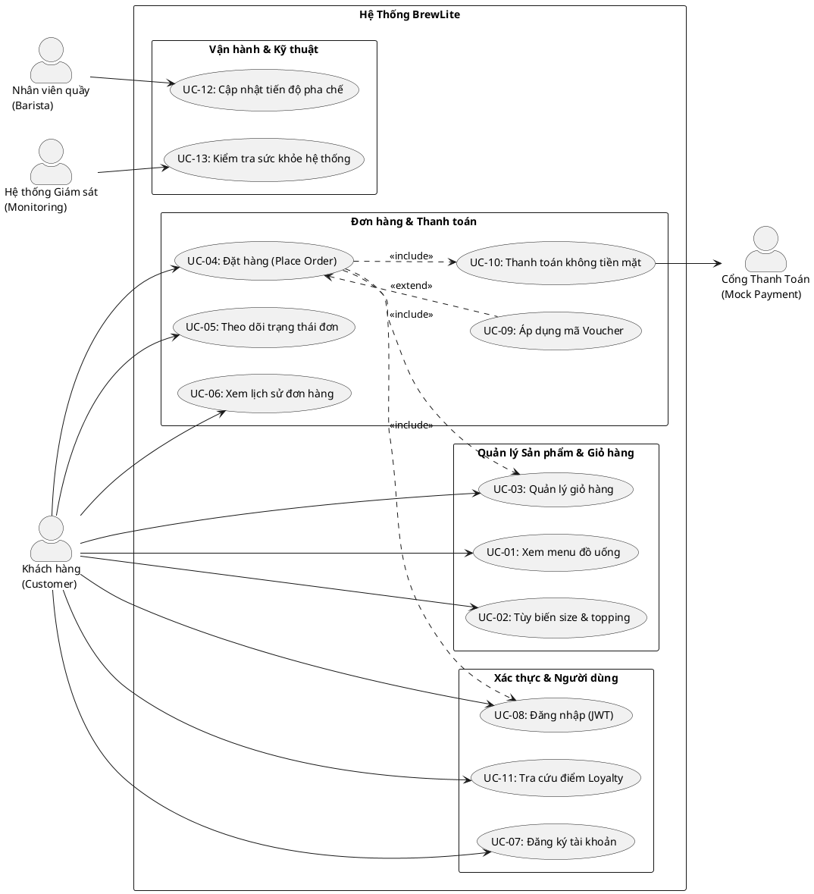

# ĐẶC TẢ YÊU CẦU PHẦN MỀM (SOFTWARE REQUIREMENTS SPECIFICATION - SRS)
## DỰ ÁN: BREWLITE — HỆ THỐNG ĐẶT CÀ PHÊ KHÔNG DÙNG TIỀN MẶT

- **Tên dự án:** BrewLite (Cashless Coffee Ordering Platform)
- **Tài liệu tham chiếu:** Assignment 1 (BrewLite-CongNghePhanMem.pdf) & Assignment 2 (Assignment2-BrewLite.pdf)
- **Mã tài liệu:** `REQ-SRS-01`
- **Phiên bản:** 1.0.0
- **Trạng thái:** Chính thức (Approved Baseline)

---

## 1. TỔNG QUAN HỆ THỐNG (SYSTEM OVERVIEW)

### 1.1 Mục đích tài liệu
Tài liệu này đặc tả chi tiết toàn bộ các yêu cầu chức năng (Functional Requirements - FRs), yêu cầu phi chức năng (Non-Functional Requirements - NFRs), tiêu chí chấp nhận nghiệm thu (Acceptance Criteria) và mô hình Use Case tổng thể của hệ thống **BrewLite**. Đây là tài liệu pháp lý kỹ thuật làm kim chỉ nam cho các giai đoạn Thiết kế mô hình (Task 2), Thiết kế kiến trúc (Task 3), Lập trình Sprint 1 & 2 (Task 4 & 5), và Kiểm thử bàn giao (Verification).

### 1.2 Mô tả chung về hệ thống
BrewLite là giải pháp đặt đồ uống không dùng tiền mặt (Cashless Coffee Ordering Platform) hoạt động theo mô hình ứng dụng web **Mobile-First / PWA**, được xây dựng trên nền tảng:
- **Frontend Client (`apps/web`):** Next.js 14/15, TypeScript, TailwindCSS, thư viện quản lý trạng thái client-side Zustand.
- **Backend API (`apps/api`):** NestJS, TypeScript, kiến trúc Modular, bảo vệ an ninh bằng Passport JWT, Class-Validator DTOs, Exception Filters.
- **Cơ sở dữ liệu (Database):** PostgreSQL 16 quản lý bằng Prisma ORM với hệ thống migrations tự động và cơ chế khóa lạc quan (Optimistic Locking).
- **Môi trường vận hành:** Đóng gói Docker, điều phối bằng Docker Compose, quy trình tích hợp và phân phối liên tục (CI/CD) qua GitHub Actions.

---

## 2. YÊU CẦU CHỨC NĂNG (FUNCTIONAL REQUIREMENTS - FR)

Toàn bộ các yêu cầu chức năng được đánh số định danh duy nhất và phân loại theo thang ưu tiên **MoSCoW** (*Must have: Bắt buộc; Should have: Nên có; Could have: Có thể có; Won't have: Chưa làm ở phiên bản này*).

| Mã FR | Tên yêu cầu chức năng | Phân loại MoSCoW | Mô tả tóm tắt | Căn cứ nhiệm vụ |
| :--- | :--- | :---: | :--- | :--- |
| **FR-01** | Xem Danh mục & Menu đồ uống | **Must Have** | Khách hàng duyệt danh sách sản phẩm đồ uống kèm hình ảnh, tên món, đơn giá niêm yết, và lọc theo danh mục. | Ass 1 §4.1, Ass 2 §6.3 |
| **FR-02** | Xem Chi tiết sản phẩm & Tùy biến món | **Must Have** | Khách hàng chọn kích cỡ ly (Size S/M/L) và các loại Topping; giá sản phẩm tự động cập nhật thời gian thực. | Ass 1 §4.1, Ass 2 §7.1 |
| **FR-03** | Quản lý Giỏ hàng (Cart Management) | **Must Have** | Khách hàng thêm món, tăng/giảm số lượng, xóa món, tính tổng tiền giỏ hàng; dữ liệu giỏ hàng được lưu trữ bền bỉ. | Ass 1 §8 (T5), Ass 2 §7.1 |
| **FR-04** | Đăng ký & Đăng nhập người dùng | **Must Have** | Khách hàng đăng ký tài khoản mới bằng email/mật khẩu, đăng nhập nhận JWT Bearer Token, mật khẩu băm bằng bcrypt. | Ass 1 §8 (T7), Ass 2 §7.1 |
| **FR-05** | Tạo đơn hàng (Order Creation) | **Must Have** | Tạo đơn hàng mới từ giỏ hàng, xác thực dữ liệu đầu vào, kiểm tra tồn kho, khởi tạo đơn ở trạng thái `PENDING`. | Ass 1 §8 (T6), Ass 2 §7.1 |
| **FR-06** | Thanh toán không tiền mặt mô phỏng | **Must Have** | Xử lý thanh toán qua Ví điện tử hoặc Thẻ ngân hàng qua Mock Payment Service, chuyển trạng thái đơn sang `PAID`. | Ass 1 §8 (T8), Ass 2 §7.1 |
| **FR-07** | Máy trạng thái đơn hàng (Order State Machine) | **Must Have** | Kiểm soát chặt chẽ vòng đời đơn hàng qua hàm `assertTransition()`, ngăn chặn mọi chuyển tiếp trạng thái bất hợp lệ. | Ass 1 §9.1, Ass 2 §4.3 |
| **FR-08** | Xử lý thanh toán Idempotent | **Must Have** | Sử dụng HTTP Header `Idempotency-Key` (UUID-v4) để ngăn chặn việc trừ tiền hoặc tạo giao dịch trùng lặp khi retry. | Ass 1 §9.2, Ass 2 §4.2 |
| **FR-09** | Kiểm soát tồn kho đồng thời (Concurrency Control) | **Must Have** | Sử dụng Database Transaction và Optimistic Locking (`version`) để loại bỏ hoàn toàn rủi ro bán vượt tồn kho (Overselling). | Ass 1 §9.3, Ass 2 §4.2 |
| **FR-10** | Khuyến mãi Voucher & Tích lũy điểm Loyalty | **Should Have** | Nhập mã voucher giảm giá hợp lệ và tự động cộng dồn điểm thưởng khách hàng thân thiết sau khi đơn hàng thanh toán thành công. | Ass 1 §9.4, Ass 2 §2.3 |
| **FR-11** | Xác nhận đơn hàng & Lịch sử đơn hàng | **Must Have** | Màn hình hiển thị mã đơn `#xxxx`, trạng thái `PAID`, dặn lấy nước; cho phép xem danh sách lịch sử đơn của cá nhân (`GET /orders/me`). | Ass 1 §7 (S5), Ass 2 §7.1 |
| **FR-12** | Quản lý trạng thái pha chế cho Barista | **Should Have** | Cung cấp endpoint cho nhân viên quầy cập nhật tiến độ đơn hàng: `PAID -> PREPARING -> READY -> COMPLETED`. | Ass 1 §9.1, Ass 2 §7.1 |
| **FR-13** | Kiểm tra sức khỏe hệ thống (System Health Check) | **Must Have** | Endpoint `GET /health` cung cấp trạng thái hoạt động của Backend API và tình trạng kết nối tới cơ sở dữ liệu PostgreSQL. | Ass 2 §5.1, §7.2 |

---

## 3. YÊU CẦU PHI CHỨC NĂNG (NON-FUNCTIONAL REQUIREMENTS - NFR)

| Mã NFR | Danh mục | Đặc tả chi tiết yêu cầu phi chức năng | Tiêu chí đo lường cụ thể | Căn cứ nhiệm vụ |
| :--- | :--- | :--- | :--- | :--- |
| **NFR-01** | **Hiệu năng (Performance)** | - Thời gian phản hồi của các API xem Menu (`GET /products`), xem Chi tiết (`GET /products/:id`) và Tạo đơn (`POST /orders`) phải nhỏ hơn 500ms trong điều kiện tải tiêu chuẩn.<br>- Thời gian hiển thị giao diện trang chủ Menu (First Contentful Paint - FCP) dưới 1.5 giây.<br>- Khả năng chịu tải đỉnh giờ cao điểm (sáng 7:30 - 9:00, trưa 11:30 - 13:30) tối thiểu 50 người dùng đồng thời (50 CCU) hoặc 100 requests/giây mà không suy giảm hiệu năng. | $\text{API Latency} < 500\text{ms}$ đối với 95% số request (p95 percentile); tải đỉnh $\ge 50$ CCU / $\ge 100$ req/s. | Ass 1 §10, Ass 2 §3.2 |
| **NFR-02** | **Bảo mật (Security)** | - Mật khẩu người dùng được băm một chiều bằng thuật toán `bcrypt` với cost factor tối thiểu 10.<br>- Xác thực phân quyền thông qua JSON Web Token (JWT) có thời hạn xác định và thuật toán mã hóa HS256.<br>- Ngăn chặn triệt để lỗ hổng IDOR trên API `GET /orders/:id`.<br>- Lớp DTO validate toàn diện tham số, lọc các trường ngoài danh sách trắng (`whitelist: true`). | 0 lỗ hổng bảo mật nghiêm trọng (SQL Injection, IDOR, Cleartext Password). | Ass 1 §8 (T7), Ass 2 §3.2 |
| **NFR-03** | **Khả năng sử dụng & Mobile-first (Usability & PWA)** | - Giao diện được thiết kế theo tư duy Mobile-First, hiển thị tối ưu trên màn hình điện thoại (viewport 360px - 430px) và responsive tự nhiên trên tablet/desktop.<br>- Hỗ trợ các thuộc tính PWA (Progressive Web App): có Web App Manifest, icon sắc nét, cấu hình viewport đúng chuẩn. | Điểm số Lighthouse Accessibility & Mobile Usability $\ge 90/100$. | Ass 1 §7, Ass 2 §3.2 |
| **NFR-04** | **Tính toàn vẹn dữ liệu & Đồng thời (Data Integrity & Concurrency)** | - Hệ thống phải đảm bảo tính ACID trong các giao dịch tạo đơn và thanh toán.<br>- Cơ chế Optimistic Locking ngăn chặn hoàn toàn hiện tượng số lượng tồn kho (`stock`) bị âm khi có nhiều luồng mua đồng thời. | Số lượng tồn kho luôn $\ge 0$; 0 lỗi race condition dẫn đến trừ kho sai. | Ass 1 §9.3, Ass 2 §4.2 |
| **NFR-05** | **Khả năng vận hành & Container hóa (Portability & Containerization)** | - Toàn bộ hệ thống (Web Next.js, API NestJS, Database PostgreSQL) phải khởi chạy mượt mà thông qua một lệnh duy nhất `docker compose up`.<br>- Cấu hình biến môi trường chuẩn hóa, tách biệt giữa môi trường dev và production. | Khởi động thành công toàn bộ stack trong môi trường container sạch sẽ. | Ass 2 §7.2 |
| **NFR-06** | **Tự động hóa CI/CD & Khả năng triển khai (Maintainability & CI/CD)** | - Pipeline CI tự động kích hoạt trên Pull Request, thực thi 4 công đoạn: `Install -> Lint -> Unit Test -> Build`. Không cho phép merge nếu CI fail.<br>- CD Pipeline hỗ trợ triển khai tự động lên máy chủ Production với chứng chỉ SSL/TLS (HTTPS) hợp lệ. | 100% commit trên nhánh `main` vượt qua CI; có sẵn cơ chế smoke test và rollback. | Ass 2 §6.4, §7.3 |

---

## 4. TIÊU CHÍ CHẤP NHẬN NGHIỆM THU (ACCEPTANCE CRITERIA)
Các tiêu chí chấp nhận được đặc tả chuẩn mực theo cú pháp **Gherkin (Given - When - Then)** có khả năng chuyển hóa trực tiếp thành kịch bản kiểm thử tự động.

### 4.1 Nghiệm thu FR-01: Xem danh mục & Menu đồ uống
```gherkin
Scenario: Khách hàng duyệt danh sách menu thành công
  Given người dùng truy cập vào trang chủ BrewLite
  When hệ thống tải trang hoàn tất
  Then danh sách sản phẩm hiển thị đầy đủ hình ảnh, tên món và giá niêm yết
  And hệ thống cung cấp các bộ lọc theo danh mục đồ uống (Cà phê, Trà, Đá xay)
  And thời gian phản hồi của API GET /products không vượt quá 500ms

Scenario: Xử lý trạng thái khi hệ thống đang tải dữ liệu menu
  Given người dùng truy cập vào trang Menu khi mạng có độ trễ
  When hệ thống đang gọi API GET /products
  Then giao diện hiển thị hiệu ứng khung xương (Skeleton loading)
  And không xảy ra hiện tượng vỡ giao diện (layout shift)
```

### 4.2 Nghiệm thu FR-02: Chi tiết sản phẩm & Tùy biến món
```gherkin
Scenario: Khách hàng chọn kích cỡ ly và giá tự động cập nhật
  Given khách hàng đang xem chi tiết sản phẩm "Cappuccino" có giá gốc 45.000đ (Size S)
  When khách hàng chọn chuyển sang "Size M" (phụ thu +5.000đ)
  Then giá hiển thị trên giao diện tức thì cập nhật thành 50.000đ

Scenario: Khách hàng thêm topping vào đồ uống
  Given khách hàng đã chọn "Cappuccino Size M" với giá 50.000đ
  When khách hàng đánh dấu chọn thêm topping "Kem cheese" (+10.000đ)
  Then tổng đơn giá của món tăng lên thành 60.000đ
  And nút "Thêm vào giỏ" hiển thị giá chính xác là 60.000đ
```

### 4.3 Nghiệm thu FR-03: Quản lý giỏ hàng
```gherkin
Scenario: Thêm sản phẩm vào giỏ hàng và bảo toàn dữ liệu
  Given khách hàng đã tùy chọn ly "Cappuccino Size M, Kem cheese" giá 60.000đ
  When khách hàng nhấn nút "Thêm vào giỏ"
  Then biểu tượng giỏ hàng cập nhật số lượng tăng thêm 1
  And sản phẩm được lưu trữ vào bộ nhớ Zustand Store
  And khi người dùng chuyển trang hoặc tải lại trang, dữ liệu giỏ hàng vẫn được bảo toàn nguyên vẹn
```

### 4.4 Nghiệm thu FR-04: Đăng ký & Đăng nhập
```gherkin
Scenario: Khách hàng đăng ký tài khoản mới thành công
  Given khách hàng nhập email "customer@example.com" và mật khẩu "SecurePassword123"
  When khách hàng gửi yêu cầu đăng ký POST /api/auth/register
  Then hệ thống tạo mới tài khoản thành công
  And mật khẩu được băm bằng thuật toán bcrypt với salt rounds >= 10 trong cơ sở dữ liệu
  And hệ thống trả về HTTP 201 Created mà không làm lộ mật khẩu dạng thô

Scenario: Đăng ký thất bại khi email đã tồn tại trong hệ thống
  Given tài khoản với email "customer@example.com" đã tồn tại trong cơ sở dữ liệu
  When khách hàng gửi yêu cầu đăng ký POST /api/auth/register với email "customer@example.com"
  Then hệ thống từ chối tạo tài khoản
  And API trả về mã lỗi HTTP 409 Conflict kèm thông điệp "Email đã được sử dụng"

Scenario: Đăng nhập nhận JWT Token hợp lệ
  Given tài khoản "customer@example.com" đã tồn tại
  When khách hàng gửi yêu cầu POST /api/auth/login với đúng mật khẩu
  Then hệ thống trả về mã truy cập accessToken dạng JWT hợp lệ
  And mã JWT chứa thông tin định danh người dùng (userId, email, role)
```

### 4.5 Nghiệm thu FR-05 & FR-06: Đặt hàng và Thanh toán
```gherkin
Scenario: Đặt đơn và thanh toán thành công
  Given khách hàng đã đăng nhập và có 1 món trong giỏ hàng trị giá 60.000đ
  When khách hàng thực hiện checkout POST /api/orders
  Then đơn hàng được tạo với trạng thái ban đầu là "PENDING"
  When khách hàng gửi yêu cầu POST /api/payments với method "E_WALLET" kèm Idempotency-Key
  Then hệ thống gọi Mock Payment Service và ghi nhận giao dịch thành công
  And trạng thái đơn hàng chuyển đổi thành "PAID"
  And tồn kho của sản phẩm được trừ đi tương ứng
  And điểm tích lũy của khách hàng được cộng dồn theo quy định

Scenario: Tạo đơn hàng thất bại khi giỏ hàng rỗng
  Given khách hàng đã đăng nhập nhưng giỏ hàng không có sản phẩm nào (items: [])
  When khách hàng gửi yêu cầu checkout POST /api/orders
  Then hệ thống từ chối tạo đơn hàng
  And API trả về mã lỗi HTTP 400 Bad Request kèm thông điệp "Giỏ hàng không được để trống"
  And không có bản ghi đơn hàng nào được tạo trong cơ sở dữ liệu

Scenario: Thanh toán thất bại khi cổng thanh toán mô phỏng từ chối giao dịch
  Given đơn hàng #1042 đang ở trạng thái "PENDING"
  When khách hàng gửi yêu cầu POST /api/payments với thẻ hoặc ví không đủ số dư
  Then Mock Payment Service trả về kết quả từ chối giao dịch
  And API trả về mã lỗi HTTP 422 Unprocessable Entity kèm thông điệp "Giao dịch thanh toán bị từ chối"
  And trạng thái đơn hàng được chuyển sang "PAYMENT_FAILED"
  And số lượng tồn kho sản phẩm không bị trừ
  And giỏ hàng của khách hàng được giữ nguyên để có thể thanh toán lại
```

### 4.6 Nghiệm thu FR-07: Máy trạng thái đơn hàng (State Machine)
```gherkin
Scenario: Chặn chuyển đổi trạng thái bất hợp lệ
  Given một đơn hàng đang ở trạng thái "PENDING"
  When có request yêu cầu cập nhật trực tiếp sang trạng thái "READY"
  Then hàm assertTransition() ném ngoại lệ InvalidStateTransitionException
  And API trả về mã lỗi HTTP 400 Bad Request
  And trạng thái đơn hàng trong cơ sở dữ liệu giữ nguyên là "PENDING"
```

### 4.7 Nghiệm thu FR-08: Thanh toán Idempotent
```gherkin
Scenario: Gửi trùng yêu cầu thanh toán với cùng Idempotency-Key
  Given một yêu cầu thanh toán cho đơn hàng #1042 đã thành công với Idempotency-Key "uuid-abc-123"
  When client gửi lại chính xác request thanh toán đó với cùng Idempotency-Key "uuid-abc-123"
  Then hệ thống trả về kết quả thành công của giao dịch trước đó
  And hệ thống tuyệt đối không tạo bản ghi thanh toán mới trong CSDL
  And số tiền và điểm thưởng không bị xử lý trùng lặp lần thứ hai
```

### 4.8 Nghiệm thu FR-09: Kiểm soát tồn kho đồng thời (Concurrency Control)
```gherkin
Scenario: Chặn bán âm kho qua giao dịch CSDL nguyên tử khi thanh toán đồng thời ly cà phê cuối cùng
  Given sản phẩm "Americano Đặc Biệt" chỉ còn đúng 1 sản phẩm trong kho (stock = 1, version = 1)
  And hai khách hàng A và B đều đã tạo đơn hàng hợp lệ ở trạng thái "PENDING"
  When cả hai khách hàng cùng gửi yêu cầu thanh toán POST /api/payments tại cùng một thời điểm
  Then hệ thống thực thi trừ tồn kho trong giao dịch CSDL nguyên tử với cơ chế Optimistic Locking
  And chỉ có duy nhất 1 giao dịch thanh toán thành công, trừ kho xuống 0 (version = 2) và đơn chuyển sang "PAID"
  And giao dịch thanh toán thứ hai bị xung đột kiểm soát phiên bản (version mismatch hoặc stock < quantity)
  And Database Transaction của giao dịch thứ hai tự động Rollback, trả về mã lỗi HTTP 409 Conflict "Sản phẩm đã hết hàng"
  And số lượng tồn kho trong cơ sở dữ liệu giữ nguyên là 0 (tuyệt đối không bị âm)
```

### 4.9 Nghiệm thu FR-13: Kiểm tra sức khỏe hệ thống (Health Check)
```gherkin
Scenario: Health check trả về trạng thái lành mạnh
  Given toàn bộ dịch vụ API và Database PostgreSQL đang chạy ổn định
  When client gửi yêu cầu GET /api/health
  Then mã trạng thái trả về là HTTP 200 OK
  And payload trả về có cấu trúc {"status": "ok", "database": "connected", "timestamp": "..."}

Scenario: Health check phát hiện cơ sở dữ liệu PostgreSQL bị mất kết nối
  Given dịch vụ API NestJS đang chạy nhưng cơ sở dữ liệu PostgreSQL bị ngắt kết nối
  When client hoặc hệ thống giám sát gửi yêu cầu GET /api/health
  Then mã trạng thái trả về là HTTP 503 Service Unavailable
  And payload phản hồi có cấu trúc {"status": "error", "database": "disconnected", "timestamp": "..."}
```

### 4.10 Nghiệm thu FR-10: Khuyến mãi Voucher & Tích lũy điểm Loyalty
```gherkin
Scenario: Áp dụng mã voucher hợp lệ giảm giá đơn hàng thành công
  Given khách hàng có đơn hàng trị giá 60.000đ trong giỏ hàng
  When khách hàng áp dụng mã voucher "BREW20" (giảm 20% cho đơn từ 50.000đ)
  Then hệ thống tính toán chiết khấu giảm 12.000đ
  And tổng tiền đơn hàng phải thanh toán cập nhật thành 48.000đ

Scenario: Áp dụng voucher không hợp lệ, hết hạn hoặc chưa đạt giá trị tối thiểu
  Given khách hàng có đơn hàng trị giá 30.000đ trong giỏ hàng
  When khách hàng áp dụng mã voucher "BREW20" (yêu cầu đơn tối thiểu 50.000đ)
  Then hệ thống từ chối áp dụng voucher
  And API trả về mã lỗi HTTP 400 Bad Request kèm thông điệp "Đơn hàng chưa đạt giá trị tối thiểu để sử dụng voucher"
  And tổng tiền đơn hàng giữ nguyên là 30.000đ

Scenario: Tích lũy điểm thưởng khách hàng thân thiết khi đơn hàng chuyển sang PAID
  Given khách hàng thanh toán thành công đơn hàng có số tiền thực trả là 48.000đ
  When trạng thái đơn hàng chuyển đổi thành "PAID"
  Then hệ thống tính toán điểm thưởng theo tỷ lệ 10.000 VNĐ = 1 điểm với quy tắc làm tròn sàn Math.floor(48000 / 10000)
  And tài khoản khách hàng được cộng chính xác 4 điểm loyalty
  And lịch sử tích điểm được ghi nhận vào bảng LoyaltyTransaction

Scenario: Không cộng điểm thưởng khi giao dịch thanh toán thất bại
  Given khách hàng thực hiện thanh toán đơn hàng trị giá 100.000đ nhưng bị cổng thanh toán từ chối
  When đơn hàng chuyển sang trạng thái "PAYMENT_FAILED"
  Then hệ thống không thực hiện cộng bất kỳ điểm loyalty nào vào tài khoản khách hàng
```

### 4.11 Nghiệm thu FR-11: Xác nhận đơn hàng & Lịch sử đơn hàng cá nhân
```gherkin
Scenario: Hiển thị màn hình xác nhận đơn hàng sau khi thanh toán thành công
  Given khách hàng vừa hoàn tất thanh toán thành công cho đơn hàng #1042
  When hệ thống điều hướng sang trang xác nhận đơn hàng /order/confirmation
  Then giao diện hiển thị biểu tượng thành công, mã đơn hàng duy nhất "#1042"
  And huy hiệu trạng thái đơn hàng hiển thị nhãn "PAID"
  And màn hình hiển thị lời dặn nhận đồ uống "Mời tới quầy lấy nước"

Scenario: Khách hàng xem danh sách lịch sử đơn hàng của chính mình
  Given khách hàng đã đăng nhập và đã đặt 3 đơn hàng trước đó
  When khách hàng gửi yêu cầu GET /api/orders/me kèm JWT Bearer Token hợp lệ
  Then API trả về mã trạng thái HTTP 200 OK
  And danh sách trả về gồm đúng 3 đơn hàng thuộc về chính tài khoản khách hàng

Scenario: Ngăn chặn lỗ hổng IDOR khi xem chi tiết đơn hàng của người khác
  Given khách hàng A đăng nhập với tài khoản hợp lệ
  When khách hàng A cố tình gửi yêu cầu GET /api/orders/:id với orderId thuộc về khách hàng B
  Then hệ thống phát hiện hành vi truy cập trái phép chéo tài khoản (anti-IDOR check)
  And API từ chối truy cập và trả về mã lỗi HTTP 403 Forbidden kèm thông điệp "Bạn không có quyền truy cập đơn hàng này"
```

### 4.12 Nghiệm thu FR-12: Quản lý trạng thái pha chế cho Barista
```gherkin
Scenario: Barista cập nhật tiến trình pha chế đồ uống thành công
  Given một đơn hàng đang ở trạng thái "PAID"
  When nhân viên Barista gửi yêu cầu PATCH /api/orders/:id/status với payload {"status": "PREPARING"}
  Then hệ thống xác thực người dùng có quyền BARISTA hoặc STAFF
  And trạng thái đơn hàng được cập nhật thành công sang "PREPARING"
  And khi Barista tiếp tục cập nhật sang "READY" và "COMPLETED", hệ thống ghi nhận thành công theo đúng chu trình

Scenario: Khách hàng thông thường bị cấm cập nhật trạng thái đơn hàng
  Given một đơn hàng đang ở trạng thái "PAID"
  When người dùng có vai trò CUSTOMER gửi yêu cầu PATCH /api/orders/:id/status với payload {"status": "COMPLETED"}
  Then hệ thống từ chối yêu cầu qua RolesGuard
  And API trả về mã lỗi HTTP 403 Forbidden kèm thông điệp "Chỉ nhân viên cửa hàng mới có quyền cập nhật trạng thái đơn hàng"
  And trạng thái đơn hàng trong cơ sở dữ liệu giữ nguyên không đổi

Scenario: Barista cố gắng chuyển đổi trạng thái đơn hàng sai quy tắc
  Given một đơn hàng đang ở trạng thái "PAID"
  When nhân viên Barista gửi yêu cầu PATCH /api/orders/:id/status với payload {"status": "COMPLETED"} mà bỏ qua bước READY
  Then hàm assertTransition() phát hiện chuyển đổi trạng thái bất hợp lệ
  And API trả về mã lỗi HTTP 400 Bad Request kèm thông điệp "Không thể chuyển trạng thái từ PAID sang COMPLETED"
  And trạng thái đơn hàng giữ nguyên là "PAID"
```

---

## 5. ĐẶC TẢ SƠ ĐỒ USE CASE TOÀN HỆ THỐNG (USE CASE SPECIFICATION)

### 5.1 Các Tác Nhân Chính (Actors)
1. **Khách hàng (Customer):** Tác nhân chính tương tác với ứng dụng PWA.
2. **Nhân viên quầy (Barista):** Tác nhân phụ trách tiếp nhận và cập nhật tiến trình pha chế đồ uống.
3. **Quản trị viên / Quản lý cửa hàng (Admin/Manager):** Tác nhân quản trị danh mục và báo cáo.
4. **Cổng thanh toán giả lập (Mock Payment Gateway):** Tác nhân hệ thống ngoài xử lý giao dịch tài chính.

### 5.2 Danh Sách Phân Rã Use Case Hệ Thống
- **Gói 1: Duyệt & Tùy biến sản phẩm (Catalog & Customization)**
  - `UC-01`: Xem danh mục đồ uống (Browse Menu)
  - `UC-02`: Xem chi tiết & Tùy chỉnh đồ uống (Customize Drink)
- **Gói 2: Quản lý giỏ hàng & Đơn hàng (Cart & Order)**
  - `UC-03`: Thao tác giỏ hàng (Manage Cart)
  - `UC-04`: Đặt đơn hàng (Place Order)
  - `UC-05`: Theo dõi trạng thái đơn hàng (Track Order Status)
  - `UC-06`: Xem lịch sử đơn hàng cá nhân (View Order History)
- **Gói 3: Xác thực tài khoản (Authentication)**
  - `UC-07`: Đăng ký tài khoản (Register)
  - `UC-08`: Đăng nhập hệ thống (Login)
- **Gói 4: Thanh toán & Khuyến mãi (Payment & Promotion)**
  - `UC-09`: Áp dụng mã giảm giá (Apply Voucher)
  - `UC-10`: Thanh toán không tiền mặt (Process Cashless Payment) *(Trọng tâm)*
  - `UC-11`: Tích lũy & Tra cứu điểm thưởng (Loyalty Points)
- **Gói 5: Vận hành cửa hàng (Store Operations)**
  - `UC-12`: Tiếp nhận đơn & Cập nhật trạng thái pha chế (Update Preparation Status)
  - `UC-13`: Kiểm tra sức khỏe hệ thống (Monitor Health Status)

### 5.3 Đặc Tả Sơ Đồ Use Case Toàn Hệ Thống (PlantUML Specification)


---

## 6. MA TRẬN ÁNH XẠ TRUY VẾT BAN ĐẦU (TRACEABILITY MAPPING)

| Mã Yêu Cầu | Tên Yêu Cầu | Use Case Ánh Xạ | API Endpoint Dự Kiến | Thành Phần Frontend Dự Kiến |
| :--- | :--- | :--- | :--- | :--- |
| **FR-01** | Xem Menu | `UC-01` | `GET /api/products` | `apps/web/src/app/page.tsx` |
| **FR-02** | Chi tiết & Tùy biến món | `UC-02` | `GET /api/products/:id` | `apps/web/src/app/products/[id]/page.tsx` |
| **FR-03** | Quản lý Giỏ hàng | `UC-03` | N/A (Client State) | `apps/web/src/lib/store.ts` |
| **FR-04** | Đăng ký & Đăng nhập | `UC-07`, `UC-08` | `POST /api/auth/register`, `POST /api/auth/login` | `apps/web/src/app/login/page.tsx` |
| **FR-05** | Đặt đơn hàng | `UC-04` | `POST /api/orders` | `apps/web/src/app/checkout/page.tsx` |
| **FR-06** | Thanh toán không tiền mặt | `UC-10` | `POST /api/payments` | `apps/web/src/app/checkout/page.tsx` |
| **FR-07** | Máy trạng thái đơn hàng | `UC-04`, `UC-10`, `UC-12` | Nội bộ `apps/api/src/common/state-machine` | Toàn hệ thống |
| **FR-08** | Thanh toán Idempotent | `UC-10` | Header `Idempotency-Key` trên `/api/payments` | `apps/web/src/lib/api-client.ts` |
| **FR-09** | Kiểm soát tồn kho đồng thời | `UC-04`, `UC-10` | Database Transaction trong `PaymentsService` & `OrdersService` | Backend Core |
| **FR-10** | Khuyến mãi & Loyalty | `UC-09`, `UC-11` | `PromotionsService`, `LoyaltyService` | `apps/web/src/app/checkout/page.tsx` |
| **FR-11** | Xác nhận & Lịch sử đơn | `UC-05`, `UC-06` | `GET /api/orders/me`, `GET /api/orders/:id` | `apps/web/src/app/order/confirmation/page.tsx` |
| **FR-12** | Barista cập nhật pha chế | `UC-12` | `PATCH /api/orders/:id/status` | Staff Portal / API |
| **FR-13** | Health Check | `UC-13` | `GET /api/health` | DevOps & Cloud Monitor |

---
*Tài liệu SRS này đã được xác thực, phân loại MoSCoW và đóng gói sẵn sàng cho công tác thiết kế mô hình hóa và triển khai mã nguồn.*
