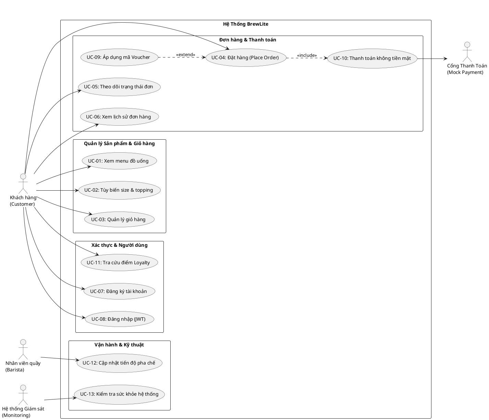

# ĐẶC TẢ YÊU CẦU PHẦN MỀM (SOFTWARE REQUIREMENTS SPECIFICATION - SRS)
## DỰ ÁN: BREWLITE — HỆ THỐNG ĐẶT CÀ PHÊ KHÔNG DÙNG TIỀN MẶT

- **Tên dự án:** BrewLite (Cashless Coffee Ordering Platform)
- **Tài liệu tham chiếu:** Assignment 1 (BrewLite-CongNghePhanMem.pdf) & Assignment 2 (Assignment2-BrewLite.pdf)
- **Mã tài liệu:** `REQ-SRS-01`
- **Phiên bản:** 1.2.0 (Post-Merge Audit & Corrective Maintenance)
- **Trạng thái:** Đề xuất nghiệm thu Task 1 (Proposed Baseline for Task 1 Review)

---

## 1. TỔNG QUAN HỆ THỐNG (SYSTEM OVERVIEW)

### 1.1 Mục đích tài liệu
Tài liệu này đặc tả chi tiết toàn bộ các yêu cầu chức năng (Functional Requirements - FRs), yêu cầu phi chức năng (Non-Functional Requirements - NFRs), tiêu chí chấp nhận nghiệm thu (Acceptance Criteria) và mô hình Use Case tổng thể của hệ thống **BrewLite**. Đây là tài liệu pháp lý kỹ thuật làm kim chỉ nam cho các giai đoạn Thiết kế mô hình (Task 2), Thiết kế kiến trúc (Task 3), Lập trình Sprint 1 & 2 (Task 4 & 5), và Kiểm thử bàn giao (Verification).

### 1.2 Mô tả chung về hệ thống
BrewLite là giải pháp đặt đồ uống không dùng tiền mặt (Cashless Coffee Ordering Platform) hoạt động theo mô hình ứng dụng web **Mobile-First / PWA**, được xây dựng trên nền tảng:
- **Frontend Client (`apps/web`):** Next.js (TypeScript, App Router, TailwindCSS / CSS Modules, quản lý trạng thái giỏ hàng client-side).
- **Backend API (`apps/api`):** NestJS (TypeScript, kiến trúc Modular, bảo vệ an ninh bằng Passport JWT, Class-Validator DTOs, Exception Filters).
- **Cơ sở dữ liệu (Database):** PostgreSQL với lược đồ quản lý dữ liệu chuẩn hóa, hỗ trợ giao dịch ACID và cơ chế khóa lạc quan (Optimistic Concurrency Control - OCC).
- **Môi trường vận hành:** Đóng gói Docker, điều phối bằng Docker Compose, quy trình tích hợp và phân phối liên tục (CI/CD) qua GitHub Actions.

---

## 2. HỆ THỐNG YÊU CẦU CHỨC NĂNG (FUNCTIONAL REQUIREMENTS - FR)

Toàn bộ các yêu cầu chức năng được đánh số định danh duy nhất từ **FR-01 đến FR-13** và phân loại theo thang ưu tiên **MoSCoW** (*Must have: Bắt buộc trong MVP; Should have: Nên có / Mở rộng; Could have: Có thể có; Won't have: Chưa làm ở phiên bản này*).

| Mã FR | Tên yêu cầu chức năng | Phân loại MoSCoW | Mô tả tóm tắt nghiệp vụ | Căn cứ nhiệm vụ |
| :--- | :--- | :---: | :--- | :--- |
| **FR-01** | Xem menu đồ uống | **Must Have** | Khách hàng duyệt danh mục đồ uống kèm hình ảnh, tên món, đơn giá niêm yết, và lọc theo danh mục hoặc tìm kiếm từ khóa. | Ass 1 §4.1, Ass 2 §6.3 |
| **FR-02** | Xem chi tiết, chọn size/topping | **Must Have** | Khách hàng xem chi tiết món, chọn kích cỡ (Size: SMALL, MEDIUM, LARGE) và các loại Topping; giá sản phẩm tự động cập nhật theo thời gian thực. Ghi chú mức đường/đá lưu vào trường ghi chú đơn hàng. | Ass 1 §4.1, Ass 2 §7.1 |
| **FR-03** | Quản lý giỏ hàng | **Must Have** | Khách hàng thêm món vào giỏ, tăng/giảm số lượng, gộp món trùng cấu hình, xóa món, và tính tổng tiền giỏ hàng chính xác. | Ass 1 §8 (T5), Ass 2 §7.1 |
| **FR-04** | Đăng ký, đăng nhập và JWT | **Must Have** | Khách hàng đăng ký tài khoản mới bằng email/mật khẩu, đăng nhập nhận JWT Bearer Token, mật khẩu băm một chiều an toàn bằng bcrypt. | Ass 1 §8 (T7), Ass 2 §7.1 |
| **FR-05** | Tạo đơn hàng | **Must Have** | Tiếp nhận thông tin từ giỏ hàng, xác thực dữ liệu đầu vào, kiểm tra tồn kho thành phẩm, khởi tạo đơn hàng mới ở trạng thái chờ thanh toán `PENDING`. | Ass 1 §8 (T6), Ass 2 §7.1 |
| **FR-06** | Thanh toán mô phỏng | **Must Have** | Xử lý thanh toán không tiền mặt qua Ví điện tử (`E_WALLET`) hoặc Thẻ ngân hàng (`BANK_CARD`) qua Mock Payment Service, chuyển trạng thái đơn sang `PAID`. | Ass 1 §8 (T8), Ass 2 §7.1 |
| **FR-07** | Quản lý trạng thái đơn | **Must Have** | Kiểm soát chặt chẽ vòng đời đơn hàng qua Máy trạng thái hữu hạn (`assertTransition`), ngăn chặn mọi chuyển tiếp trạng thái bất hợp lệ hoặc nhảy cóc. | Ass 1 §9.1, Ass 2 §4.3 |
| **FR-08** | Idempotent Payment | **Must Have** | Sử dụng HTTP Header `Idempotency-Key` (chuẩn UUID-v4) và ràng buộc duy nhất trong CSDL để loại bỏ rủi ro trừ tiền hoặc tạo giao dịch trùng lặp khi retry. | Ass 1 §9.2, Ass 2 §4.2 |
| **FR-09** | Kiểm soát tồn kho đồng thời | **Must Have** | Sử dụng Database Transaction và Optimistic Locking (cột `version`) để loại bỏ hoàn toàn rủi ro bán vượt tồn kho thành phẩm (Overselling) khi có nhiều yêu cầu đồng thời. | Ass 1 §9.3, Ass 2 §4.2 |
| **FR-10** | Voucher và Loyalty | **Should Have** | Nhập mã voucher giảm giá hợp lệ (`BREW20`) tại bước checkout và tự động tích lũy điểm thưởng khách hàng thân thiết sau khi đơn hàng chuyển sang `PAID` (theo quy tắc BR-LOYALTY-01). | Ass 1 §9.4, Ass 2 §2.3 |
| **FR-11** | Xác nhận và lịch sử đơn | **Must Have** | Màn hình hiển thị mã đơn nhận món `#xxxx`, trạng thái `PAID`, dặn lấy nước tại quầy; cho phép xem danh sách lịch sử đơn của cá nhân (`GET /orders/me`). | Ass 1 §7 (S5), Ass 2 §7.1 |
| **FR-12** | Cập nhật tiến độ pha chế | **Should Have** | Cung cấp endpoint cho nhân viên quầy/Barista cập nhật tiến độ chế biến đơn hàng: `PAID -> PREPARING -> READY -> COMPLETED`. | Ass 1 §9.1, Ass 2 §7.1 |
| **FR-13** | Health Check | **Must Have** | Endpoint `GET /health` cung cấp trạng thái hoạt động của Backend API và tình trạng kết nối tới cơ sở dữ liệu PostgreSQL. | Ass 2 §5.1, §7.2 |

---

## 3. YÊU CẦU PHI CHỨC NĂNG (NON-FUNCTIONAL REQUIREMENTS - NFR)

| Mã NFR | Tên NFR | Định nghĩa & Tiêu chuẩn kỹ thuật | Điều kiện đo lường & Ngưỡng chấp thuận | Phương pháp kiểm chứng |
| :--- | :--- | :--- | :--- | :--- |
| **NFR-01** | **Hiệu năng (Performance)** | - Thời gian phản hồi của các API xem Menu (`GET /products`), Chi tiết (`GET /products/:id`), và Tạo đơn (`POST /orders`).<br>- Thời gian hiển thị giao diện trang chủ Menu (First Contentful Paint - FCP). | - $\text{API Latency} < 500\text{ms}$ đối với 95% số request (p95 percentile) ở điều kiện tải thông thường.<br>- $\text{FCP} < 1.5\text{s}$ trên mạng tiêu chuẩn. | - Kịch bản kiểm thử tải / Supertest / Benchmark log.<br>- Báo cáo Lighthouse Performance. |
| **NFR-02** | **Bảo mật (Security)** | - Mật khẩu người dùng được băm một chiều bằng thuật toán `bcrypt` với cost factor $\ge 10$.<br>- Xác thực qua JSON Web Token (JWT) có thời hạn xác định, thuật toán HS256.<br>- Ngăn chặn triệt để lỗ hổng IDOR trên API `GET /orders/:id`.<br>- DTO validate toàn diện tham số, lọc các trường ngoài whitelist. | - 0 lỗ hổng bảo mật nghiêm trọng (SQL Injection, IDOR, Cleartext Password).<br>- 100% request không có token hoặc sai quyền bị từ chối với HTTP 401/403. | - Unit/Integration tests cho Auth Guard và IDOR check.<br>- Static code analysis (ESLint security rules). |
| **NFR-03** | **Khả năng sử dụng (Usability & PWA)** | - Giao diện được thiết kế theo tư duy Mobile-First, tối ưu trên màn hình điện thoại (viewport 360px - 430px) và responsive trên tablet/desktop.<br>- Không xảy ra hiện tượng vỡ giao diện (layout shift); kích thước phần tử bấm (touch targets) $\ge 44 \times 44\text{px}$. | - Điểm số Accessibility $\ge 90/100$ trên Google Lighthouse.<br>- Giao diện hiển thị nhất quán trên Chrome, Safari, Edge và Firefox. | - Kiểm tra trực quan trên đa thiết bị.<br>- Playwright E2E mobile viewport profile. |
| **NFR-04** | **Tính toàn vẹn dữ liệu & Đồng thời (Data Integrity & Concurrency)** | - Hệ thống phải đảm bảo tính ACID trong các giao dịch tạo đơn và thanh toán.<br>- Cơ chế Optimistic Concurrency Control (OCC) ngăn chặn hoàn toàn hiện tượng số lượng tồn kho thành phẩm (`stock`) bị âm khi có nhiều luồng mua đồng thời. | - Số lượng tồn kho luôn $\ge 0$.<br>- 0 lỗi race condition dẫn đến trừ kho sai hoặc thanh toán trùng lặp. | - Kịch bản kiểm thử tranh chấp đồng thời (Concurrency Tests).<br>- Kiểm thử kịch bản Idempotency Key lặp lại. |
| **NFR-05** | **Khả năng triển khai & Container hóa (Deployability & Containerization)** | - Toàn bộ hệ thống (Web Next.js, API NestJS, Database PostgreSQL) phải khởi chạy đồng bộ thông qua một lệnh duy nhất `docker compose up`.<br>- Tách biệt rõ ràng biến môi trường phát triển và môi trường production. | - Khởi động thành công toàn bộ stack trong môi trường container sạch sẽ.<br>- Container vượt qua health check tự động trong 30 giây. | - Khởi chạy và kiểm tra logs trên Docker Engine.<br>- Kiểm tra endpoint `GET /health` qua curl. |
| **NFR-06** | **Tự động hóa CI/CD & Khả năng bảo trì (Maintainability & CI/CD)** | - Pipeline CI tự động kích hoạt trên Pull Request, thực thi 4 công đoạn: `Install -> Lint -> Unit Test -> Build`. Không cho phép merge nếu CI thất bại.<br>- CD Pipeline hỗ trợ đóng gói Docker image, kiểm tra smoke test và triển khai lên môi trường Production an toàn. | - 100% commit trên nhánh `main` vượt qua CI Quality Gate.<br>- Có quy trình smoke test xác minh và phương án rollback khi triển khai lỗi. | - GitHub Actions workflow execution logs.<br>- Báo cáo kết quả CI/CD trên pull request. |

---

## 4. TIÊU CHÍ CHẤP NHẬN NGHIỆM THU (ACCEPTANCE CRITERIA)

Các tiêu chí chấp nhận được đặc tả chuẩn mực theo cú pháp **Gherkin (Given - When - Then)** có khả năng chuyển hóa trực tiếp thành kịch bản kiểm thử tự động.

### 4.1 Nghiệm thu FR-01: Xem menu đồ uống
```gherkin
Scenario: Khách hàng duyệt danh sách menu thành công
  Given người dùng truy cập vào trang chủ hoặc trang menu BrewLite
  When hệ thống tải trang hoàn tất
  Then danh sách sản phẩm hiển thị đầy đủ hình ảnh, tên món và giá niêm yết
  And hệ thống cung cấp các bộ lọc theo danh mục đồ uống (Cà phê, Trà, Bánh)
  And thời gian phản hồi của API GET /products không vượt quá 500ms

Scenario: Xử lý trạng thái khi hệ thống đang tải hoặc không có sản phẩm
  Given người dùng truy cập vào trang Menu khi mạng có độ trễ
  When hệ thống đang gọi API GET /products
  Then giao diện hiển thị hiệu ứng khung xương (Skeleton loading)
  And nếu danh sách trả về rỗng, giao diện hiển thị thông báo "Hiện chưa có đồ uống nào"
```

### 4.2 Nghiệm thu FR-02: Xem chi tiết, chọn size/topping
```gherkin
Scenario: Khách hàng chọn kích cỡ ly và giá tự động cập nhật
  Given khách hàng đang xem chi tiết sản phẩm "Cà phê Latte" có giá gốc 45.000đ (Size SMALL)
  When khách hàng chọn chuyển sang "Size MEDIUM" (phụ thu +5.000đ)
  Then giá hiển thị trên giao diện tức thì cập nhật thành 50.000đ

Scenario: Khách hàng thêm topping và ghi chú mức đường/đá
  Given khách hàng đã chọn "Cà phê Latte Size MEDIUM" với giá 50.000đ
  When khách hàng chọn thêm topping "Kem cheese" (+10.000đ) và nhập ghi chú "50% đường, ít đá"
  Then tổng đơn giá của món tăng lên thành 60.000đ
  And nút "Thêm vào giỏ" hiển thị giá chính xác là 60.000đ
```

### 4.3 Nghiệm thu FR-03: Quản lý giỏ hàng
```gherkin
Scenario: Thêm sản phẩm vào giỏ hàng và tính tổng tiền
  Given khách hàng đã tùy chọn ly "Cà phê Latte Size MEDIUM, Kem cheese" giá 60.000đ
  When khách hàng nhấn nút "Thêm vào giỏ"
  Then biểu tượng giỏ hàng cập nhật số lượng tăng thêm 1
  And tổng tiền tạm tính của giỏ hàng cập nhật tăng 60.000đ

Scenario: Tăng giảm số lượng và xóa món khỏi giỏ
  Given giỏ hàng đang có 1 ly "Cà phê Latte" giá 45.000đ
  When khách hàng nhấn nút "+" tăng số lượng lên 2
  Then tổng tiền giỏ hàng cập nhật thành 90.000đ
  When khách hàng nhấn nút "-" khi số lượng bằng 1
  Then món hàng được xóa hoàn toàn khỏi giỏ hàng
```

### 4.4 Nghiệm thu FR-04: Đăng ký, đăng nhập và JWT
```gherkin
Scenario: Đăng ký tài khoản mới thành công
  Given người dùng chưa có tài khoản trên hệ thống
  When gửi yêu cầu POST /api/auth/register với email hợp lệ và mật khẩu >= 6 ký tự
  Then hệ thống tạo tài khoản mới với mật khẩu được băm bằng bcrypt
  And phản hồi HTTP 201 Created kèm thông tin người dùng (không chứa mật khẩu)

Scenario: Đăng nhập nhận JWT Token hợp lệ
  Given tài khoản đã đăng ký tồn tại trong hệ thống
  When gửi yêu cầu POST /api/auth/login với thông tin chính xác
  Then hệ thống trả về mã truy cập Bearer JWT Token
  And token được lưu trữ an toàn phía client để xác thực các yêu cầu tiếp theo
```

### 4.5 Nghiệm thu FR-05: Tạo đơn hàng
```gherkin
Scenario: Tạo đơn hàng thành công từ giỏ hàng
  Given khách hàng đã đăng nhập và giỏ hàng có ít nhất 1 sản phẩm còn tồn kho thành phẩm
  When khách hàng nhấn nút xác nhận đặt đơn (POST /api/orders)
  Then hệ thống khởi tạo đơn hàng mới ở trạng thái PENDING
  And hệ thống cấp mã hiển thị duy nhất (orderCode) và lưu snapshot chi tiết từng món
  And API phản hồi HTTP 201 Created chứa orderId (UUID) và totalAmount

Scenario: Từ chối tạo đơn khi giỏ hàng trống hoặc sản phẩm hết hàng
  Given giỏ hàng của khách hàng đang rỗng hoặc sản phẩm có tồn kho bằng 0
  When khách hàng gửi yêu cầu tạo đơn
  Then hệ thống chặn lại với mã lỗi HTTP 400 Bad Request hoặc HTTP 409 Conflict
  And không có bản ghi đơn hàng nào được tạo trong cơ sở dữ liệu
```

### 4.6 Nghiệm thu FR-06: Thanh toán mô phỏng
```gherkin
Scenario: Thanh toán mô phỏng thành công
  Given đơn hàng đang ở trạng thái PENDING với tổng tiền 48.000đ
  When khách hàng gửi yêu cầu thanh toán (POST /api/payments) qua ví điện tử
  Then Mock Payment Service phản hồi giao dịch được chấp thuận (SUCCESS)
  And trạng thái đơn hàng được chuyển từ PENDING sang PAID
  And hệ thống kích hoạt trừ tồn kho thành phẩm tương ứng và làm trống giỏ hàng

Scenario: Thanh toán mô phỏng thất bại do lỗi thẻ hoặc từ chối
  Given đơn hàng đang ở trạng thái PENDING
  When Mock Payment Service trả về kết quả FAILED
  Then trạng thái đơn hàng chuyển sang PAYMENT_FAILED
  And số lượng tồn kho không bị trừ, giỏ hàng được giữ nguyên để khách hàng thử lại
```

### 4.7 Nghiệm thu FR-07: Quản lý trạng thái đơn (Order State Machine)
```gherkin
Scenario: Chuyển đổi trạng thái đơn hàng tuần tự hợp lệ
  Given đơn hàng vừa được thanh toán thành công ở trạng thái PAID
  When nhân viên quầy tiếp nhận và cập nhật sang PREPARING
  Then hệ thống chấp thuận và lưu trạng thái PREPARING
  When nhân viên hoàn tất pha chế và cập nhật sang READY
  Then hệ thống chấp thuận và thông báo đồ uống đã sẵn sàng

Scenario: Ngăn chặn chuyển đổi trạng thái bất hợp lệ
  Given đơn hàng đang ở trạng thái PENDING
  When có request cố tình chuyển đơn hàng nhảy cóc sang COMPLETED
  Then hàm assertTransition lập tức ném ngoại lệ InvalidStateTransitionException
  And API trả về mã lỗi HTTP 400 Bad Request, giữ nguyên trạng thái PENDING
```

### 4.8 Nghiệm thu FR-08: Idempotent Payment
```gherkin
Scenario: Gửi lại request thanh toán với cùng Idempotency-Key
  Given đơn hàng đã thanh toán thành công với key "c73a21b4-..."
  When client gửi lại request POST /api/payments với cùng header Idempotency-Key
  Then hệ thống phát hiện khóa đã tồn tại trong CSDL
  And trả về ngay kết quả giao dịch thành công trước đó (isDuplicate = true)
  And không thực hiện trừ tồn kho lần hai và không cộng trùng lặp điểm
```

### 4.9 Nghiệm thu FR-09: Kiểm soát tồn kho đồng thời (Concurrency Control)
```gherkin
Scenario: Hai khách hàng cùng mua ly nước cuối cùng trong kho đồng thời
  Given sản phẩm "Cà phê Latte" chỉ còn 1 ly trong kho (stock = 1, version = 10)
  When hai giao dịch thanh toán gửi yêu cầu trừ kho đồng thời
  Then giao dịch thứ nhất cập nhật thành công (stock = 0, version = 11)
  And giao dịch thứ hai phát hiện xung đột phiên bản Optimistic Lock
  Then giao dịch thứ hai bị rollback tự động, trả về HTTP 409 Conflict
  And số lượng tồn kho trong cơ sở dữ liệu không bao giờ bị âm
```

### 4.10 Nghiệm thu FR-10: Voucher và Loyalty
```gherkin
Scenario: Áp dụng mã giảm giá hợp lệ
  Given đơn hàng có tổng tiền tạm tính từ 50.000đ trở lên
  When khách hàng nhập mã khuyến mãi "BREW20" (giảm 20%)
  Then hệ thống giảm trừ 20% và cập nhật totalAmount chính xác

Scenario: Tích lũy điểm khách hàng thân thiết khi đơn hàng PAID
  Given đơn hàng thanh toán thành công số tiền 48.000đ
  When đơn hàng chuyển sang trạng thái PAID
  Then hệ thống tính toán điểm thưởng (theo BR-LOYALTY-01)
  And ghi nhận giao dịch vào bảng LoyaltyTransaction và cộng vào tài khoản khách
```

### 4.11 Nghiệm thu FR-11: Xác nhận và lịch sử đơn
```gherkin
Scenario: Hiển thị màn hình xác nhận sau khi thanh toán
  Given đơn hàng thanh toán thành công chuyển sang PAID
  When khách hàng được điều hướng tới màn hình /order/confirmation
  Then giao diện hiển thị biểu tượng thành công, mã nhận món (orderCode), huy hiệu PAID
  And hiển thị thông điệp hướng dẫn: "Mời tới quầy lấy nước"

Scenario: Tra cứu lịch sử đơn hàng cá nhân
  Given khách hàng đang đăng nhập với tài khoản của mình
  When gửi yêu cầu GET /api/orders/me
  Then hệ thống chỉ trả về danh sách các đơn hàng thuộc quyền sở hữu của chính khách hàng đó
  And từ chối truy cập (HTTP 403 Forbidden) nếu khách cố tình đọc đơn của người khác
```

### 4.12 Nghiệm thu FR-12: Cập nhật tiến độ pha chế
```gherkin
Scenario: Nhân viên Barista cập nhật trạng thái đơn
  Given nhân viên quầy có quyền STAFF/ADMIN
  When gửi request PATCH /api/orders/:id/status để chuyển đơn từ PAID sang PREPARING
  Then hệ thống cập nhật thành công và ghi nhận thời gian bắt đầu chế biến
```

### 4.13 Nghiệm thu FR-13: Health Check
```gherkin
Scenario: Kiểm tra tình trạng sức khỏe hệ thống
  Given hệ thống Backend API và Database PostgreSQL đang hoạt động bình thường
  When gửi yêu cầu GET /health
  Then hệ thống phản hồi HTTP 200 OK
  And payload chứa thông tin trạng thái hoạt động: `{"status": "ok", "database": "up"}`
```

---

## 5. MÔ HÌNH HÓA USE CASE TOÀN HỆ THỐNG

### 5.1 Danh sách Actor
1. **Khách hàng (Customer) — Primary Actor:** Người dùng cuối trực tiếp duyệt menu, tùy biến đồ uống, quản lý giỏ hàng, đặt đơn và thanh toán.
2. **Nhân viên quầy / Barista (Counter Staff) — Secondary Actor:** Nhân viên tiếp nhận đơn hàng đã thanh toán và cập nhật tiến độ pha chế qua API.
3. **Cổng thanh toán mô phỏng (Mock Payment Service) — Secondary System Actor:** Hệ thống giả lập xử lý giao dịch thanh toán không tiền mặt.
4. **Hệ thống giám sát (Monitoring System) — System Actor:** Công cụ tự động thăm dò endpoint kiểm tra sức khỏe hệ thống.

### 5.2 Phân rã Gói Use Case
- **Gói 1: Quản lý Sản phẩm & Giỏ hàng (Menu & Cart)**
  - `UC-01`: Xem menu đồ uống (FR-01)
  - `UC-02`: Tùy biến size & topping (FR-02)
  - `UC-03`: Quản lý giỏ hàng (FR-03)
- **Gói 2: Xác thực & Khách hàng (Authentication & User)**
  - `UC-07`: Đăng ký tài khoản (FR-04)
  - `UC-08`: Đăng nhập (JWT) (FR-04)
  - `UC-11`: Tra cứu điểm Loyalty (FR-10)
- **Gói 3: Đơn hàng & Thanh toán (Orders & Payments - Core)**
  - `UC-04`: Đặt hàng (Place Order) (FR-05, FR-07, FR-09)
  - `UC-09`: Áp dụng mã Voucher (FR-10)
  - `UC-10`: Thanh toán không tiền mặt (FR-06, FR-08)
  - `UC-05`: Theo dõi trạng thái đơn hàng (FR-11)
  - `UC-06`: Xem lịch sử đơn hàng cá nhân (FR-11)
- **Gói 4: Vận hành & Kỹ thuật (Operations & Health)**
  - `UC-12`: Cập nhật tiến độ pha chế (FR-12)
  - `UC-13`: Kiểm tra sức khỏe hệ thống (FR-13)

### 5.3 Đặc Tả Sơ Đồ Use Case Toàn Hệ Thống (PlantUML Specification)
Sơ đồ tuân thủ tiêu chuẩn học thuật tối giản, đen trắng (Academic Monochrome UML), loại bỏ các liên kết include sai ngữ nghĩa (ví dụ: đăng nhập là tiền điều kiện, không phải hành động luôn include khi đặt hàng):



---

## 6. MA TRẬN ÁNH XẠ TRUY VẾT BAN ĐẦU (TRACEABILITY MAPPING)

Bảng ánh xạ chuẩn hóa đồng bộ giữa Yêu cầu chức năng (FR), Use Case nghiệp vụ, API Endpoint và Thành phần mã nguồn:

| Mã Yêu Cầu | Tên Yêu Cầu Chức Năng | Use Case Ánh Xạ | API Endpoint Dự Kiến | Thành Phần Triển Khai |
| :--- | :--- | :--- | :--- | :--- |
| **FR-01** | Xem menu đồ uống | `UC-01` | `GET /products` | `apps/web/src/app/page.tsx`, `apps/api/src/products/` |
| **FR-02** | Xem chi tiết, chọn size/topping | `UC-02` | `GET /products/:id` | `apps/web/src/app/menu/page.tsx`, `apps/api/src/products/` |
| **FR-03** | Quản lý giỏ hàng | `UC-03` | N/A (Client State) | `apps/web/src/app/menu/page.tsx` |
| **FR-04** | Đăng ký, đăng nhập và JWT | `UC-07`, `UC-08` | `POST /auth/register`, `POST /auth/login` | `apps/api/src/auth/` |
| **FR-05** | Tạo đơn hàng | `UC-04` | `POST /orders` | `apps/api/src/orders/`, `apps/web/src/app/menu/page.tsx` |
| **FR-06** | Thanh toán mô phỏng | `UC-10` | `POST /payments` | `apps/api/src/payments/`, `apps/web/src/app/menu/page.tsx` |
| **FR-07** | Quản lý trạng thái đơn | `UC-04`, `UC-10`, `UC-12` | Nội bộ `order-state-machine` | `apps/api/src/orders/state-machine/` |
| **FR-08** | Idempotent Payment | `UC-10` | Header `Idempotency-Key` trên `/payments` | `apps/api/src/payments/` |
| **FR-09** | Kiểm soát tồn kho đồng thời | `UC-04`, `UC-10` | Transaction & OCC (`version`) | `apps/api/src/payments/`, `apps/api/src/products/` |
| **FR-10** | Voucher và Loyalty | `UC-09`, `UC-11` | `PromotionsService`, `LoyaltyService` | `apps/api/src/payments/` |
| **FR-11** | Xác nhận và lịch sử đơn | `UC-05`, `UC-06` | `GET /orders/me`, `GET /orders/:id` | `apps/api/src/orders/`, `apps/web/src/app/menu/page.tsx` |
| **FR-12** | Cập nhật tiến độ pha chế | `UC-12` | `PATCH /orders/:id/status` | Staff Portal / API |
| **FR-13** | Health Check | `UC-13` | `GET /health` | `apps/api/src/health/` (hoặc `app.controller.ts`) |

---

## 7. CÁC QUY TẮC NGHIỆP VỤ & KHOẢNG TRỐNG TRIỂN KHAI (BUSINESS RULES & GAPS)

### 7.1 Business Rules
1. **BR-LOYALTY-01 (Tỷ lệ tích lũy điểm thưởng):**
   - *Tài liệu đề xuất:* 10.000 VNĐ chi tiêu = 1 điểm.
   - *Mã nguồn nhánh Sprint 1 (`payments.service.ts`):* `Math.floor(amount / 1000)` (1.000 VNĐ = 1 điểm).
   - *Trạng thái:* `PROPOSED / PENDING APPROVAL from PO`. Trong giai đoạn kiểm thử, áp dụng tỷ lệ của mã nguồn để khớp với test tự động.
2. **BR-PROMO-01 (Mã khuyến mãi mặc định):**
   - Mã `BREW20` chiết khấu 20% cho đơn hàng có tổng tiền từ 50.000 VNĐ trở lên (`minOrderValue: 50000`, `discountType: PERCENTAGE`, `discountValue: 20`).
3. **BR-REFUND-01 (Quy tắc hoàn tiền khi hủy đơn):**
   - *Hành vi nghiệp vụ mong muốn:* Nếu đơn hàng đã ở trạng thái `PAID` bị hủy do sự cố kỹ thuật hoặc hết nguyên liệu, hệ thống cần thực hiện hoàn tiền tự động 100% cho khách hàng.
   - *Trạng thái:* `PROPOSED / PENDING APPROVAL`.

### 7.2 Khoảng trống triển khai (Implementation Gaps)
- **GAP-01 (Chức năng Refund & Hủy đơn sau thanh toán):** Mã nguồn backend hiện tại chưa cài đặt phương thức `refund()` trong service thanh toán và chưa có endpoint `PATCH /orders/:id/cancel`. Cần triển khai bổ sung ở Task 4/5 nếu bài toán yêu cầu nghiệp vụ hoàn tiền.
- **GAP-02 (Cơ chế lưu giữ Idempotency Key tại Client):** Frontend hiện tại tái tạo đơn mới và sinh key mới mỗi lần bấm; chưa lưu key vào `sessionStorage` gắn với `orderId` để chống trừ tiền trùng khi rớt mạng rồi bấm thử lại.
- **GAP-03 (Endpoint Health Check trên main):** Nhánh `main` hiện chỉ có `AppController` trả về chuỗi chào mừng, chưa có endpoint `GET /health` trả về trạng thái database (đã có trên nhánh `feature/sprint1-mvp-foundation`).
