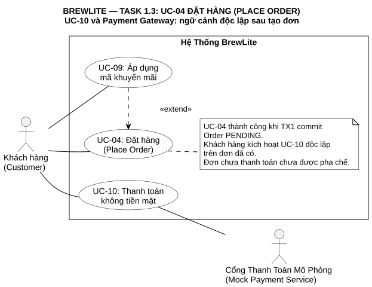

# TASK 1.3 — ĐẶC TẢ USE-CASE TRỌNG TÂM: UC-04 ĐẶT HÀNG (PLACE ORDER)
## DỰ ÁN: BREWLITE — HỆ THỐNG ĐẶT CÀ PHÊ KHÔNG DÙNG TIỀN MẶT

- **Tên dự án:** BrewLite (Cashless Coffee Ordering Platform)
- **Tài liệu tham chiếu:** Assignment 1 (Task 10) & Assignment 2 (Task 1.3, Task 2)
- **Mã tài liệu:** `REQ-UC-04`
- **Phiên bản:** 1.4.0 (Independent UC-04 / UC-10 — Retry & Authorization Clarification)
- **Trạng thái:** Đề xuất nghiệm thu Task 1 (Proposed Baseline for Task 1 Review)
- **MVP do nhóm lựa chọn:** Đặt đồ uống (Drink Ordering)
- **Use-case trọng tâm:** `UC-04 — Đặt hàng (Place Order)`
- **Quan hệ UML chuẩn hóa:** Customer liên kết độc lập với UC-04 và UC-10; UC-09 mở rộng UC-04.

---

## 1. Định Nghĩa Nghiệp Vụ và Ranh Giới Phạm Vi

### 1.1 Định nghĩa cốt lõi của UC-04
**UC-04: Đặt hàng (Place Order) tạo đơn hợp lệ từ giỏ hàng và hoàn tất khi TX1 đã COMMIT Order cùng OrderItem ở trạng thái PENDING, trả mã đơn và số tiền cần thanh toán.**

1. **Tạo đơn hàng (FR-05):**
   - Xác thực JWT, kiểm tra giỏ hàng và DTO, kiểm tra khả dụng và tồn kho sơ bộ, tính lại giá phía server.
   - Gọi API `POST /orders`, lưu Order và OrderItem trong TX1, phản hồi HTTP 201 Created.
2. **Hoàn tất đặt hàng (UC-04):**
   - Order PENDING là hậu điều kiện thành công của UC-04. Khách hàng có thể kích hoạt UC-10 sau đó trên chính đơn này.
   - UC-04 không trừ hoặc giữ tồn kho. UC-10 kiểm tra lại tồn kho bằng OCC khi thanh toán.
   - Đơn chưa thanh toán không được chuyển sang PREPARING, READY hoặc COMPLETED.

### 1.2 Trong phạm vi UC-04:
- Tiếp nhận và kiểm tra giỏ hàng của khách hàng (kèm size, topping, số lượng, ghi chú).
- Xác thực tài khoản khách hàng thông qua JWT Bearer Token (FR-04).
- Kiểm tra khả dụng, tồn kho sơ bộ và tính lại giá phía máy chủ.
- Tạo Order và OrderItem ở trạng thái PENDING qua TX1 của `POST /orders` (FR-05, FR-07).
- Trả mã đơn và số tiền cần thanh toán sau COMMIT TX1.

### 1.3 Ngoài phạm vi UC-04:
- Thanh toán, idempotency, trừ kho OCC, chuyển PAID, đối soát và hoàn tiền thuộc UC-10 độc lập.
- Nhân viên quầy / Barista tiếp nhận đơn đã thanh toán và cập nhật tiến độ pha chế (`UC-12`, FR-12).
- Tra cứu danh sách lịch sử các đơn hàng cũ của cá nhân (`UC-06`, FR-11).
- Quản trị danh mục menu sản phẩm hoặc báo cáo doanh thu tài chính cửa hàng.

---

## 2. Bản Chất Nghiệp Vụ Của Use Case Độc Lập: UC-10

**UC-10: Thanh toán không tiền mặt (Cashless Payment) là Use Case độc lập, được khách hàng kích hoạt trên đơn hàng đã tồn tại.**

Bản chất của `UC-10` là **thực hiện giao dịch thanh toán qua dịch vụ mô phỏng trên đơn đã có**. Trách nhiệm cụ thể của `UC-10`:
1. Tiếp nhận mã đơn hàng đã tồn tại ở trạng thái `PENDING` (hoặc trạng thái hợp lệ để thử lại như `PAYMENT_FAILED`).
2. Kiểm tra quyền sở hữu đơn hàng và tính toàn vẹn của số tiền thanh toán (`amount === order.totalAmount`).
3. Tiếp nhận phương thức thanh toán ví điện tử (`E_WALLET`) hoặc thẻ (`BANK_CARD`).
4. Gửi yêu cầu `POST /payments` kèm HTTP Header `Idempotency-Key` (chuẩn UUID v4).
5. Tương tác với Cổng thanh toán mô phỏng (Mock Payment Service) và nhận kết quả giao dịch.
6. Xử lý đồng thời và kiểm soát trừ tồn kho thành phẩm bằng khóa lạc quan OCC.
7. Khi thanh toán thành công (`SUCCESS`), cập nhật bản ghi `Payment` và kích hoạt máy trạng thái chuyển `Order` sang **`PAID`**.
8. Trả kết quả thanh toán cho khách hàng sau COMMIT TX2; UC-10 hoàn tất thành công khi Order PAID.

> [!NOTE]
> UC-10 sử dụng dữ liệu đơn do UC-04 tạo trước đó. Hai Use Case có actor Customer liên kết độc lập; không có quan hệ include hoặc extend giữa chúng.

### 2.1 Sơ Đồ Use Case Chi Tiết (Detail Use Case Diagram)

Mô hình Use Case chi tiết của `UC-04: Đặt hàng (Place Order)` được quản lý thống nhất tại tệp nguồn PlantUML: [use-case-place-order.puml](./use-case-place-order.puml).

UC-10 và Payment Gateway được giữ để thể hiện ngữ cảnh sau tạo đơn; chúng không thuộc phạm vi thực thi của UC-04. Đặc tả UC-10 độc lập nằm tại Mục 2.2–2.4; sơ đồ này không biểu diễn quan hệ include/extend giữa UC-04 và UC-10.

Bản kết xuất đồ họa chính thức được nhúng trực tiếp dưới đây:




### 2.2 Đặc tả độc lập UC-10

| Thuộc tính | Chi tiết đặc tả |
| :--- | :--- |
| **Actor chính / phụ** | Khách hàng (Customer) / Cổng thanh toán mô phỏng (Mock Payment Service). |
| **Trigger** | Khách hàng chọn thanh toán một đơn đã tồn tại, chọn Ví/Thẻ và xác nhận thanh toán. |
| **Tiền điều kiện** | Đơn tồn tại, khách hàng có quyền sở hữu; Order PENDING hoặc PAYMENT_FAILED; không có giao dịch đang xử lý, chưa xác định, đang hoàn tiền hoặc đã hoàn ngăn tạo giao dịch mới. Mọi yêu cầu, kể cả gửi lại cùng khóa, phải xác thực JWT và kiểm tra quyền sở hữu đơn/giao dịch trước khi trả dữ liệu. Sau đó mới tra cứu kết quả cũ theo chủ sở hữu, khóa và payload; Cùng khóa nhưng khác payload bị từ chối với 409; điều kiện tạo giao dịch mới chỉ áp dụng khi chưa có khóa trong phạm vi hợp lệ. Gửi lại khóa hợp lệ có thể trả kết quả cũ khi Order đã PAID. |
| **Hậu điều kiện thành công** | Payment SUCCESS, Order PAID và tồn kho được trừ đúng một lần sau COMMIT TX2. Khách hàng nhận kết quả thanh toán. |
| **Hậu điều kiện chưa thành công** | TX1 đã commit được bảo toàn. FAILED chuyển PAYMENT_FAILED; timeout giữ PENDING để đối soát; OCC sau SUCCESS đi theo BR-REFUND-OCC. |
| **Truy vết** | FR-06, FR-08; FR-07 cho chuyển trạng thái và FR-09 cho OCC/trừ kho. Thiết kế mục tiêu; đối soát và hoàn tiền còn phụ thuộc GAP-01, GAP-02. |

### 2.3 Luồng chính UC-10

1. Khách hàng chọn thanh toán đơn đã tồn tại và phương thức Ví/Thẻ.
2. Frontend gửi `POST /payments` kèm JWT, orderId, amount, method và Idempotency-Key.
3. Backend xác thực JWT và kiểm tra quyền sở hữu đơn/giao dịch trước khi trả bất kỳ kết quả cũ nào; đối chiếu khóa/payload trong phạm vi chủ sở hữu. Cùng khóa nhưng khác payload bị từ chối với 409, không tạo attempt mới. Nếu chưa có khóa trong phạm vi hợp lệ, kiểm tra số tiền, trạng thái và cấp quyền tạo giao dịch theo cơ chế nguyên tử.
4. Lưu attempt cùng merchantReference và công việc đối soát bền vững trước khi gọi Mock Payment Service.
5. Mock Payment Service trả SUCCESS; Backend bắt đầu TX2.
6. TX2 kiểm tra OCC, trừ kho, lưu Payment SUCCESS và chuyển Order PAID qua máy trạng thái.
7. COMMIT TX2 và trả kết quả thanh toán; UC-10 hoàn tất thành công.
8. Frontend hiển thị xác nhận PAID. Quy tắc xóa giỏ sau PAID được giữ như thiết kế hiện tại.

### 2.4 Luồng thay thế và ngoại lệ UC-10

ALT-01 (Ví/Thẻ), ALT-05 (thanh toán lại) và ALT-06 (Loyalty) tại Mục 5 áp dụng cho UC-10.

- **EX-06 (Thanh toán bị cổng từ chối — mockOutcome = 'FAILED'):**
  - Cổng thanh toán phản hồi thất bại (thẻ lỗi hoặc ví không đủ số dư).
  - Bản ghi `Order` ở trạng thái `PENDING` đã tạo trước đó **không bị xóa bỏ**.
  - Hàm máy trạng thái chuyển trạng thái đơn hàng sang **`PAYMENT_FAILED`**.
  - Tồn kho thành phẩm không bị trừ; hệ thống **tuyệt đối không thông báo thanh toán thành công**.
  - Màn hình thanh toán hiển thị lỗi chi tiết và cung cấp nút "Thanh toán lại" để khách hàng đổi phương thức hoặc thử lại (kích hoạt lại `UC-10`).
- **EX-07 (Thanh toán Timeout hoặc mạng chập chờn — mockOutcome = 'PENDING'):**
  - Đơn hàng tiếp tục duy trì ở trạng thái **`PENDING`**; bản ghi `Payment` lưu `status: 'PENDING'`.
  - Hệ thống thông báo giao dịch đang được xử lý, **không công bố UC-10 đã thành công**. Khách hàng được hướng dẫn kiểm tra lịch sử trước khi thử lại để tránh trừ tiền trùng.
- **EX-08 (Gửi lại request thanh toán trùng lặp — Idempotency Match):**
  - Backend xác thực JWT và kiểm tra quyền sở hữu đơn/giao dịch; chỉ sau đó trả kết quả `Idempotency-Key` đã tồn tại, khớp chủ sở hữu và payload, ở trạng thái `SUCCESS`. Không tiết lộ kết quả hoặc sự tồn tại của giao dịch thuộc khách hàng khác.
  - Backend trả về ngay kết quả giao dịch trước đó (`isDuplicate = true`), không trừ tiền lần hai, không trừ kho lặp lại.
- **EX-09 (Xung đột tồn kho đồng thời khi thanh toán — OCC Conflict):**
  - Hai giao dịch thanh toán đồng thời cho ly nước cuối cùng; giao dịch thứ hai phát hiện lệch `version`.
  - Transaction thanh toán của giao dịch thứ hai bị rollback. Thực hiện BR-REFUND-OCC bên dưới để lưu và hoàn giao dịch đã SUCCESS; trả 409 nếu HTTP còn mở; tác vụ nền lưu kết quả cho GET tiếp theo.

### BR-REFUND-OCC — Hoàn tiền mô phỏng sau xung đột tồn kho

Thiết kế được chọn cho trường hợp Payment Service đã trả SUCCESS nhưng TX2 bị rollback do OCC:

1. Rollback TX2 giữ nguyên tồn kho và trạng thái Order trước TX2.
2. Trong transaction riêng (TX3), lưu transactionId của dịch vụ thanh toán, Idempotency-Key, refundKey cố định và Payment REFUND_PENDING. Nếu lưu thất bại, giữ khóa giao dịch đang xử lý để đối soát, khôi phục bản ghi trước khi thực hiện hoàn tiền.
3. Gọi hoàn tiền mô phỏng toàn bộ số tiền với cùng refundKey trong mọi lần thử. Dịch vụ mô phỏng trả kết quả cũ khi nhận khóa hoàn tiền trùng.
4. Nếu đã hoàn thành công, cập nhật Payment REFUNDED và Order CANCELLED trong cùng transaction. Nếu thất bại, đang xử lý hoặc timeout, giữ REFUND_PENDING và lưu lịch thử lại. Tác vụ đối soát xử lý tiếp bất đồng bộ, kể cả khi ứng dụng khởi động lại. Khi dịch vụ đã hoàn nhưng ghi DB thất bại, dùng lại refundKey để phục hồi kết quả.
5. Khi HTTP thanh toán còn mở, trả 409 kèm trạng thái hoàn tiền sau lần thử đầu. Khi HTTP đã đóng, tác vụ nền chỉ lưu kết quả; client gửi GET mới để đọc trạng thái. UI thông báo đang hoàn hoặc đã hoàn, giữ thông tin đơn. Chỉ xóa giỏ tự động trong luồng Order PAID.
6. Retry thanh toán cùng khóa trả trạng thái hiện có, gồm REFUND_PENDING hoặc REFUNDED. Từ chối khóa thanh toán mới cho đơn có giao dịch đang hoàn hoặc đã hủy.
7. Hoàn tiền trong tình huống này không tăng tồn kho vì TX2 đã rollback. Quy tắc hủy một đơn PAID đã trừ kho được đặc tả riêng.

Tiêu chí kiểm chứng: hai khách mua sản phẩm cuối cùng tạo một đơn PAID; giao dịch còn lại được hoàn đúng một lần. Lặp request thanh toán/hoàn tiền và khởi động lại tác vụ không tạo khoản thu hoặc hoàn trùng. Timeout hoàn tiền giữ REFUND_PENDING, sau đối soát thành công chuyển REFUNDED/CANCELLED. Tổng tồn kho chỉ giảm cho đơn PAID.

Đây là thiết kế cần triển khai và kiểm thử ở backend/mock payment; trạng thái tài liệu không xác nhận tính năng đã chạy trong mã nguồn.


### Quy tắc retry và đối soát giao dịch

- Trước mọi phản hồi giao dịch cũ, xác thực JWT và kiểm tra quyền sở hữu đơn/giao dịch; khóa idempotency không thay thế quyền truy cập.
- Gửi lại cùng yêu cầu dùng cùng Idempotency-Key và payload. Khi FAILED đã được xác minh, lần thanh toán mới trên cùng đơn dùng khóa mới.
- Khóa được gắn với chủ sở hữu, orderId, amount và method. Cùng khóa nhưng thông tin khác bị từ chối với 409.
- Kiểm tra trạng thái và cấp quyền xử lý giao dịch mới theo cơ chế nguyên tử trên đơn. Chặn giao dịch mới khi đang xử lý, PENDING chưa đối soát, REFUND_PENDING, REFUNDED hoặc Order PAID/CANCELLED.
- Timeout: lưu trạng thái chờ, mã tham chiếu và công việc đối soát bền vững trước khi trả phản hồi. Tác vụ nền tra cứu Payment Service bằng transactionId hoặc mã tham chiếu. SUCCESS tiếp tục TX2/OCC; FAILED chuyển PAYMENT_FAILED; chưa rõ thì lên lịch kiểm tra tiếp.
- Mỗi lượt HTTP và mỗi lượt tác vụ nền có điểm kết thúc riêng. REFUND_PENDING dùng tác vụ đến hạn và cùng refundKey; không giữ request HTTP chờ toàn bộ quá trình hoàn tiền.
- Tác vụ nhận quyền xử lý nguyên tử và kiểm tra trạng thái trước cập nhật. Kết quả SUCCESS được áp dụng đúng một lần. Kiểm thử gồm gửi lại, payload đổi, hai khóa đồng thời, timeout rồi SUCCESS/FAILED và hoàn tiền lặp.


### Dữ liệu đối soát và phạm vi phản hồi HTTP

- Trước khi gọi Payment Service, commit attempt PENDING cùng merchantReference duy nhất, chủ sở hữu, orderId, amount, method, Idempotency-Key, payload chuẩn hóa và công việc đối soát bền vững. Lỗi commit dừng trước lời gọi thanh toán.
- Gửi merchantReference tới cổng mô phỏng và hỗ trợ tra cứu bằng mã này. transactionId được lưu khi nhận được; timeout trước khi có transactionId vẫn tra cứu được. Chưa tìm thấy giao dịch chưa đủ để kết luận FAILED.
- Timeout trả 202/PENDING và kết thúc lượt POST /payments. Tác vụ nền tiếp nhận công việc đến hạn và cập nhật dữ liệu, không phản hồi vào HTTP đã đóng.
- SUCCESS sau đối soát áp dụng TX2/OCC đúng một lần. OCC xung đột tạo REFUND_PENDING và công việc hoàn tiền trong TX3; tác vụ hoàn tiền chạy với cùng refundKey.
- Nhánh đồng bộ còn HTTP mở có thể trả 409 kèm trạng thái hoàn tiền sau lần thử đầu. Sau khi HTTP đóng, client đọc kết quả bằng một lượt GET /orders/:id có xác thực quyền sở hữu.


---

## 3. Tác Nhân, Kích Hoạt, Tiền Điều Kiện và Hậu Điều Kiện

| Thuộc tính | Chi tiết đặc tả |
| :--- | :--- |
| **Mã Use Case** | `UC-04` |
| **Tên Use Case** | Đặt hàng (Place Order) |
| **Phân loại** | Core Business Flow (Nghiệp vụ cốt lõi MVP) |
| **Actor chính** | **Khách hàng (Customer):** Xác nhận tạo đơn từ giỏ hàng. |
| **Actor phụ** | Không có actor phụ trực tiếp trong UC-04. |
| **Trigger** | Khách hàng nhấn **"Xác nhận đặt hàng"** tại giỏ hàng/checkout. |
| **Tiền điều kiện** | 1. Khách hàng đã truy cập ứng dụng BrewLite và giỏ hàng có ít nhất một (01) đồ uống hợp lệ.<br>2. Các sản phẩm trong giỏ có trạng thái kinh doanh (`isAvailable = true`) và đủ tồn kho thành phẩm (`stock >= quantity`).<br>3. Khách hàng đã đăng nhập tài khoản hợp lệ với JWT Bearer Token (FR-04).<br>4. Backend API và CSDL PostgreSQL đang hoạt động bình thường. |
| **Hậu điều kiện thành công (Success Postconditions)** | Order và OrderItem được lưu hợp lệ, TX1 đã COMMIT; Order = **PENDING**. Khách hàng nhận orderId, orderCode và totalAmount. UC-04 không tạo Payment, không chuyển PAID và không trừ hoặc giữ tồn kho. Đơn chưa thanh toán chưa được pha chế hoặc nhận đồ uống. |
| **Hậu điều kiện thất bại / Chưa hoàn tất (Failure / Incomplete Postconditions)** | Validation thất bại thì không tạo đơn. Lỗi trước COMMIT TX1 phải ROLLBACK phần đã ghi; giỏ được giữ nguyên và khách nhận lỗi 400/401/409/500 tương ứng. Lỗi UC-10 phát sinh sau này không làm mất kết quả tạo đơn đã COMMIT. |

---

## 4. Luồng Sự Kiện Chi Tiết (Flow of Events)

### 4.1 Luồng chính thành công (Main Success Flow)

1. **Khách hàng** mở Giỏ hàng, xem các món đã chọn.
2. **Hệ thống** hiển thị size, topping, số lượng và tổng tiền tạm tính.
3. **Khách hàng** nhập ghi chú nếu cần và nhấn **"Xác nhận đặt hàng"**.
4. **Frontend** kiểm tra dữ liệu giỏ và phiên đăng nhập.
5. **Frontend** gửi `POST /orders` kèm JWT và CreateOrderDto.
6. **Backend** xác thực JWT, validate dữ liệu, kiểm tra khả dụng và tồn kho sơ bộ, tính lại giá phía máy chủ.
7. **Backend** bắt đầu TX1, lưu Order và OrderItem với Order = PENDING, rồi COMMIT TX1.
8. **Backend** phản hồi 201 Created với orderId, orderCode, totalAmount và PENDING.
9. **Frontend** hiển thị kết quả tạo đơn và số tiền cần thanh toán. **UC-04 kết thúc thành công.**

**GAP-05 — Mất phản hồi sau COMMIT TX1:** Order/OrderItem đã được lưu ở PENDING nên không được coi timeout là bằng chứng TX1 rollback. Hiện đặc tả chưa có cơ chế idempotency cho `POST /orders`; gửi lại có thể tạo thêm đơn. Idempotency-Key của `POST /payments` không chống trùng bước tạo đơn. Khi chưa rõ kết quả, client cần tra cứu các đơn của chính khách hàng trước khi cho phép xác nhận tạo đơn mới; nếu không xác định được đơn tương ứng thì thông báo kết quả chưa xác định, không tự động gửi lại `POST /orders`. Tra cứu lịch sử chỉ hỗ trợ khôi phục, không bảo đảm chống trùng trong mọi tình huống. Cần thiết kế cơ chế nhận diện yêu cầu tạo đơn bền vững và kiểm chứng retry sau mất phản hồi ở Task triển khai; chưa tuyên bố cơ chế này đã tồn tại.


---

## 5. Các Luồng Thay Thế (Alternative Flows)

| Mã | Điều kiện kích hoạt | Cách xử lý của hệ thống |
| :--- | :--- | :--- |
| **ALT-01** | Khách hàng chọn thanh toán bằng Thẻ ngân hàng (Bank Card) | Thuộc UC-10 độc lập (Mục 2.3 Bước 1–2): gửi method BANK_CARD thay cho E_WALLET trên đơn đã tồn tại. |
| **ALT-02** | Khách hàng áp dụng mã khuyến mãi (`UC-09` - Should Have / FR-10) | Tại Bước 2 hoặc 3, khách hàng nhập mã `BREW20`. Hệ thống kiểm tra điều kiện model `Promotion` (đơn $\ge$ 50.000đ), chiết khấu 20%, cập nhật `discountAmount` và `totalAmount`. Bước 5 gửi kèm `promoCode`; UC-10 độc lập sử dụng số tiền đã chiết khấu khi khách chọn thanh toán sau đó. |
| **ALT-03** | Khách hàng đặt món tiêu chuẩn không có topping | Cho phép tạo đơn với danh sách topping rỗng (`toppings: []`), đơn giá tính theo size niêm yết. |
| **ALT-04** | Khách hàng chưa đăng nhập khi nhấn đặt hàng | Tại Bước 4, hệ thống phát hiện chưa có JWT Token; client tạm lưu giỏ hàng vào `localStorage`, chuyển hướng sang Đăng nhập (`UC-08`); sau khi đăng nhập thành công, tự động điều hướng quay lại và tiếp tục từ Bước 5. |
| **ALT-05** | Khách hàng thực hiện thanh toán lại cho đơn hàng chưa thanh toán | Thuộc UC-10 độc lập: chọn đơn PENDING hoặc PAYMENT_FAILED và kiểm tra giao dịch cũ trước khi thanh toán. Lần thanh toán mới sau FAILED đã xác minh dùng khóa mới; gửi lại cùng yêu cầu dùng khóa cũ. |
| **ALT-06** | Tích lũy điểm thưởng thành viên (Quy tắc nghiệp vụ FR-10 / BR-LOYALTY-01 - Should Have) | Khi `UC-10` chuyển đơn sang `PAID`, hệ thống tự động ghi nhận điểm tích lũy vào bảng `LoyaltyTransaction` theo quy tắc `BR-LOYALTY-01`. Khách hàng có thể tra cứu số dư điểm qua `UC-11: Tra cứu điểm Loyalty`. (Lưu ý: Tỷ lệ quy đổi đang chờ phê duyệt tại `GAP-03`; việc tách biệt transaction thanh toán và tích điểm là định hướng kỹ thuật mong muốn). |

---

## 6. Các Luồng Ngoại Lệ (Exception Flows)

UC-04 xử lý ngoại lệ tạo đơn tại Tầng A và B. Tầng C tham chiếu ngoại lệ của UC-10 độc lập.

### Tầng A — Ngoại lệ trước khi tạo đơn (Pre-Order Exceptions):
- **EX-01 (Giỏ hàng rỗng):** Nút đặt đơn bị vô hiệu hóa. Nếu client cố tình gọi `POST /orders` với `items: []`, backend trả về HTTP 400 Bad Request. Không tạo đơn.
- **EX-02 (Sản phẩm hết hàng / Không đủ tồn kho):** Backend kiểm tra `stock < quantity`, từ chối tạo đơn với HTTP 400 Bad Request hoặc HTTP 409 Conflict. Giỏ hàng được giữ nguyên để khách hàng điều chỉnh món.
- **EX-03 (Chưa xác thực hoặc JWT hết hạn):** `JwtAuthGuard` chặn request với HTTP 401 Unauthorized. Chuyển hướng khách hàng đăng nhập lại, bảo toàn giỏ hàng.
- **EX-04 (Sai lệch giá giữa client và server):** Backend tính lại giá theo dữ liệu CSDL. Nếu phát hiện client can thiệp sửa giá trái phép, trả về HTTP 400 Bad Request.

### Tầng B — Ngoại lệ trong khi lưu đơn hàng (Order Persistence Exceptions):
- **EX-05 (Lỗi CSDL khi lưu Order PENDING):** Database Transaction tạo đơn gặp sự cố kết nối hoặc lỗi ghi; hệ thống rollback 100%, trả về HTTP 500 Internal Server Error. Không tạo bản ghi rác, thông báo khách hàng thử lại.

### Tầng C — Tham chiếu ngoại lệ của UC-10 độc lập (Payment Exceptions):

EX-06 đến EX-09 và BR-REFUND-OCC được đặc tả tại Mục 2.4. Các lỗi này phát sinh trong UC-10 sau khi UC-04 đã thành công ở PENDING.


---

## 7. Ma Trận Truy Vết Yêu Cầu Chức Năng (FR Traceability)

| Thành phần của UC-04 / UC-10 | Mã FR Ánh Xạ | Tên Yêu Cầu Chức Năng (SRS 1.4.0) | Phân loại MoSCoW | Trách nhiệm thực thi |
| :--- | :---: | :--- | :---: | :--- |
| Nguồn dữ liệu thực đơn | **FR-01** | Xem menu đồ uống | Must Have | Cung cấp danh mục sản phẩm cho giỏ hàng. |
| Cấu hình size & topping | **FR-02** | Xem chi tiết, chọn size/topping | Must Have | Lưu snapshot kích cỡ và topping vào `OrderItem`. |
| Quản lý giỏ hàng client | **FR-03** | Quản lý giỏ hàng | Must Have | Đóng gói danh sách món thành payload `CreateOrderDto`. |
| Xác thực danh tính khách | **FR-04** | Đăng ký, đăng nhập và JWT | Must Have | Bảo vệ an ninh API `POST /orders` và `POST /payments`. |
| Khởi tạo đơn hàng PENDING | **FR-05** | Tạo đơn hàng | Must Have | UC-04 hoàn tất khi tạo Order PENDING và COMMIT TX1. |
| Thanh toán không tiền mặt | **FR-06** | Thanh toán mô phỏng | Must Have | UC-10 độc lập chuyển Order sang PAID khi TX2 commit. |
| Máy trạng thái đơn hàng | **FR-07** | Quản lý trạng thái đơn | Must Have | UC-04 khởi tạo PENDING; UC-10 kiểm soát chuyển tiếp hợp lệ `PENDING -> PAID` hoặc `PAYMENT_FAILED`. |
| Thanh toán Idempotent | **FR-08** | Idempotent Payment | Must Have | Header `Idempotency-Key` trong `UC-10` chống thanh toán trùng lặp. |
| Kiểm soát kho đồng thời | **FR-09** | Kiểm soát tồn kho đồng thời | Must Have | Kiểm tra kho ở FR-05 và trừ kho OCC (`version`) ở `UC-10`. |
| Khuyến mãi & Loyalty | **FR-10** | Mã khuyến mãi & Loyalty | Should Have | `UC-09` chiết khấu đơn hàng; Tự động tích điểm theo `BR-LOYALTY-01` sau `PAID`; Khách hàng dùng `UC-11` tra cứu điểm. |
| Màn hình xác nhận thành công | **FR-11** | Xác nhận và lịch sử đơn | Must Have | Hiển thị mã đơn và số tiền khi UC-04 thành công ở PENDING; xác nhận PAID thuộc UC-10/UC-05. |

---

## 8. Tiêu Chí Chấp Nhận Nghiệm Thu (Acceptance Criteria)

### 8.1 Nghiệm thu UC-04 Tạo đơn hàng (FR-05)
```gherkin
Scenario: UC-04 tạo đơn PENDING thành công từ giỏ hàng
  Given khách hàng đã đăng nhập với JWT Token hợp lệ
  And giỏ hàng có ít nhất 1 sản phẩm còn tồn kho khả dụng
  When khách hàng gửi yêu cầu tạo đơn (POST /api/orders)
  Then hệ thống khởi tạo đơn hàng mới ở trạng thái PENDING
  And hệ thống cấp mã hiển thị duy nhất (orderCode) và lưu snapshot chi tiết từng món
  And API phản hồi HTTP 201 Created chứa orderId (UUID) và totalAmount
  And UC-04 kết thúc thành công; tồn kho chưa bị trừ hoặc giữ
  And đơn PENDING không được chuyển sang PREPARING, READY hoặc COMPLETED
```

### 8.2 Nghiệm thu Use Case UC-10 độc lập
```gherkin
Scenario: Khách hàng hoàn tất quy trình đặt hàng không tiền mặt thành công (Happy Path)
  Given đơn hàng đã được tạo ở trạng thái PENDING với tổng tiền 60.000đ
  When khách hàng kích hoạt UC-10 trên đơn đã tồn tại (POST /api/payments)
  Then Mock Payment Service phản hồi giao dịch được chấp thuận (SUCCESS)
  And hàm assertTransition chuyển trạng thái đơn hàng từ PENDING sang PAID
  And hệ thống trừ tồn kho thành phẩm tương ứng qua cơ chế khóa lạc quan OCC
  And giỏ hàng trên client được làm trống
  And giao diện hiển thị màn hình xác nhận đặt hàng thành công kèm mã nhận nước tại quầy
  And Use Case UC-10 chính thức hoàn tất thành công sau COMMIT TX2

Scenario: Xử lý khi thanh toán thất bại trong quy trình đặt hàng
  Given đơn hàng đang ở trạng thái PENDING
  When hành vi thanh toán UC-10 nhận kết quả thất bại (FAILED) từ cổng thanh toán
  Then trạng thái đơn hàng chuyển sang PAYMENT_FAILED
  And số lượng tồn kho thành phẩm không bị trừ
  And hệ thống không hiển thị thông báo thanh toán thành công
  And thông tin đơn hàng được giữ lại để khách hàng có thể thực hiện thanh toán lại
```

---

## 9. Liên Kết Thiết Kế Kỹ Thuật (Task 2 Alignment)

Đặc tả UC-04 và UC-10 độc lập trong tài liệu này là cơ sở trực tiếp cho các biểu đồ thiết kế trong **Task 2**:
1. **Lược đồ Lớp (Class Diagram):** Mô hình hóa cấu trúc quan hệ giữa thực thể `Order`, `OrderItem`, `Payment`, enum `OrderStatus` (`PENDING`, `PAID`, `PAYMENT_FAILED`) và cơ chế khóa lạc quan `version`.
2. **Sơ đồ Tuần tự (Sequence Diagram):** Biểu diễn hai Use Case độc lập trong kịch bản UC-CORE-01:
   - UC-04 ([SequenceDiagram.puml](../diagram/SequenceDiagram.puml)): `Client -> OrdersController -> OrdersService -> DB Transaction 1 (Commit PENDING) -> HTTP 201 Created`.
   - UC-10 ([SequenceDiagram-UC10.puml](../diagram/SequenceDiagram-UC10.puml)): `Client -> PaymentsController (UC-10) -> PaymentsService -> Mock Payment -> DB Transaction 2 (OCC Deduct Stock, Commit PAID) -> HTTP 200 OK -> Màn hình xác nhận`.
3. **Sơ đồ Máy trạng thái (State Machine Diagram):** Thể hiện rõ vòng đời chuyển đổi trạng thái của đơn hàng từ `Initial -> PENDING -> PAID` (hoặc `PAYMENT_FAILED`), khẳng định `PENDING` là trạng thái chờ và chỉ `PAID` mới đưa đơn vào chu trình pha chế.

Activity tương ứng: [UC-04](../diagram/ActivityDiagram.puml) và [UC-10](../diagram/ActivityDiagram-UC10.puml).
