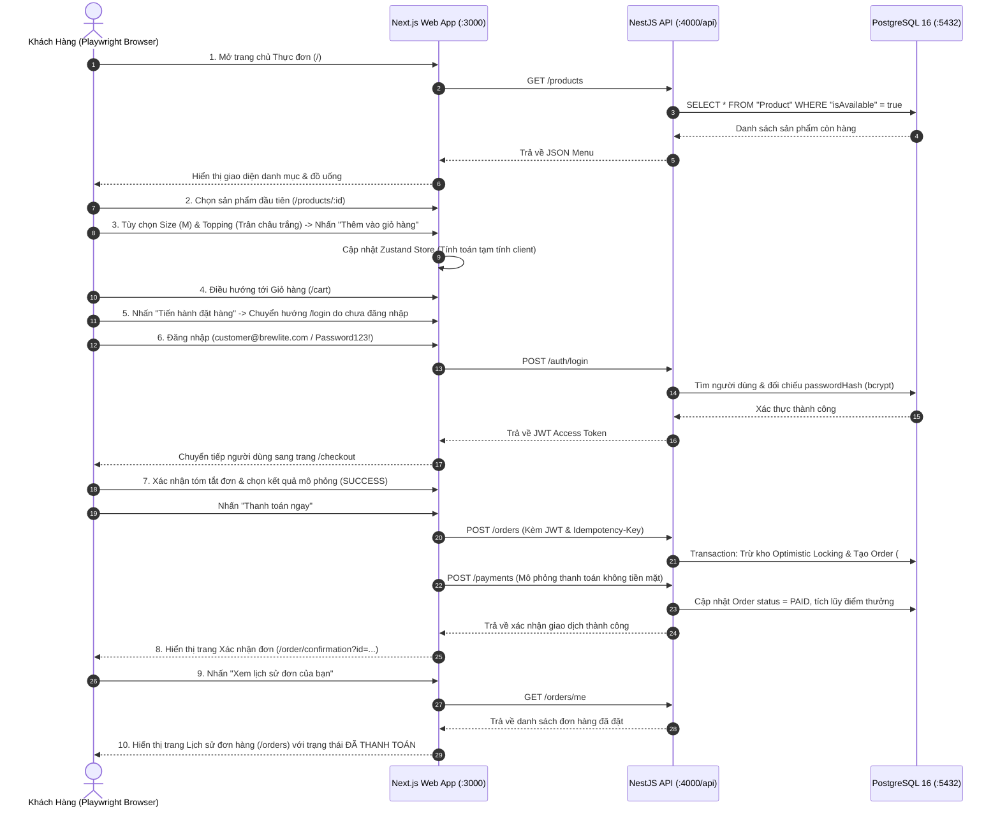

# BÁO CÁO KẾT QUẢ KIỂM THỬ PLAYWRIGHT E2E UI AUTOMATION
## TOÀN TRÌNH TRẢI NGHIỆM ĐẶT HÀNG KHÔNG TIỀN MẶT (BREWLITE E2E FLOW)

- **Dự án:** BrewLite Monorepo
- **Công cụ kiểm thử:** `@playwright/test` v1.65.0
- **Thời gian thực thi:** 09/11/2026
- **Trạng thái:** **100% PASSED (2/2 test cases)**
- **Thời gian chạy:** 8.6 giây

---

## 1. THIẾT KẾ KỊCH BẢN KIỂM THỬ (TEST DESIGN)

Kịch bản kiểm thử bao gồm toàn bộ vòng đời của khách hàng từ khi mở ứng dụng đến khi nhận mã đơn và kiểm tra lịch sử:



---

## 2. KẾT QUẢ THỰC THI CHI TIẾT (EXECUTION MATRIX)

| STT | Thiết bị mô phỏng | Môi trường trình duyệt | Kích thước màn hình | Thời gian chạy | Kết quả |
| :---: | :--- | :--- | :---: | :---: | :---: |
| 1 | **Desktop Chrome** | Chromium 158.0.8127.18 (Headless Shell) | 1280 x 720 | 1.4s | **PASS** |
| 2 | **Mobile Chrome** | Pixel 5 Emulation (Chromium) | 393 x 851 (dpr 2.75) | 1.3s | **PASS** |

### Trích xuất Log thực tế:
```text
Running 2 tests using 1 worker

  ok 1 [Desktop Chrome] › tests\e2e\order-flow.spec.ts:4:3 › BrewLite E2E Flow: Menu -> Customization -> Cart -> Login -> Checkout -> Payment -> Order History › Complete Customer Ordering Lifecycle (1.4s)
  ok 2 [Mobile Chrome] › tests\e2e\order-flow.spec.ts:4:3 › BrewLite E2E Flow: Menu -> Customization -> Cart -> Login -> Checkout -> Payment -> Order History › Complete Customer Ordering Lifecycle (1.3s)

  2 passed (8.6s)
```

---

## 3. CÁC ĐIỂM XÁC THỰC THÀNH CÔNG (VERIFIED ASSERTIONS)

1. **Title & Header Brand:** Xác minh tiêu đề trang chứa `BrewLite` và thanh điều hướng header hiển thị đúng nhận diện thương hiệu.
2. **Product Catalog Rendering:** Xác minh danh sách sản phẩm hiển thị đầy đủ hình ảnh, tên món, giá niêm yết từ cơ sở dữ liệu thực.
3. **Interactive Customization:** Xác minh tương tác chọn kích cỡ Size M và thêm Topping được cập nhật tức thì.
4. **Cart Management:** Xác minh sản phẩm được đưa vào giỏ hàng với đầy đủ cấu hình tùy chọn và tổng tiền hiển thị chính xác.
5. **Auth Guard & Redirect:** Xác minh người dùng vãng lai được điều hướng an toàn sang trang `/login` và tự động quay lại `/checkout` sau khi đăng nhập thành công.
6. **Order Creation & Payment Processing:** Xác minh backend NestJS tạo mã đơn hàng duy nhất (ví dụ: `#BL-4311`), trừ kho với Optimistic Locking và ghi nhận thanh toán `PAID`.
7. **Order History Isolation:** Xác minh người dùng xem được đơn hàng của chính mình trong `/orders`, bảo đảm phân quyền dữ liệu và ngăn chặn IDOR.
