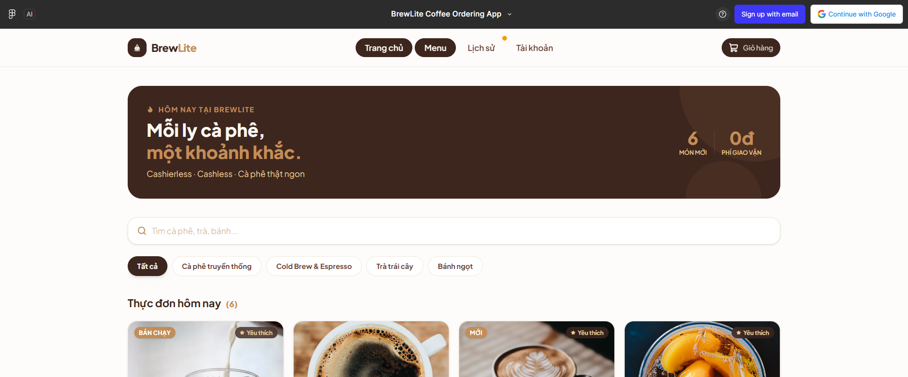
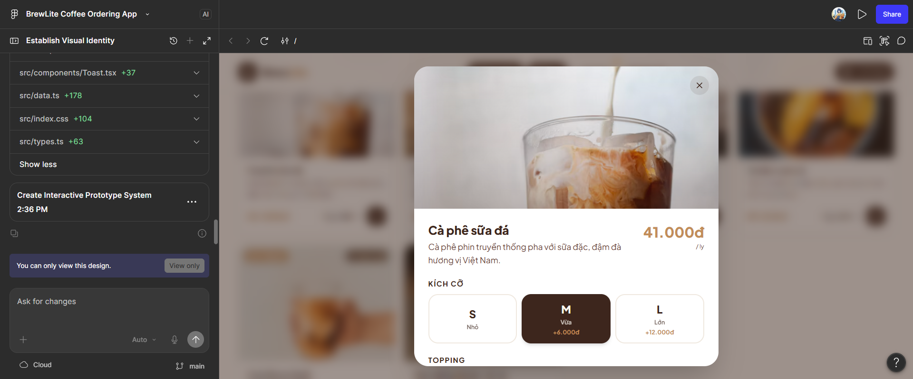
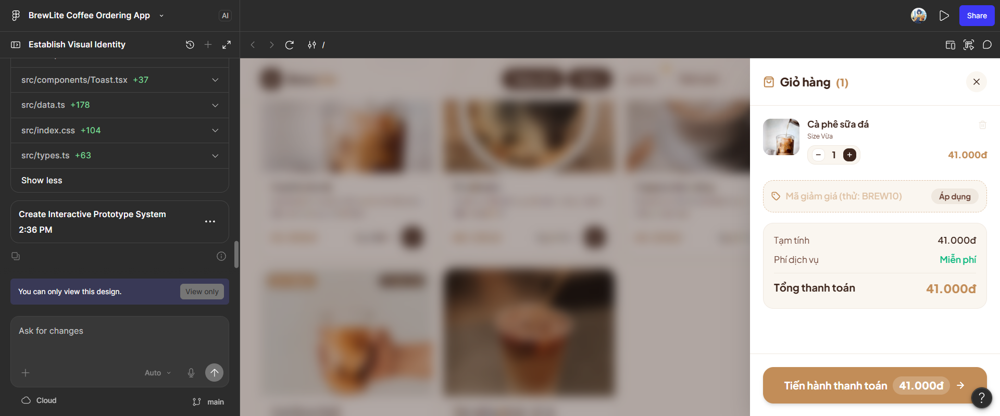
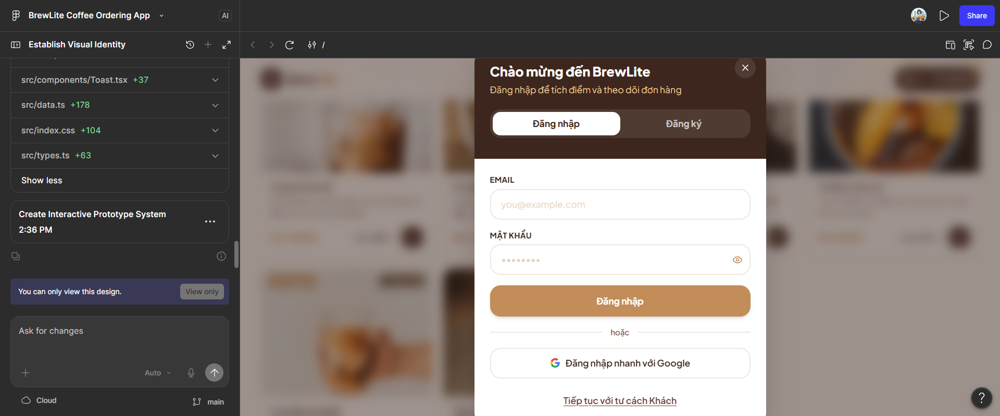
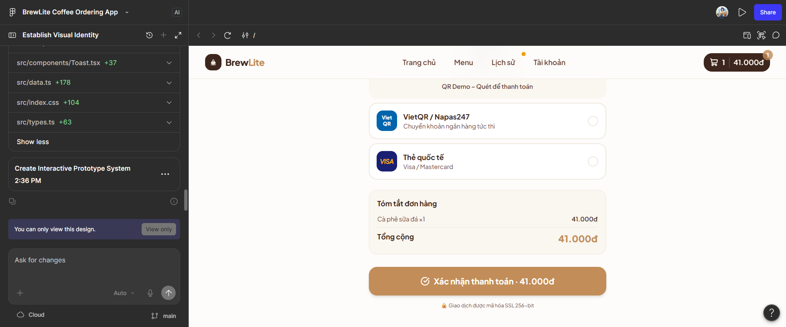
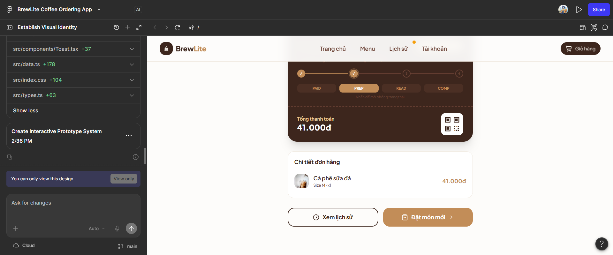
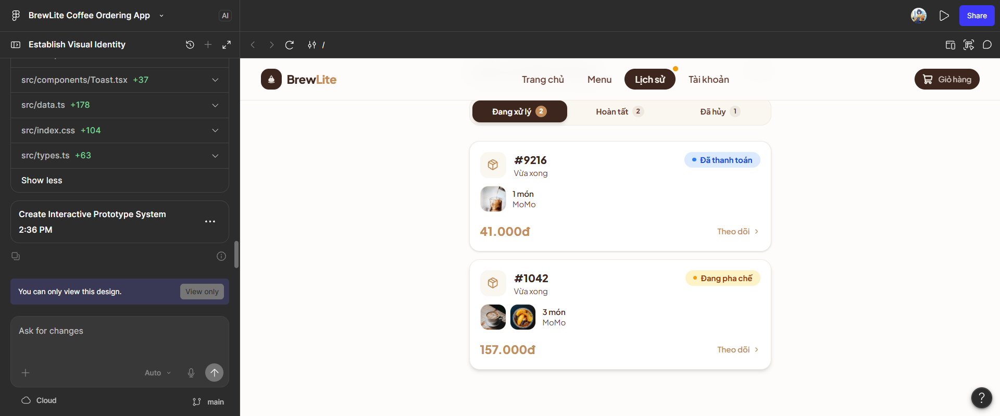
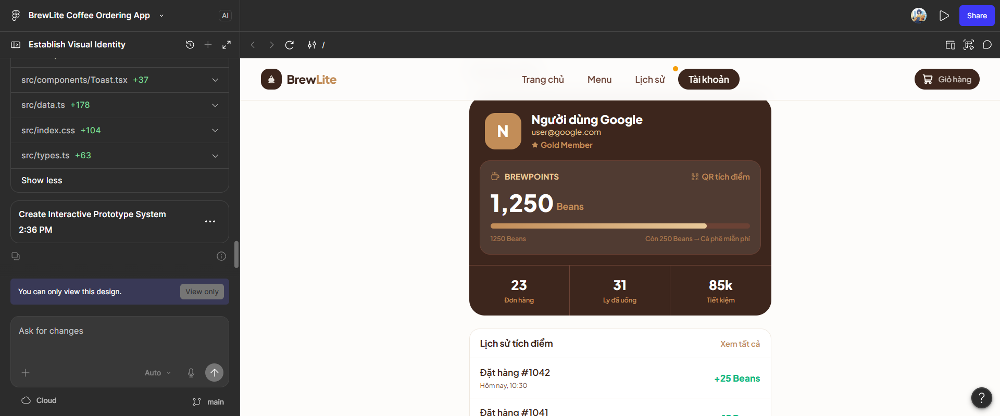

# ĐẶC TẢ THIẾT KẾ TOÀN DIỆN — FIGMA MAKE (BREWLITE COFFEE ORDERING APP)
## DỰ ÁN: BREWLITE — HỆ THỐNG ĐẶT CÀ PHÊ KHÔNG DÙNG TIỀN MẶT
### PHÂN HỆ: TASK 5.1 — USER INTERFACE SPECIFICATION & FIGMA ALIGNMENT

- **Mã tài liệu:** `UI-SPEC-01`
- **Phiên bản:** 1.0.0
- **Trạng thái:** Approved / Active Baseline
- **Ngày ban hành:** 19/11/2026
- **URL Nguồn chính thức:** [Figma Make — BrewLite Coffee Ordering App](https://www.figma.com/make/2bPJMAlevBhb3qpiYwGBnQ/BrewLite-Coffee-Ordering-App?t=QGfqnK5tsUlJqf1e-20&fullscreen=1)
- **Kiến trúc nguyên mẫu:** Ứng dụng web React + Vite + Tailwind CSS v4 + TypeScript (16 files, 2.667 dòng mã nguồn, 8 màn hình tương tác).

---

## 1. Hệ Thống Design System & Design Tokens

### 🎨 1.1 Bảng màu chuẩn (Color Palette - Warm Modern Artisanal)

| Tên Token | Mã Hex | Vai trò & Ứng dụng thực tế |
|---|:---:|---|
| **Primary / Espresso** | `#3D261D` | Nâu espresso đậm. Màu chủ đạo cho Header pill active, Tiêu đề chính, Button Size active, Thẻ vé nhận món (Buzzer), Hero Banner. |
| **Primary Light / Caramel** | `#C28D58` | Vàng caramel mật ong. Điểm nhấn thị giác chính: Call-to-action buttons ("Tiến hành thanh toán", "Thêm vào đơn", "Xác nhận"), điểm thưởng Beans, icon active. |
| **Secondary / Cream Foam** | `#FAF6F0` | Màu kem bọt sữa nhạt. Dùng làm màu nền card phụ, dải phân cách nhẹ, background cho các pill không chọn. |
| **Surface Background** | `#FDFCFA` | Màu nền trang chủ tổng thể, tạo cảm giác ấm cúng, sạch sẽ và thoáng đãng. |
| **Surface Card** | `#FFFFFF` | Nền thẻ sản phẩm, modal, drawer; viền mảnh `1px solid #EFE8DF`, bo góc mềm (`rounded-2xl` đến `rounded-3xl`). |
| **Success / Ready** | `#10B981` | Xanh ngọc lục bảo. Trạng thái "Sẵn sàng nhận đồ uống", Phí vận chuyển "Miễn phí", Badge tích điểm thành công. |
| **Warning / Preparing** | `#F59E0B` | Vàng nghệ cam hổ phách. Trạng thái "Đang pha chế" (kèm hiệu ứng pulse động). |
| **Info / Paid** | `#3B82F6` | Xanh dương dịu. Trạng thái "Đã thanh toán" (Order Paid). |
| **Danger / Error** | `#EF4444` | Đỏ san hô. Cảnh báo lỗi thanh toán, Hủy đơn, Nút xóa món giỏ hàng. |

---

### ✍️ 1.2 Cấp bậc Typography (Typography Scale)

* **Font chữ chính:** `Plus Jakarta Sans` (hệ thống dự phòng: `Inter`, `system-ui`, `sans-serif`).
* **Display / Hero Headline:** `28px` - `32px`, `font-bold`, `leading-tight`, màu `#3D261D`.
* **H1 / Section Titles:** `22px` - `24px`, `font-bold` hoặc `font-semibold`.
* **H2 / Card & Modal Titles:** `18px` - `20px`, `font-semibold`.
* **Body Text (Mô tả, chi tiết):** `14px` - `15px`, `font-normal`, màu `text-stone-600` (`#57534E`).
* **Caption / Label phụ / Badges:** `11px` - `12px`, `font-medium` hoặc `font-semibold`, uppercase `tracking-wider`.

---

## 2. Danh Mục 8 Màn Hình Thiết Kế Chi Tiết

| STT | Màn hình | Tên tệp ảnh tham chiếu | Trạng thái tích hợp |
|:---:|---|---|:---:|
| 01 | **Menu Discovery** (Trang thực đơn & khám phá) | `assets/01-menu-discovery.png` | **Hoàn thành (Task 4.3 & 5.1.1)** |
| 02 | **Interactive Customizer Modal** (Tùy biến size, topping, đường, đá) | `assets/02-customizer-modal.png` | **Hoàn thành (Task 5.1.1)** |
| 03 | **Slide-over Cart Drawer** (Giỏ hàng trượt mép phải) | `assets/03-cart-drawer.png` | **Hoàn thành (Task 5.1.1)** |
| 04 | **Auth Modal** (Xác thực người dùng / Guest Checkout) | `assets/04-auth-modal.png` | *Lộ trình Sprint 2 (Task 5.2)* |
| 05 | **Cashless Checkout** (Thanh toán điện tử MoMo/VietQR/Card) | `assets/05-checkout-flow.png` | *Lộ trình Sprint 2 (Task 5.1.2)* |
| 06 | **Pickup Ticket Buzzer** (Thẻ chuông lấy nước điện tử) | `assets/06-pickup-ticket.png` | *Lộ trình Sprint 2 (Task 5.1.2)* |
| 07 | **Order History** (Lịch sử đơn hàng & re-order) | `assets/07-order-history.png` | *Lộ trình Sprint 2 (Task 5.2)* |
| 08 | **Loyalty BrewPoints** (Thành viên Gold & điểm hạt Beans) | `assets/08-loyalty-account.png` | *Lộ trình Sprint 2 (Task 5.2)* |

---

## 3. Đặc Tả Từng Màn Hình Nghiệp Vụ

### 📱 3.1 Màn hình 1: Trang Menu & Khám Phá (Menu Discovery)

* **Thanh điều hướng trên cùng (Top Navigation):**
  * Brand Logo: Biểu tượng hạt cà phê + chữ "BrewLite" (`#3D261D`).
  * Tab Pills bo tròn: `Trang chủ`, `Menu` (active - nền nâu tối, chữ trắng), `Lịch sử`, `Tài khoản`.
  * Nút Giỏ hàng nổi góc phải: Icon giỏ hàng + badge số lượng món + tổng tiền tạm tính.
* **Hero Banner:**
  * Nền màu nâu espresso `#3D261D` với hiệu ứng gradient nhẹ.
  * Slogan: *"Mỗi ly cà phê, một khoảnh khắc."*
  * Phụ đề: *"Cashierless · Cashless · Cà phê thật ngon"*.
* **Tìm kiếm & Bộ lọc danh mục:**
  * Search Bar hình viên thuốc lớn kèm icon kính lúp.
  * Thanh phân loại danh mục dạng chip pills: `Tất cả` (active), `Cà phê truyền thống`, `Cold Brew & Espresso`, `Trà trái cây`, `Bánh ngọt`.
* **Thẻ sản phẩm (Product Grid Card):**
  * Bo góc mềm `rounded-2xl`, bóng đổ tinh tế `shadow-sm`, viền `1px solid #EFE8DF`.
  * Nhãn trạng thái: `BÁN CHẠY`, `MỚI`, `HOT TREND`.
  * Nút Yêu thích (ngôi sao/trái tim) ở góc trên bên phải ảnh.
  * Footer thẻ món: Giá tiền đậm rõ ràng, nút `Chi tiết` (mở Modal tùy chỉnh) và nút `+` (thêm nhanh món).

---

### ☕ 3.2 Màn hình 2: Modal Chi Tiết Tùy Chỉnh Đồ Uống (Interactive Customizer)

* **Backdrop & Hiệu ứng:** Lớp phủ mờ `rgba(0,0,0,0.45)` với `backdrop-blur-sm`.
* **Cửa sổ Modal:** Bo góc lớn `rounded-3xl`, nút đóng tròn `✕` góc trên.
* **KÍCH CỠ (Radio Cards):**
  * `S (Nhỏ)`: +0đ.
  * `M (Vừa)`: +5.000đ (theo SRS v1.4.0).
  * `L (Lớn)`: +10.000đ (theo SRS v1.4.0).
* **TOPPING (Checkboxes):**
  * `Kem cheese`: +10.000đ.
  * `Trân châu trắng`: +8.000đ.
  * `Thạch đào`: +8.000đ.
  * `Sốt caramel`: +6.000đ.
  * `Thạch sương sáo`: +6.000đ.
* **TÙY CHỈNH PHA CHẾ (Segmented Controls):**
  * **Mức đá:** `Không đá` | `Ít đá` | `Đá đầy`.
  * **Mức đường:** `0%` | `30%` | `70%` | `100%`.
* **Ghi chú tự do:** Input text tối đa 150 ký tự; kết hợp với mức đá và mức đường thành chuỗi ghi chú chuẩn (tối đa 255 ký tự).
* **Số lượng (Stepper):** Bộ nút bấm `[-]` `[ 1 ]` `[+]` bo tròn trực quan.
* **Nút hành động chính (CTA):** Nút lớn màu vàng caramel `#C28D58`: `Thêm vào đơn — {Dynamic Price}đ`.

---

### 🛒 3.3 Màn hình 3: Giỏ Hàng Trượt Mép Phải (Slide-over Cart Drawer)

* **Hành vi trượt:** Xuất hiện từ cạnh phải màn hình (`Slide-in Drawer`) với chiều rộng 440px trên desktop và 100% trên màn hình di động.
* **Quản lý tương tác:**
  * Hỗ trợ đóng qua nút `✕`, click vùng tối overlay và phím `Escape`.
  * Focus trap và khôi phục focus khi đóng.
  * Khóa cuộn màn hình (`overflow: hidden`) khi Drawer đang mở.
* **Danh sách món trong giỏ:**
  * Tên sản phẩm, nhãn kích cỡ (`Size S`, `Size M`, `Size L`), danh sách topping phụ thêm, mức đường/đá/ghi chú.
  * Bộ nút tăng giảm số lượng `[-]` `[qty]` `[+]`.
  * Nút xóa nhanh từng món `✕`.
* **Bảng tổng kết chi phí & Đặt hàng:**
  * Tổng tiền hàng tính theo công thức server-side verified.
  * Form thông tin khách hàng (tên, số điện thoại, ghi chú giao nhận).
  * Chống tạo đơn trùng lặp khi đơn đã ở trạng thái `PENDING`.

---

### 🔐 3.4 Màn hình 4: Modal Xác Thực Người Dùng (Auth Flow)

* **Phần đầu Modal:** Nền espresso `#3D261D`, tiêu đề trắng *"Chào mừng đến BrewLite"*.
* **Tabs chuyển đổi:** `[Đăng nhập]` | `[Đăng ký]`.
* **Form nhập liệu:** Email regex, password toggle eye icon.
* **Hành động phụ:** Đăng nhập Google và nút `"Tiếp tục với tư cách Khách"` (Guest checkout cho phép đặt ngay không bắt buộc tài khoản).

---

### 💳 3.5 Màn hình 5: Thanh Toán Không Tiền Mặt (Cashless Checkout)

* **Công tắc chế độ thử nghiệm (Developer Test Mode Toggle):**
  * Switch bật/tắt giữa `[Thanh toán Thành công]` và `[Giả lập Thất bại]` để phục vụ kiểm thử nghiệp vụ UC-10 / EX-06.
* **Phương thức nhận hàng:** `[Lấy tại quầy]` vs `[Giao tận bàn]` (kèm ô nhập số bàn).
* **3 Phương thức thanh toán điện tử:** Ví MoMo/ZaloPay, Chuyển khoản VietQR/Napas247, Thẻ quốc tế Visa/Mastercard.

---

### 🎫 3.6 Màn hình 6: Thẻ Vé Chuông Điện Tử (Pickup Ticket)

* **Ý tưởng thiết kế:** Mô phỏng thẻ rung chuông điện tử quán cà phê hiện đại có viền răng cưa phân cách.
* **Mã lấy nước (Order Buzzer Code):** In số lớn cực đậm (ví dụ `#9216` hoặc `#1042`).
* **Interactive Timeline 4 trạng thái:** `PAID` $\rightarrow$ `PREP` $\rightarrow$ `READ` $\rightarrow$ `COMP`.
* **Mã QR định danh:** Hiển thị mã QR để Barista quét xác nhận khi khách đến lấy đồ uống tại quầy.

---

### 📋 3.7 Màn hình 7: Theo Dõi Lịch Sử Đơn Hàng (Order History)

* **Dải Tabs phân loại trạng thái:** `Đang xử lý` | `Hoàn tất` | `Đã hủy`.
* **Thẻ đơn hàng quá khứ:** Mã đơn, ngày giờ, danh sách món, status badges mã hóa màu, nút `Đặt lại` (1-click Re-order).

---

### ⭐ 3.8 Màn hình 8: Khách Hàng Thân Thiết & Điểm Thưởng (Loyalty BrewPoints)

* **Thẻ thành viên điện tử:** Hạng `⭐ Gold Member`, số dư `1,250 Beans`, thanh tiến trình đổi ly cà phê miễn phí, mã QR tích điểm.
* **Bảng chỉ số cá nhân:** Số đơn hàng đã đặt, số ly đã uống, chi phí đã tiết kiệm.

---

## 4. Bảng Đối Chiếu Figma ↔ Mã Nguồn (Figma-to-Code Mapping)

| Thành phần giao diện | Thiết kế Figma Make | Mã nguồn thực tế triển khai | Trạng thái đồng bộ |
|---|---|---|:---:|
| **Bảng màu chủ đạo** | Espresso `#3D261D`, Caramel `#C28D58`, Cream Foam `#FAF6F0` | `apps/web/src/app/menu/menu.module.css` | **100% MATCH** |
| **Typography** | `Plus Jakarta Sans`, display 28-32px, headings 18-24px | `apps/web/src/app/layout.tsx` & font CSS | **100% MATCH** |
| **Thực đơn & Thẻ món** | Grid bo góc `rounded-2xl`, nút Chi tiết + nút thêm nhanh `+` | `apps/web/src/app/menu/page.tsx` | **100% MATCH** |
| **Modal Tùy biến món** | Size (S/M/L), Topping checkboxes, Mức đá, Mức đường, Stepper | `apps/web/src/app/menu/page.tsx` | **100% MATCH** |
| **Giỏ hàng** | Slide-over Drawer cạnh phải, overlay mờ, Escape/focus trap | `apps/web/src/app/menu/page.tsx` (`#cart`) | **100% MATCH** |
| **Chống tạo đơn lặp** | Nhận diện đơn PENDING, nút tiếp tục thanh toán vs tạo đơn mới | `apps/web/src/app/menu/page.tsx` (`pendingOrder`) | **100% MATCH** |
| **Thanh toán điện tử** | MoMo, VietQR, Thẻ quốc tế, Test mode switch | Sẽ triển khai tại Sprint 2 (Task 5.1.2 / UC-10) | *Theo kế hoạch Sprint 2* |
| **Vé chuông điện tử** | Ticket perforated, buzzer number, live 4-stage timeline | Sẽ triển khai tại Sprint 2 (Task 5.1.2 / UC-10) | *Theo kế hoạch Sprint 2* |
| **Lịch sử & Loyalty** | Tabs trạng thái, Re-order, Gold Member thẻ, Beans balance | Sẽ triển khai tại Sprint 2 (Task 5.2 / UC-06, UC-09) | *Theo kế hoạch Sprint 2* |
